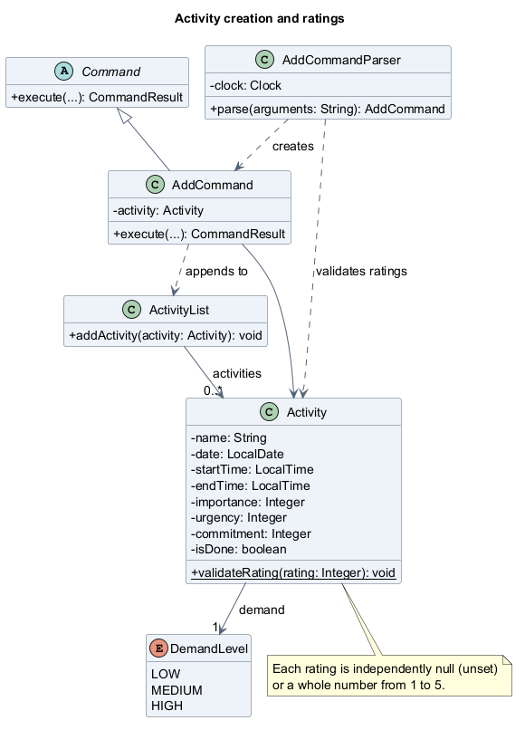
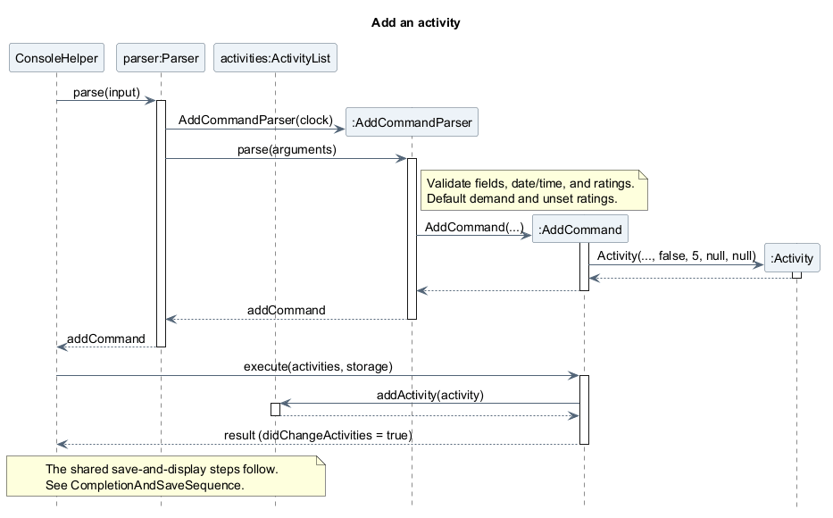
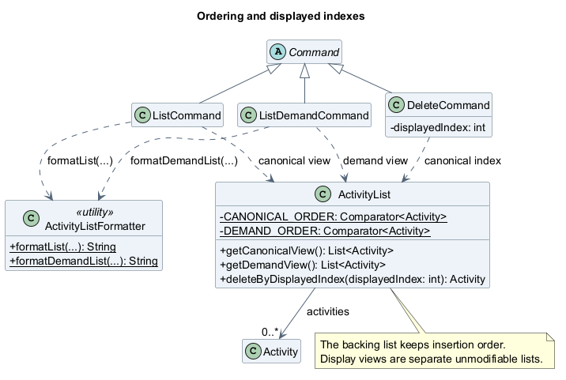
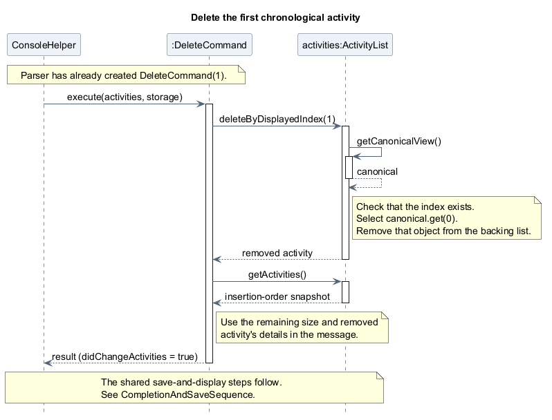
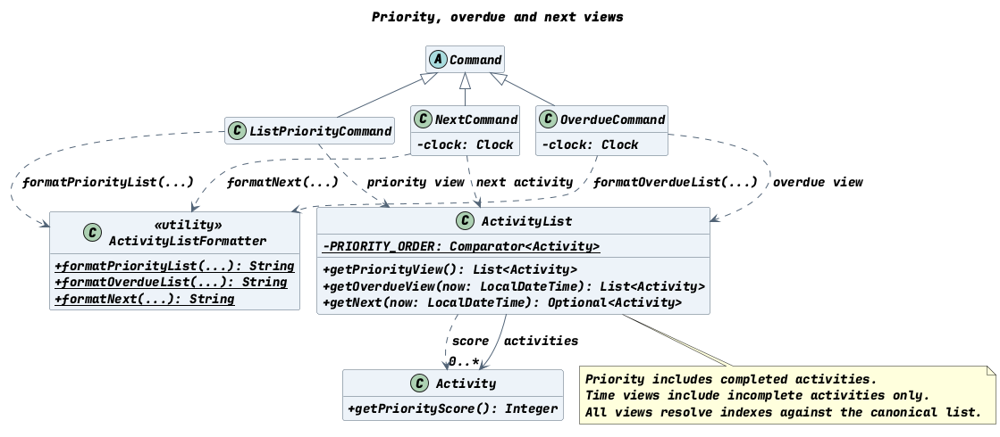
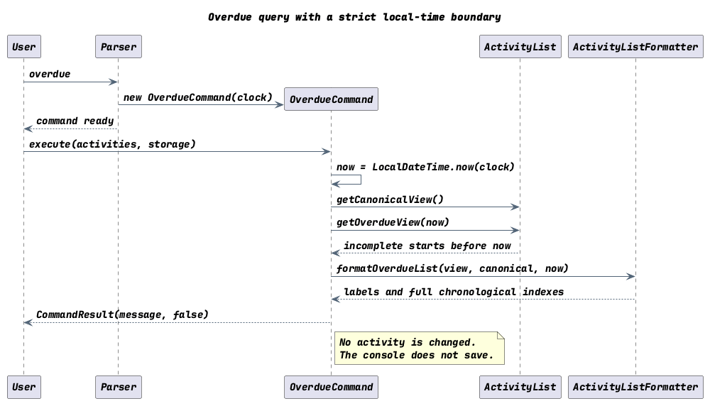
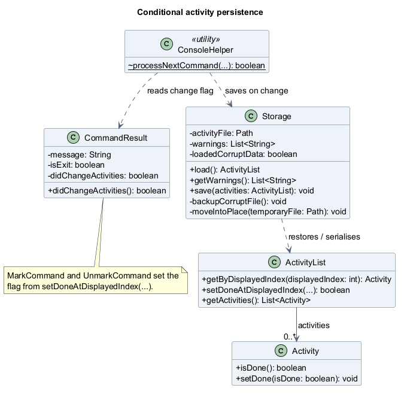
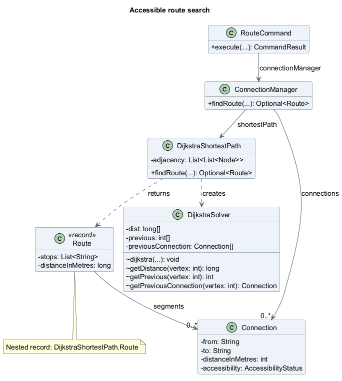

# UniEnable Developer Guide

## Table of contents

- [Introduction](#introduction)
- [Setting up and getting started](#setting-up-and-getting-started)
- [Design and implementation](#design-and-implementation)
  - [Architecture](#architecture)
  - [Activity creation and ratings](#activity-creation-and-ratings)
  - [Ordering and displayed indexes](#ordering-and-displayed-indexes)
  - [Priority, overdue, and next views](#priority-overdue-and-next-views)
  - [Completion and persistence](#completion-and-persistence)
  - [Facility Accessibility Data (`facilities.txt`)](#facility-accessibility-data-facilitiestxt)
  - [Facility lookup](#facility-lookup)
  - [Accessibility Route Connections (`connections.txt`)](#accessibility-route-connections-connectionstxt)
  - [Accessible route search](#accessible-route-search)
- [Testing and defensive programming](#testing-and-defensive-programming)
- [Product scope](#product-scope)
  - [Team contributions](#team-contributions)
  - [V2.0 planning reference](#v20-planning-reference)
- [User stories](#user-stories)
  - [Core schedule](#core-schedule)
  - [Views and reminders](#views-and-reminders)
  - [Energy and priority](#energy-and-priority)
  - [Accessible navigation](#accessible-navigation)
  - [Foundation](#foundation)
- [Use cases](#use-cases)
- [Non-functional requirements](#non-functional-requirements)
- [Glossary](#glossary)
- [Instructions for manual testing](#instructions-for-manual-testing)
- [Acknowledgements](#acknowledgements)

## Introduction

UniEnable is a Java command-line application for managing dated activities and
checking campus accessibility reference information. Activities have start and
end times, a demand level, a completion state, and optional importance, urgency,
and commitment ratings. Users can also look up facility features and find the
shortest recorded accessible route between supported hubs.

The target users are tertiary students with ASD, ADHD, or mobility constraints
who are adapting to unfamiliar university routines and managing their commitments
independently. UniEnable aims to make those routines easier to organise by combining
activity planning with campus facility and route information.

This guide explains the current design for developers maintaining the application.
See the [User Guide](UserGuide.md) for command formats and examples. Facility and
connection records are bundled sample data, so their results need to be checked
against current campus information before use.

## Setting up and getting started

Install **JDK 25** and clone the repository. Check `java -version` before building
or running the application. In IntelliJ IDEA, import the project as a Gradle
project and select JDK 25 for both the project SDK and Gradle JVM. The
[README](../README.md#setting-up-in-intellij) gives the IDE setup steps.

Use the included Gradle wrapper; a separate Gradle installation is unnecessary.
The first build needs internet access to download Gradle and dependencies. Run
the following commands from the project root:

| Purpose | Windows PowerShell | macOS / Linux |
| --- | --- | --- |
| Compile the application | `.\gradlew.bat classes` | `./gradlew classes` |
| Run automated tests | `.\gradlew.bat test` | `./gradlew test` |
| Run all configured checks | `.\gradlew.bat check` | `./gradlew check` |
| Run the console application | `.\gradlew.bat run --console=plain` | `./gradlew run --console=plain` |
| Build the executable JAR | `.\gradlew.bat shadowJar` | `./gradlew shadowJar` |

`check` runs tests, Checkstyle, and the configured JaCoCo coverage checks. The
application entry point is `seedu.unienable.UniEnable`. Gradle's `run` task enables
assertions; add `-ea` to the VM options when running the main method directly in
an IDE. After `shadowJar`, run the JAR with assertions enabled:

```text
java -ea -jar build/libs/unienable.jar
```

Enter `help` to see the commands and `bye` to exit. Activity data is stored at
`data/activities.txt`, relative to the directory where the application starts.
Use the same working directory between sessions to load the same activities.
Facility and connection data come from `src/main/resources/facilities.txt` and
`src/main/resources/connections.txt`; these resources are also included in the JAR.

## Design and implementation

### Architecture


The diagram groups related classes by responsibility and shows selected
dependencies. `UniEnable` loads activities and runs the console loop. Its
package-private helper, `ConsoleHelper`, loads facilities before connections,
then constructs the managers and parser. `Ui` handles console input and output;
`Parser` delegates input to a feature parser, which creates a concrete `Command`.

`ConsoleHelper` executes the command against the shared `ActivityList` and
`Storage`. The returned `CommandResult` supplies a message, an exit flag, and an
activity-change flag. Only a result reporting an activity change triggers a save,
before its message is displayed. Facility and route commands query their managers
without changing activities; recoverable errors use `UniEnableException` and are
displayed by the console so the user can continue.

| Area | Main classes and responsibilities |
| --- | --- |
| Startup and console loop | `UniEnable` restores activity data and reads commands until `bye` or end of input. `ConsoleHelper` loads reference data, constructs the parser, executes commands, and saves activity changes. |
| User interface | `Ui` reads lines and displays messages between borders. `ActivityListFormatter`, `FacilityOutputFormatter`, and `FacilityDetailsFormatter` build messages without reading input or printing. `RouteCommand` formats its own route result. |
| Parsing | `Parser` identifies the command word. `AddCommandParser`, `ListDeleteCommandParser`, `MarkCommandParser`, `FacilityCommandParser`, and `RouteParser` validate their arguments and create commands. An injected `Clock` makes add-time and time-view validation repeatable in tests. |
| Command execution | Concrete subclasses implement `Command.execute(ActivityList, Storage)`. Each returns a `CommandResult`; the activity-change flag lets the console decide when to save. |
| Activity model | `Activity` stores activity details, completion, ratings, and the combined priority score. `ActivityList` owns the collection, creates chronological, demand, priority, overdue, and next views, and resolves displayed indexes against the chronological view. |
| Accessibility logic | `FacilityManager` provides facility lookup and feature filtering. `ConnectionManager` provides connection queries and delegates route searches to `DijkstraShortestPath`, which uses a fresh `DijkstraSolver` per search. |
| Reference models | `Facility` contains `FacilityFeature` records. `Connection` stores two facility names, a distance, accessibility and shelter statuses, a traversal type, and optional barrier information and notes. These objects are immutable. |
| Storage | `Storage` loads six- or nine-field activity rows and saves nine-field rows, with recovery backups when needed. `FacilityStorage` and `ConnectionStorage` load bundled reference records and return records plus warnings in `LoadResult<T>`. |
| Exceptions | `UniEnableException` is the checked error contract for recoverable failures. `ParseException` reports invalid commands, while `InvalidIndexException` reports indexes outside the current activity view. |

If facility loading fails, the parser still supports activity commands, help,
and exit. If only connection loading fails, facility commands remain available
but route commands report that connection data is unavailable. Activity-load
warnings and failures are reported at startup; a fatal activity read failure
starts an empty in-memory list while `Storage` retains recovery protection.

Diagram source: [ArchitectureDiagram.puml](diagrams/ArchitectureDiagram.puml).
Edit the source and regenerate its image together when the design changes. With
the [PlantUML JAR](https://plantuml.com/download) available, run this command from
the project root, replacing `PATH_TO_PLANTUML_JAR` with its location:

```text
java -jar "PATH_TO_PLANTUML_JAR" -charset UTF-8 -tpng -o ../images docs/diagrams/ArchitectureDiagram.puml
```

PlantUML resolves `../images` relative to the diagram source directory, producing
`docs/images/ArchitectureDiagram.png`. The source selects the bundled Smetana
layout engine, so a separate Graphviz installation is unnecessary for this diagram.

### Activity creation and ratings

#### Overview

The `add` feature records an incomplete activity with a date, start and end times,
demand, and independently optional importance, urgency, and commitment ratings.
Ratings capture user input; the priority view calculates a combined score only when
all three are present.

#### High-level design

`AddCommandParser` checks the input and creates an `AddCommand`, whose constructor
creates the `Activity`. Executing the command appends that activity to
`ActivityList`. The class diagram shows these relationships; only the members
needed to explain creation and validation are included.



Source: [ActivityCreationClassDiagram.puml](diagrams/ActivityCreationClassDiagram.puml).

#### Implementation and sequence diagram

For example, `add n/Tutorial d/2026-12-01 s/10:00 e/11:00 imp/5` follows these steps:

1. `Parser.parse()` recognises `add` and passes the arguments to a new
   `AddCommandParser` with the session's `Clock`.
2. `readFields()` collects known prefixes in any order. `n/`, `d/`, `s/`, and `e/`
   are required; supplied fields must have non-empty values and appear once.
3. The parser checks date/time formats, that the end follows the start on the
   same day, and that the activity's end date/time is strictly after now.
4. Omitted demand becomes `MEDIUM`. `parseRating()` uses `Activity.validateRating()`
   to check each supplied integer is between 1 and 5; omitted ratings become `null`.
5. The parser constructs `AddCommand`, which creates an `Activity` with
   `isDone = false`. `execute()` calls `ActivityList.addActivity()` and returns a
   `CommandResult` with the activity-change flag set to `true`.

The sequence shows that object creation happens during parsing, while insertion
happens during execution. The common save-and-display flow is explained under
[Completion and persistence](#completion-and-persistence).



Source: [AddActivitySequence.puml](diagrams/AddActivitySequence.puml).

#### Design considerations

The parser handles input formats and the current-time check, while the model
provides the shared rating-range rule. Keeping the current-time restriction out
of the `Activity` constructor lets storage restore historical activities.
Using nullable `Integer` ratings distinguishes an unset value from the valid
range; a primitive `int` would need an extra marker. The three ratings remain
independent, so users can supply only the values they need.

#### Error handling

Invalid fields produce a `ParseException` with a warning and usage message before
anything is added. Names cannot contain `|` or line breaks, since these would
break the saved record format. Ordinary slash text such as `and/or` is preserved,
but a known prefix at the start of a whitespace-separated name token starts
another field. Duplicate and overlapping activities are currently allowed.

### Ordering and displayed indexes

#### Overview

`list` displays activities by date and start time. `list demand` groups them from
`HIGH` to `LOW`, then by date and start time. Delete, mark, and unmark always use
the one-based indexes from chronological `list`, even after a demand-ordered list
has been displayed.

#### High-level design

`ActivityList` keeps its backing list in insertion order and creates separate,
unmodifiable sorted lists for display. The activity objects in those lists are
shared with the backing list. Commands choose the view, while
`ActivityListFormatter` renders its supplied order without sorting or printing.



Source: [ActivityOrderingClassDiagram.puml](diagrams/ActivityOrderingClassDiagram.puml).
The shared `Activity` fields are shown in the creation diagram above.

#### Implementation and sequence diagram

1. `Parser` delegates `list` and `delete` syntax to `ListDeleteCommandParser`.
   It creates `ListCommand`, `ListDemandCommand`, or `DeleteCommand` as appropriate.
2. Listing calls `getCanonicalView()` or `getDemandView()`. Sorting is stable:
   activities tied on all ordering fields retain their insertion order.
3. `ActivityListFormatter` numbers the selected view from 1. The demand view
   includes a notice telling users to run `list` before choosing a deletion index.
4. For `delete 1`, `deleteByDisplayedIndex(1)` creates the canonical view, checks
   the index, and selects element 0. It removes that activity object from the
   backing list rather than removing backing-list element 0.
5. `DeleteCommand` returns the removed activity's details and the new count with
   the activity-change flag set. The console then follows the common save flow.

The sequence starts after `DeleteCommand` has been parsed. It highlights why
deletion follows chronological display order even when insertion order differs.



Source: [DeleteActivitySequence.puml](diagrams/DeleteActivitySequence.puml).

#### Design considerations

Sorting copies keeps listing read-only and preserves insertion order for storage.
Sorting the backing list in place would make a display command change that order.
Using one canonical index rule also avoids keeping a separate "last displayed
list" state, though users must check `list` when switching from the demand view.

#### Error handling

The parser rejects missing or extra arguments, signed or non-numeric indexes,
and integers too large for `int`. Zero passes syntax checking but is rejected
by `ActivityList`, which also handles empty lists and out-of-range indexes through
`InvalidIndexException`. Assertions check view ordering and deletion invariants;
`FINE` log messages record list and delete operations. These support debugging,
while checked exceptions handle invalid user input.

### Priority, overdue, and next views

#### Overview

`list priority` ranks every activity, including completed ones, by the revised
V2.0 guide's combined score. `overdue` and `next` answer time-sensitive questions
for incomplete activities. All three views are read-only and display the full
chronological index used by `mark`, `unmark`, and `delete`.

`Activity.getPriorityScore()` returns:

```text
URG * URG * (IMP + COM)
```

The score is available only when importance, urgency, and commitment are all set.
The possible range is 2 to 250. Completion and demand do not affect the score.

#### High-level design

`Activity` owns the score formula so every view uses one definition. `ActivityList`
owns the ordering and filtering rules. `ListPriorityCommand`, `OverdueCommand`, and
`NextCommand` select views, while `ActivityListFormatter` renders them without
sorting or printing. The class diagram shows these relationships.



Source: [PriorityAndTimeViewsClassDiagram.puml](diagrams/PriorityAndTimeViewsClassDiagram.puml).

#### Implementation and sequence diagram

1. `ListDeleteCommandParser` recognises `list priority`; `Parser` recognises
   `overdue` and `next`. The time commands receive the session's injected `Clock`.
2. `OverdueCommand` and `NextCommand` call `LocalDateTime.now(clock)` once per
   execution, so filtering, labels, and logging use the same instant.
3. `getPriorityView()` sorts by available score descending, then canonical order.
   Missing scores use a nulls-last comparator and therefore follow all scored rows.
   Completed activities are not filtered out.
4. `getOverdueView(now)` keeps incomplete activities whose start is strictly
   before `now`. `getNext(now)` returns the first incomplete activity whose start
   is strictly after `now` in canonical order. Equal starts retain add order.
5. `ActivityListFormatter` maps each selected activity to its index in
   `getCanonicalView()`. Priority rows also show the score and the three ratings;
   overdue rows add `OVERDUE TODAY`, `OVERDUE WEEK`, or `OVERDUE EARLIER`.
6. Each command returns a `CommandResult` with the activity-change flag left
   false, so the console does not save.

The sequence shows the overdue query; `next` uses the same clock and index flow,
and `list priority` omits the time boundary.



Source: [PriorityAndTimeViewsSequence.puml](diagrams/PriorityAndTimeViewsSequence.puml).

#### Time-boundary rules

All comparisons use the computer's local time zone. They are strict, so an
activity starting exactly at the current instant appears in neither `overdue`
nor `next`.

| Label or view | Rule |
| --- | --- |
| `OVERDUE TODAY` | Start date equals today and start is before now. |
| `OVERDUE WEEK` | Start date is before today but not before the current week's Monday. |
| `OVERDUE EARLIER` | Start date is before the current week's Monday. |
| `next` | Earliest incomplete start strictly after now. |

The Monday boundary is calculated with `TemporalAdjusters.previousOrSame(MONDAY)`.
This handles Sunday-to-Monday and year rollover without special cases. An activity
that started in the past but has not ended remains overdue because the boundary is
its start, not its end.

#### Design considerations

The PDF includes completed activities in priority, while the earlier team note
proposed pending activities only. This implementation follows the approved PDF
behaviour. Excluding completed rows would also be defensible for a to-do view, but
it would hide finished high-effort work and make the displayed score set smaller
than the guide specifies.

A nullable score keeps the formula in one place and avoids a sentinel number.
Using `nullsLast` after reversing the score comparator gives descending available
scores and a deterministic unavailable group. The shared canonical comparator
handles score ties and equal starts, preserving insertion order because Java's
stream sort is stable.

Filtering into immutable lists keeps these views read-only and avoids changing the
backing insertion order used by storage. Resolving indexes from the full canonical
view, rather than numbering the filtered view, prevents users from passing a
sub-view index to a change command. Passing `now` as a parameter also keeps the
model testable without a global clock.

#### Error handling

The parser rejects arguments after `overdue` and `next`, and after `list priority`.
The model rejects a null `now` and asserts priority and overdue ordering. Commands
write `FINE` logs with view sizes and the captured instant. Time views have no
exceptional user-input path beyond command syntax; empty results produce explicit
messages instead of warnings.

### Completion and persistence

#### Overview

`mark` and `unmark` update completion using the same chronological indexes as
deletion. `ConsoleHelper` saves successful activity changes through `Storage`.
The file is loaded at startup, so completion state and optional ratings survive
between sessions.

#### High-level design

`MarkCommand` and `UnmarkCommand` call `ActivityList.setDoneAtDisplayedIndex()`.
Its boolean result becomes the activity-change flag in `CommandResult`.
The diagram focuses on how that result controls persistence; activity fields
and index resolution are covered by the earlier diagrams.



Source: [ActivityPersistenceClassDiagram.puml](diagrams/ActivityPersistenceClassDiagram.puml).

#### Implementation and sequence diagram

1. At startup, `UniEnable` calls `Storage.load()` and displays its warnings.
   A missing file gives an empty list; valid rows are restored in file order.
   Loading does not rewrite the file or apply the add-time "after now" rule.
2. `MarkCommandParser` creates a mark or unmark command. During execution, the
   command gets the selected activity for its message, then asks
   `setDoneAtDisplayedIndex()` to resolve the index again and change its state.
3. The model returns `false` if the state already matches. The command returns
   that change flag, and `ConsoleHelper` calls `save()` only when it is `true`.
   Read-only commands, repeated mark/unmark, and `bye` do not save.
4. If an earlier load detected malformed rows or a read failure and the original
   file still exists, `save()` first calls `backupCorruptFile()`. It copies the
   original bytes to `activities.txt.corrupt.bak` and verifies them with
   `Files.mismatch()` before writing the replacement.
5. Storage serialises `getActivities()` in insertion order as UTF-8, writes
   `activities.txt.tmp`, and calls `moveIntoPlace()`. It attempts an atomic
   replacement, falling back to a normal replacement on `FileSystemException`.
6. After a successful save, storage clears its recovery flag and the console
   displays the command result. The sequence below shows `mark 1`; add, delete,
   and unmark use the same conditional save steps.

Saved rows have this format:

```text
NAME|DATE|START|END|DEMAND|DONE|IMP|URG|COM
```

`DONE` is `true` or `false`; each unset rating is stored as `-`. Six-field legacy
rows still load with all ratings unset. The next successful activity-changing
save writes all rows in the nine-field format, which the original V1.0 loader
cannot read.


Source: [CompletionAndSaveSequence.puml](diagrams/CompletionAndSaveSequence.puml).
The sequence assumes a valid index and successful I/O; optional blocks show the
conditions for saving and making a recovery backup. Minor getter and file calls
are omitted.

#### Design considerations

The change flag keeps save decisions in one place and avoids rewriting data
after read-only or unchanged commands. A separate "dirty" flag could support
automatic retries after a failed save, but the current implementation retries
only after another actual activity change. Writing a temporary file first avoids
truncating the activity file while serialising; the fallback replacement itself
is not atomic.

#### Error handling

Malformed rows are skipped with physical line numbers in the warnings. Invalid
UTF-8 or other read failures are reported as `UniEnableException`; the console
starts with an empty list, and storage retains the recovery flag. A failed
backup stops saving before the activity file is replaced. A later recovery
backup can overwrite the previous `.corrupt.bak`, so it is not a backup history.

Save failures are displayed and leave the console running. The command's change
has already happened in memory and is not rolled back; its normal confirmation
is skipped. Repeating the same `add` may create a duplicate, and `bye` does not
retry saving. The [User Guide's recovery steps](UserGuide.md#error-handling)
explain how to preserve and save the in-memory state before exiting.

### Facility Accessibility Data (`facilities.txt`)

The UTF-8 [facility dataset](../src/main/resources/facilities.txt) stores nine
facilities: AS1 to AS8 and Central Library (CLB), identified by F01 to F09.
It is bundled with the application and loaded from the classpath, including
when running the packaged JAR.

The facility and connection records were adapted with reference to the
[NUS FASS accessibility map](https://osa.nus.edu.sg/wp-content/uploads/2025/03/250224-FASS-Access-Route-Faculty-Map.pdf),
updated 24 February 2025. UniEnable maintains these text datasets separately;
the source credits are listed in [Acknowledgements](#acknowledgements).

Each pipe-separated facility row has one of two formats:

```text
FACILITY|ID|NAME|DESCRIPTION
FEATURE|FACILITY_ID|TYPE|STATUS|NOTES
```

For `FACILITY`, `NAME` is the short hub code used by `Facility.getName()`, such
as AS1; `DESCRIPTION` supplies the longer building description. The row requires
four fields, although the description may be empty. A `FEATURE` row references
the stable facility ID and records a feature type, a `YES`, `NO`, or `UNKNOWN`
status, and optional notes. The notes field may be omitted or left empty.

#### Facilities covered

All nine facilities record `STEP_FREE_ENTRANCE: YES`. The table summarises their
other recorded features and notes. An omitted feature means no record is present;
it does not imply `NO` or `UNKNOWN`. Full entrance notes remain in the dataset.

| ID | Hub | Dataset description | Other recorded features and notes |
| --- | --- | --- | --- |
| F01 | AS1 | Faculty of Arts and Social Sciences, Block 1 | `LIFT: NO`; floors 4-5 are not accessible. |
| F02 | AS2 | Faculty of Arts and Social Sciences, Block 2 | `LIFT: NO`; building has no lift. |
| F03 | AS3 | Faculty of Arts and Social Sciences, Block 3 | `LIFT: YES`; serves the main floors. |
| F04 | AS4 | Faculty of Arts and Social Sciences, Block 4 | `LIFT: YES` (floors 1-6); `ACCESSIBLE_WASHROOM: YES` (floors 3-6). |
| F05 | AS5 | Faculty of Arts and Social Sciences, Block 5 | `LIFT: YES` (floor 6 is not accessible); `ACCESSIBLE_WASHROOM: YES` (near the lift lobby). |
| F06 | AS6 | Computing Drive link building (School of Computing) | `LIFT: YES` (floors 1, B1, and 6 are not accessible); `ACCESSIBLE_WASHROOM: YES` (upper floor, shared with SoC). |
| F07 | AS7 | The Shaw Foundation Building | `LIFT: YES` (basement B1 is not accessible); `ACCESSIBLE_WASHROOM: YES` (ground floor). |
| F08 | AS8 | Faculty of Arts and Social Sciences, Block 8 | `LIFT: YES` (floors 1-4); `ACCESSIBLE_WASHROOM: YES` (near the lift lobby); `REST_POINT: YES` (PitStop@FASS). |
| F09 | CLB | Central Library | `LIFT: YES` (shared upper floors linked to School of Computing); `ACCESSIBLE_WASHROOM: YES` (4th-floor toilet requires staff card access). |

`FacilityStorage` associates features with facilities by exact ID after reading
all rows, so a feature can precede its facility declaration. It constructs
immutable `Facility` objects containing their `FacilityFeature` lists and skips
unknown facility references with warnings. [Facility lookup](#facility-lookup)
explains how commands query these records.

### Facility lookup

#### Overview

The `facility` commands list reference facilities, show one hub's recorded
features, or search by feature and accessibility status. The bundled dataset
contains AS1 to AS8 and CLB, with stable IDs F01 to F09. Commands read this sample
data without changing activities or editing facility records.

#### High-level design

`FacilityStorage` parses the bundled resource into immutable `Facility` and
`FacilityFeature` objects. `FacilityManager` takes a snapshot of the loaded list
and handles queries without file I/O. The class diagram separates loading from
querying; `LoadResult<T>` carries accepted records and warnings, with
`T = Facility` for this loader.


Source: [FacilityClassDiagram.puml](diagrams/FacilityClassDiagram.puml).

#### Implementation and sequence diagram

1. During startup, `ConsoleHelper` calls `FacilityStorage.load()` to read the
   bundled resource using the [facility data format and association rules](#facility-accessibility-data-facilitiestxt).
2. The console displays load warnings and constructs `FacilityManager` from the
   accepted records. The manager is passed into `Parser` and its
   `FacilityCommandParser`.
3. The feature parser creates `FacilityListCommand`, `FacilityViewCommand`, or
   `FacilityFindCommand`. For a feature search, `type/` must precede the optional
   `status/`; the omitted status defaults to `YES`.
4. Listing uses `getFacilities()`. A single-hub query uses `findFacility()`,
   checking stable IDs before names, ignoring case and surrounding whitespace.
   A search calls `findByFeature(type, status)` and matches the recorded status
   exactly. An absent feature does not match `UNKNOWN`.
5. Results preserve dataset order. A facility appears at most once in search
   results, even if several records match. `FacilityOutputFormatter` builds the
   response and adds the shared accessibility disclaimer; detail output also
   uses `FacilityDetailsFormatter`.
6. The command returns a `CommandResult` without an activity change. The console
   displays the message without calling activity storage's `save()`.

The sequence shows the execution of `facility find type/LIFT status/NO` after
parsing. In the bundled dataset it returns AS1 and AS2. Listing and single-hub
lookup use the same read-only result path with different manager methods.


Source: [FacilityLookupSequence.puml](diagrams/FacilityLookupSequence.puml).

#### Design considerations

Separating the loader from the manager lets query tests supply small lists
without creating files. Defensive copies keep callers from changing the loaded
collection or a facility's feature list. Explicit `YES`, `NO`, and `UNKNOWN`
values preserve the difference between confirmed absence and unconfirmed data;
treating missing features as `UNKNOWN` would lose that distinction.

#### Error handling

Malformed rows, duplicate IDs or names, unknown facility references, and invalid
enums produce line-numbered warnings while valid records remain available.
For conflicting statuses of the same feature at a facility, the first valid
status is kept and later conflicting rows are skipped. Resource tags, enum
values, and feature-to-facility IDs are matched exactly when loading; command
input is case-insensitive.

A missing or unreadable resource raises `UniEnableException` and uses the
fallback described in [Architecture](#architecture). Invalid command filters
raise `ParseException`. An unknown hub produces a warning with supported names;
a valid search with no matches returns a normal no-results message.

### Accessibility Route Connections (`connections.txt`)

The UTF-8 [connection dataset](../src/main/resources/connections.txt) stores ten
bidirectional links between the nine facilities. Together they form a weighted
graph: hub names are vertices, recorded links are edges, and distances are edge
weights. The [Connection model](../src/main/java/seedu/unienable/model/Connection.java)
names each weight `distanceInMetres`, so distances here are the project's
recorded values in metres.

Each pipe-separated row follows this format:

```text
CONNECTION|ID|FROM|TO|DISTANCE|ACCESSIBILITY|TYPE|SHELTER|KNOWN_BARRIER|NOTES
```

| Column | Field | Meaning and validation |
| --- | --- | --- |
| 1 | `CONNECTION` | Required record tag, matched exactly. |
| 2 | `ID` | Unique connection identifier, parsed as a Java `int`. |
| 3 | `FROM` | One endpoint's facility name, such as AS6; must exactly match a loaded facility name. |
| 4 | `TO` | The other endpoint's facility name; must be known and different from `FROM`. Endpoint order does not restrict travel direction. |
| 5 | `DISTANCE` | Positive integer distance in metres, used as the routing weight. |
| 6 | `ACCESSIBILITY` | `YES`, `NO`, or `UNKNOWN`. Only `YES` connections are eligible for route search. |
| 7 | `TYPE` | Traversal category: `PATH`, `RAMP`, `SHELTERED_RAMP`, `LIFT`, or `OTHER`. |
| 8 | `SHELTER` | Independent `YES`, `NO`, or `UNKNOWN` shelter status; `UNKNOWN` means unconfirmed. |
| 9 | `KNOWN_BARRIER` | Optional description of a recorded barrier. |
| 10 | `NOTES` | Optional additional route information. |

`ConnectionStorage` accepts eight to ten fields. Omitted or empty optional
fields become `null`; to supply notes without a barrier, keep an empty ninth
field. Tags and enum values are case-sensitive when loading.

For example, this actual record describes a bidirectional, 90-metre accessible
path between AS6 and AS1, recorded as sheltered, with no barrier text:

```text
CONNECTION|3|AS6|AS1|90|YES|PATH|YES||Main covered walkway
```

Connection 7, between **AS1 and AS2**, is a 130-metre `RAMP` with accessibility
`YES` and shelter `NO`. Its note identifies the route via the unsheltered
pick-up/drop-off points (PUDOs) at CP14/Arts Link. Shelter and accessibility are
separate properties, so this connection remains eligible for routing.

At startup, `ConnectionStorage` validates endpoints against facilities already
loaded from `facilities.txt`. [Accessible route search](#accessible-route-search)
explains how the graph is built and how routes are found and displayed.

#### Connectivity graph

This project-generated graph shows the ten recorded connections. Node positions
are schematic, not geographical.


Source: [fass-accessibility-network.puml](diagrams/fass-accessibility-network.puml).
With Java 25 and the PlantUML JAR available, regenerate the SVG from the project
root using the command below. The output is written to `docs/images`.

```text
java -jar "PATH_TO_PLANTUML_JAR" -charset UTF-8 -tsvg -o ../images docs/diagrams/fass-accessibility-network.puml
```

### Accessible route search

#### Overview

`route from/START to/END` finds a shortest route by recorded distance between
two hub names. Connections are bidirectional, and only those marked `YES` for
accessibility can be traversed. The result includes ordered stops, segment
details, total metres, and the sample-data disclaimer.

#### High-level design

`ConnectionManager` keeps a connection snapshot and constructs one reusable
`DijkstraShortestPath` graph. Each query creates a fresh package-private
`DijkstraSolver` for distances and predecessors. The returned `Route` is the
nested record `DijkstraShortestPath.Route`; it copies its stop and segment lists.
The diagram shows these query and result relationships, omitting graph-node
internals and unrelated connection-filtering methods.



Source: [RoutingClassDiagram.puml](diagrams/RoutingClassDiagram.puml).

#### Implementation and sequence diagram

1. After loading facilities, `ConsoleHelper` calls `ConnectionStorage.load()`.
   It reads `/connections.txt`, validating endpoints against the already loaded
   facility names. Valid records are passed to `ConnectionManager`.
2. `DijkstraShortestPath` assigns a vertex index to each distinct, normalised
   endpoint name. Endpoints from `NO` or `UNKNOWN` connections are still known
   vertices. It then adds two adjacency entries for each `YES` connection, using
   its positive distance and retaining the original `Connection` object.
3. `Parser` delegates route input to `RouteParser`, which requires `from/` before
   `to/` and creates a `RouteCommand`. Executing the command calls
   `ConnectionManager.findRoute()`, which delegates to the reusable graph.
4. The graph resolves both names, ignoring case and surrounding spaces, and
   creates a new solver. `dijkstra()` uses a priority queue to select the nearest
   unsettled vertex. `eNeighbours()` updates a neighbour only when a shorter
   distance is found, recording its predecessor vertex and connection. Distances
   use `long` so a route total can exceed the `int` range of individual segments.
5. If the destination distance remains `Long.MAX_VALUE`, the graph returns
   `Optional.empty()`. Otherwise, it follows predecessors back to the source and
   reverses the collected stops and connections to construct a `Route`.
6. `RouteCommand` formats the result using the ordered stops rather than a
   connection's stored endpoint direction. It displays traversal types, shelter,
   barriers, and notes, adds the disclaimer, and returns without changing
   activities or triggering a save.

The sequence shows a successful query after parsing. A known hub queried against
itself gives a zero-distance route with one stop and no segments. The graph uses
names found in the connection dataset; stable facility IDs such as F01 are not
route endpoints.


Source: [RouteSearchSequence.puml](diagrams/RouteSearchSequence.puml).
Minor getter calls and console output are omitted to keep the search flow readable.

#### Design considerations

Reusing the graph avoids rebuilding the adjacency list for every request, while
a fresh solver prevents search state leaking between requests. A predefined
route table would require maintaining a separate path for each hub pair; the
current search derives paths from the connection records instead.

The cost is distance alone. Shelter, traversal type, and recorded barriers do
not add routing restrictions or preferences, so a selected route may include
an unsheltered section or a narrow passage. The result describes recorded links
and needs checking against current campus conditions and the user's needs.

#### Error handling

The connection loader skips invalid rows with line-numbered warnings, including
unknown endpoints, self-connections, duplicate IDs, non-positive distances, and
invalid enum values. Missing or unreadable data makes route commands unavailable
without disabling successfully loaded facility queries.

`RouteParser` reports malformed prefixes or missing endpoints through
`ParseException`. Unknown or blank graph endpoints raise `IllegalArgumentException`,
which `RouteCommand` converts to a checked `UniEnableException` with usage text.
Known but disconnected endpoints return a normal "No confirmed accessible route
recorded" message; this describes the local dataset rather than proving that
no accessible route exists on campus.

## Testing and defensive programming

### Automated testing

JUnit Jupiter tests are under `src/test/java/seedu/unienable`. Run `test` for
the test suite, or `check` for tests, Checkstyle, and the configured coverage
checks, using the wrapper commands in [Setting up](#setting-up-and-getting-started).
To focus on one class on Windows, for example:

```text
.\gradlew.bat test --tests "seedu.unienable.parser.AddCommandParserTest"
```

On macOS or Linux, replace `.\gradlew.bat` with `./gradlew`. Test results are
written to `build/reports/tests/test/index.html`; the JaCoCo HTML report is at
`build/reports/jacoco/test/html/index.html` after `check` or `jacocoTestReport`.

| Area | Representative tests and purpose |
| --- | --- |
| Activity input and commands | `AddCommandParserTest`, `MarkCommandParserTest`, and `ListDeleteCommandParserTest` check valid syntax and rejected inputs. `ActivityTest` and the activity command tests cover ratings, ordering, displayed indexes, and completion. |
| Activity persistence | `StorageTest` checks field round trips, legacy rows, malformed data, recovery backups, and failed writes. `UniEnableTest` exercises console sessions, warnings, restart persistence, and invalid commands that must preserve saved bytes. |
| Facility reference data | `FacilityStorageTest`, `FacilityManagerTest`, `FacilityCommandParserTest`, and the facility command tests cover loading, exact status matching, formatting, and unavailable data. |
| Routing | `DijkstraSolverTest` checks distances and predecessors. `DijkstraShortestPathTest` compares all 81 ordered hub pairs in the bundled graph with JGraphT and rejects inaccessible shortcuts. `ConnectionManagerTest`, `RouteParserTest`, and `RouteCommandTest` cover endpoint lookup, disconnected hubs, same-hub routes, and output. |

Use the existing `Clock.fixed()` and temporary-storage patterns when extending
tests. A fixed clock makes date boundaries repeatable; `@TempDir` and explicitly
supplied storage paths keep fixtures separate from a developer's activity file.
Reference loaders accept `Reader` inputs so tests can supply malformed records
without changing bundled resources.

The [build configuration](../build.gradle) requires **100% line and branch
coverage for its selected accessibility classes**. This is a repository rule,
not a measurement of the whole application: the selection excludes the routing
algorithm, route parser, and route command. Coverage does not replace checking
expected results and failure behaviour. CI runs `check` with Java 25 on Windows,
macOS, and Ubuntu, as configured in [the workflow](../.github/workflows/gradle.yml).

### Defensive programming

Parsers report invalid user input through checked exceptions before executing a
command. The model checks displayed-index bounds and rating ranges, while
defensive collection copies protect activity views and reference data. Assertions
check internal ordering and deletion invariants; enable them as described in
the setup section. They support debugging rather than input validation.

Storage distinguishes rejected records from failures to read the file. The
console reports recoverable exceptions and continues accepting commands.
Recovery backups, temporary writes, and the limits of retrying a failed save
are explained under [Completion and persistence](#completion-and-persistence).
Reference-data failures use the fallback described in [Architecture](#architecture).

## Product scope

### Target users and value proposition

The students described in the [Introduction](#introduction) need a predictable
way to record commitments and check campus reference information. UniEnable
brings these tasks into a keyboard-operated application with local activity
storage. Using the current interface requires entering text commands in a terminal.

### Current boundaries

The current build supports dated, same-day activities, optional ratings,
chronological, demand, and priority views, overdue and next queries, completion,
deletion, persistence, facility queries, and shortest recorded accessible routes.
Reference information covers the nine bundled hubs; it is sample data without
live campus updates.

The [user stories](#user-stories) distinguish available features from proposals.
Four supplied Must-Have stories remain unimplemented: keyword search (US03),
editing (US05), today's summary (US10), and today's high-demand count (US16).
Workbook priority therefore does not imply inclusion in the current build.
The team still needs to confirm release scope for the remaining stories.

### Team contributions

The following ownership and version allocations were supplied by the team.
Sample commands illustrate each member's work. Each member should review and
maintain the descriptions and diagrams for their enhancements.

| Team member | V1.0 work | V2.0 work |
| --- | --- | --- |
| [Lou Yu Luke (@lukelouyu)](https://github.com/lukelouyu) | Exit: `bye`. [Facility listing, lookup, and feature searches](#facility-lookup): `facility list`, `facility AS4` (or `facility F04`), and `facility find type/LIFT status/NO`. | [Accessible routes](#accessible-route-search): `route from/AS6 to/AS7`. [Optional importance, urgency, and commitment ratings on add](#activity-creation-and-ratings): `add n/Project d/2099-12-01 s/09:00 e/10:00 imp/5 urg/4 com/3`. |
| [Atharva Rege (@Atharva005)](https://github.com/Atharva005) | Help: `help`. [Adding an activity with name, date, times, and optional demand](#activity-creation-and-ratings): `add n/Tutorial d/2099-12-01 s/09:00 e/10:00 dem/HIGH`. | `view today`, `view tomorrow`, and `view week`. |
| [Muhammad Asyraf Bin Abdul Rahim (@officialasyrafrahim)](https://github.com/officialasyrafrahim) | [Chronological listing, demand ordering, and deletion](#ordering-and-displayed-indexes): `list`, `list demand`, and `delete 1`. | [Priority, overdue, and next views](#priority-overdue-and-next-views): `list priority`, `overdue`, and `next`. |
| [Oliver (@Oliver-koh)](https://github.com/Oliver-koh) | [Saving, backups, and recovery](#completion-and-persistence), triggered automatically by activity changes; completion commands: `mark 1` and `unmark 1`. | `edit` and activity-name `find`. |

The version columns describe the team's work allocation. Luke's V2.0 routes
and add ratings are already implemented in this checkout. Asyraf's priority,
overdue, and next views are also implemented. The remaining V2.0 commands listed
above, `view today`, `view tomorrow`, and `view week`, remain planned. Index
examples require an existing activity; use chronological `list` before selecting
it.

### V2.0 planning reference

The supplied `UniEnable_User_Guide_V2.0_Revised.pdf` (revised 20 October 2026)
separates verified V1.0 behaviour from proposed V2.0 additions. This checkout
already supports optional add ratings, nine-field persistence, and the priority,
overdue, and next views described above. The following commands remain
unimplemented here; their draft behaviour is a reference for future work, not a
description of existing classes or a set of executable manual tests.

| Proposed feature | Planning reference and intended behaviour |
| --- | --- |
| `edit INDEX ...` and `find KEYWORD` | PDF page 8: update supplied fields while preserving omitted fields and completion; search activity names by case-insensitive substring and retain chronological indexes. |
| `view today`, `view tomorrow`, and `view week` | PDF pages 11-14: local calendar periods, chronological indexes, and summaries of activities, completion, demand, and recorded ratings. The weekly period is Monday to Sunday; the draft includes empty days and counts both completion states in demand and rating totals. |

When implementing these features, update the design sections, diagrams, tests,
and story statuses together. Continue using the injected clock for time-dependent
behaviour and the existing change flag to control saving.

## User stories

These stories are adapted from the team's supplied `User Stories.xlsx`, grouped
by its five epics. IDs follow the workbook's row order. The supplied priorities
are retained: **Must-Have** identifies candidate MVP needs, **Nice-to-Have**
identifies useful extensions, and **Future** identifies later ideas. Feature
ownership is recorded under [Team contributions](#team-contributions); remaining
release scope still needs team confirmation.

Priority and implementation status are separate. **Implemented** means the
current application supports the story, **Partial** means only part of the
requested experience is available, and **Not implemented** means the user-facing
feature is absent. Statuses below reflect the current repository rather than
the proposed class structures or release plans in the tutorial document.

### Core schedule

| ID | Priority | As a/an ... | I can ... | So that ... | Current status |
| --- | --- | --- | --- | --- | --- |
| US01 | Must-Have | student managing multiple commitments | add an activity with a name, date, and time | I can record what I need to attend | Implemented |
| US02 | Must-Have | student planning my routine | list all my activities in chronological order | I can review my commitments and anticipate what comes next | Implemented |
| US03 | Must-Have | student with a long schedule | find activities by keyword | I can locate a specific commitment quickly | Not implemented |
| US04 | Must-Have | student whose plans change | delete an activity | obsolete commitments do not clutter my schedule | Implemented |
| US05 | Must-Have | student whose details change | edit an existing activity's name, date, or time | I can correct my plan without deleting and re-adding it | Not implemented |
| US06 | Must-Have | student who finds it difficult to track completion | mark and unmark an activity as done | I know what is finished and what remains | Implemented |
| US07 | Nice-to-Have | student balancing responsibilities | assign a category (academic, CCA, daily) to an activity | I can distinguish types of commitments | Not implemented |
| US08 | Nice-to-Have | student who finds timetable entry tedious | add a recurring activity by specifying its day, time, and week numbers | I do not re-enter the same class repeatedly | Not implemented |
| US09 | Nice-to-Have | student whose day changes unexpectedly | reschedule an activity to a new date or time | my plan stays realistic when disruptions occur | Not implemented |

US01 includes start and end times. US04 and US06 use indexes from chronological
`list`. Deleting and re-adding an activity is a workaround for changing plans;
it does not implement the editing or rescheduling stories.

### Views and reminders

| ID | Priority | As a/an ... | I can ... | So that ... | Current status |
| --- | --- | --- | --- | --- | --- |
| US10 | Must-Have | student who benefits from predictable routines | view all of today's activities in one summary | I can prepare for the day ahead | Not implemented |
| US11 | Nice-to-Have | student preparing in advance | view tomorrow's activity summary | I can plan before the next morning | Not implemented |
| US12 | Nice-to-Have | student who struggles to track a full timetable | view a week's activities grouped by day | I have an overview of my upcoming week | Not implemented |
| US13 | Nice-to-Have | student who forgets tasks easily | see my overdue and next-upcoming activities highlighted | I know what needs attention first | Implemented |
| US14 | Future | student who finds it difficult to keep track of time | get an alert 10 minutes before an activity starts | I can mentally prepare for the transition | Not implemented |

### Energy and priority

| ID | Priority | As a/an ... | I can ... | So that ... | Current status |
| --- | --- | --- | --- | --- | --- |
| US15 | Must-Have | student with sensory or attention limits | assign a demand level to an activity | I can record how demanding I expect it to be | Implemented |
| US16 | Must-Have | student with sensory limits | see the count of high-demand activities scheduled today | I can anticipate a potentially stressful day | Not implemented |
| US17 | Nice-to-Have | student managing my energy | set importance, commitment, and urgency levels on an activity | I can capture how much each one matters | Implemented |
| US18 | Nice-to-Have | student unsure what to do first | view my pending activities ordered by combined priority score | I can decide what to tackle next | Implemented |
| US19 | Nice-to-Have | student aware of my workload | view the commitment level of a specific activity | I can decide whether to take it on | Partial |
| US20 | Nice-to-Have | student aware of my sensory limits | get a warning when the total demand of a day exceeds my personal daily limit | I can avoid overloading myself | Not implemented |
| US21 | Future | student with a short gap between classes | see pending activities whose estimated duration fits a given gap | I can use the available time realistically | Not implemented |
| US22 | Future | student managing my energy | get reminders to take a short break after a sustained work interval | I keep my energy up instead of burning out | Not implemented |

US15 and US17 are supported when adding an activity. For US19, the commitment
rating is stored and shown in the add confirmation, but there is no command to
retrieve an existing activity's ratings; `list` does not show them. `list demand`
orders demand levels and does not implement combined priority scoring. US18 is
implemented by `list priority`, which follows the revised V2.0 PDF and includes
completed activities; the row's "pending" wording comes from the supplied
workbook.

### Accessible navigation

| ID | Priority | As a/an ... | I can ... | So that ... | Current status |
| --- | --- | --- | --- | --- | --- |
| US23 | Must-Have | student with mobility constraints | list accessible facilities at a supported hub | I can identify useful facilities before travelling there | Implemented |
| US24 | Future | student who avoids stairs | get textual directions to a lift at a supported hub | I can move between levels more easily | Not implemented |
| US25 | Future | student using a mobility aid | get textual directions to a ramp at a supported hub | I can avoid step-only entrances | Not implemented |
| US26 | Must-Have | student navigating an unfamiliar campus | get the shortest recorded accessible route between two supported hubs | I can follow a suitable path without interpreting a map | Implemented |
| US27 | Nice-to-Have | student assessing a stored route | see which lifts, ramps, or accessible entrances occur along it | I can judge whether the route suits my needs | Partial |
| US28 | Future | student whose mobility needs affect travel time | record my own travel duration between two locations | my planning reflects the journey I can actually make | Not implemented |
| US29 | Future | student overwhelmed by ambient noise | view which supported locations are flagged as high-noise | I can avoid visiting them | Not implemented |
| US30 | Future | student overwhelmed by ambient noise | request a route between hubs that avoids locations flagged as high-noise | my emotional wellbeing is protected while travelling | Not implemented |

US26 adapts the supplied "predefined accessible route" story to the implemented
shortest-distance search over recorded accessible connections. For US27, route
output shows each connection's traversal type, shelter status, barriers, and
notes, but does not collect all facility features along the route. Facility
lookup supplies recorded features and notes rather than step-by-step directions
to individual lifts or ramps. All accessibility results use bundled sample data.

### Foundation

| ID | Priority | As a/an ... | I can ... | So that ... | Current status |
| --- | --- | --- | --- | --- | --- |
| US31 | Must-Have | returning user | have my activities saved automatically and reloaded when I reopen the app | I can continue from my saved schedule between sessions | Implemented |
| US32 | Future | student estimating my time | record an estimated duration on an activity | gap-fitting and planning features have data to work with | Not implemented |
| US33 | Must-Have | new user | see a list of available commands and their formats | I can learn to use the product without external documentation | Implemented |

US31's benefit is phrased around successfully saved data, since a failed save
requires recovery as described under [Completion and persistence](#completion-and-persistence).
US32 concerns a separate estimated-duration value; start and end times alone do
not provide that feature. US33 is supported by `help`.

## Use cases

The actor is a student using the running console application. Successful saves
require a writable activity-data location. These cases describe current behaviour.

### UC01: Record an activity

Supports US01, US15, US17, and US31.

1. The student enters an `add` command with a name, date, start and end times,
   and any optional demand or ratings.
2. UniEnable validates the input and adds an incomplete activity.
3. UniEnable saves the updated list and displays the activity details and count.

**Extensions:** Invalid fields or an end date/time at or before now produce a
warning without adding anything. If saving fails, the activity remains in memory
and the app reports the failure; the student follows the
[recovery steps](UserGuide.md#error-handling) before exiting.

### UC02: Change or delete a selected activity

Supports US04, US06, and US31.

1. The student runs `list` and selects an index from the chronological view.
2. The student enters `mark INDEX`, `unmark INDEX`, or `delete INDEX`.
3. UniEnable applies the change, saves, and confirms it. A deleted activity is
   removed immediately, so later indexes may change.

**Extensions:** An empty list or invalid index produces a warning without a
change. Repeating mark or unmark when the state already matches reports that
state without saving. A save failure follows the recovery path in UC01.

### UC03: Inspect recorded facility features

Supports US23.

1. The student enters `facility list`, a facility ID or name, or a feature search.
2. UniEnable queries the loaded facilities and displays details or matching hubs.
3. The result includes the sample-data disclaimer; activity data is unchanged.

**Extensions:** Invalid filters, unknown hubs, or unavailable reference data
produce a warning. A valid search with no matches returns a normal empty result.

### UC04: Find a recorded accessible route

Supports US26 and part of US27.

1. The student enters `route from/START to/END` using supported hub names.
2. UniEnable finds a shortest-distance path through connections marked `YES`.
3. UniEnable displays ordered stops, segment details, total distance, and the
   disclaimer. Activity data is unchanged.

**Extensions:** Malformed input, unknown endpoints, or unavailable connection
data produce a warning. Known but disconnected endpoints return a no-route
message. A known hub queried against itself returns zero metres and no segments.

## Non-functional requirements

These constraints describe the current design and how to check it. They do not
claim that every supported platform or failure condition has been tested manually.

| ID | Requirement | Verification and limits |
| --- | --- | --- |
| NFR01 | Build and run with Java 25 using the included Gradle wrapper. | Compile and run the JAR; the CI matrix checks Windows, macOS, and Ubuntu. |
| NFR02 | Make supported operations available through text commands, with built-in help and recoverable input errors. | Exercise `help`, invalid inputs, and a subsequent valid command. |
| NFR03 | Preserve all activity fields across successful saves and restarts. | Compare stored fields and reloaded state; exercise six-field migration and nine-field round trips. A failed save requires recovery. |
| NFR04 | Report malformed stored rows and protect the original file before a recovery save replaces it. | Check line-numbered warnings, backup bytes, and failed-backup behaviour. The normal-move fallback is not atomic. |
| NFR05 | Query bundled reference data without network access during normal operation. | Test facilities and routes with networking disabled after building. Initial Gradle dependency downloads need internet access. |
| NFR06 | Keep changes maintainable through automated tests, Checkstyle, and reproducible diagram sources. | Run `check`; update related tests and regenerate each changed diagram from its `.puml` source. |

Response-time targets, maximum activity counts, and compatibility with specific
assistive technologies have not been agreed or measured. Set concrete targets
with the team before making those guarantees.

## Glossary

| Term | Meaning in UniEnable |
| --- | --- |
| Activity | A named commitment with a date, start/end times, demand, completion state, and optional ratings. |
| Demand | The activity's `LOW`, `MEDIUM`, or `HIGH` level; separate from its numeric ratings. |
| Ratings | Independent importance, urgency, and commitment values from 1 to 5. An omitted value is unset, stored as `-`. |
| Priority score | `URG * URG * (IMP + COM)`, available only when all three ratings are set. |
| Canonical view | Activities sorted by date and start time, retaining insertion order for ties. |
| Displayed index | A one-based position in chronological `list`, used by delete, mark, and unmark and shown by priority, overdue, and next. |
| Hub | A supported facility name: AS1 to AS8 or CLB in the bundled dataset. |
| Facility ID | A stable lookup identifier, F01 to F09. Route endpoints use hub names instead. |
| Connection | A bidirectional recorded link with distance, accessibility, traversal type, shelter, and optional barrier information or notes. |
| Accessibility status | A recorded `YES`, `NO`, or `UNKNOWN` value. A missing feature is distinct from an explicit `UNKNOWN`. |
| Route | Ordered stops and their connecting segments, with total recorded distance. |
| Recovery backup | The original activity-file bytes copied to `.corrupt.bak` before a save following detected corruption; not a backup history. |

## Instructions for manual testing

### Prepare a separate test folder

1. Use Java 25 and the [setup commands](#setting-up-and-getting-started) to run
   `check` and build `shadowJar`.
2. Copy `build/libs/unienable.jar` into a new, empty test folder. Open a terminal
   there and run `java -ea -jar unienable.jar`. Its `data/activities.txt` will
   belong to this test folder. Keep the folder for restart checks.
3. Enter commands one at a time. Expected results below omit console borders.
   Dates use 2099 so they are in the future; replace them if necessary.

### Activities and restart persistence

Run these steps in order, starting with no activity file.

| Step | Input or action | Expected result |
| --- | --- | --- |
| 1 | `help`, then `list` | Help lists supported commands; the list is empty. |
| 2 | `add n/CCA EXCO meeting d/2099-12-02 s/14:00 e/15:00 dem/HIGH imp/5 urg/4 com/3` | CCA EXCO meeting is added with all three ratings and a count of 1. |
| 3 | `add n/CS2113 tutorial class d/2099-12-01 s/09:00 e/10:00 imp/2` | CS2113 tutorial class is added with default MEDIUM demand, importance 2, and unset urgency/commitment; count is 2. |
| 4 | `list`, then `list demand` | Chronological order is CS2113 tutorial class, CCA EXCO meeting; demand order is CCA EXCO meeting, CS2113 tutorial class. Both are incomplete. |
| 5 | `mark 1`, then `mark 1` again | CS2113 tutorial class becomes done even though demand order was shown last. The second command reports it is already done. |
| 6 | `bye`, relaunch from the same folder, then `list` | The app exits cleanly; CS2113 tutorial class reloads as `[X]` and CCA EXCO meeting as `[ ]`. |
| 7 | `unmark 1`, then `list` | CS2113 tutorial class is incomplete again. |
| 8 | `delete 1`, then `list` | CS2113 tutorial class is removed; CCA EXCO meeting is now chronological index 1. |
| 9 | `list priority` | CCA EXCO meeting appears with `Priority 128 (IMP 5, URG 4, COM 3)`; if it was skipped, no scored rows appear. |
| 10 | `overdue`, then `next` | No overdue activities are listed because 2099 is still in the future; `next` shows the earliest future incomplete activity with its chronological index. |
| 11 | `list priority extra`, `overdue extra`, and `next extra` | Each command produces a warning and leaves activities unchanged. |

At step 6, inspect `data/activities.txt`. It should retain insertion order and
all ratings, even though `list` shows chronological order:

```text
CCA EXCO meeting|2099-12-02|14:00|15:00|HIGH|false|5|4|3
CS2113 tutorial class|2099-12-01|09:00|10:00|MEDIUM|true|2|-|-
```

Compare the file contents before and after the repeated mark at step 5 and the
read-only commands below: these commands should not change the saved bytes.

### Invalid activity and command input

After the walkthrough, try each input below. Each should produce a warning,
leave CCA EXCO meeting unchanged in memory and on disk, and allow the next command.

| Input | Expected reason for rejection |
| --- | --- |
| `add n/Bad d/2099-12-01 s/09:00` | Missing end time. |
| `add n/Bad d/2099-12-01 s/09:00 e/10:00 imp/6` | Rating outside 1 to 5. |
| `add n/Bad d/2099-02-30 s/09:00 e/10:00` | Invalid calendar date. |
| `add n/Bad d/2099-12-01 s/10:00 e/09:00` | End time does not follow start time. |
| `add n/Ended d/2000-01-01 s/09:00 e/10:00` | Activity has already ended. |
| `delete 0` and `mark 99` | Index outside the current chronological list. |
| `help extra` | Help accepts no arguments. |

### Facility queries and routes

Use the bundled resources without editing them. These commands should leave the
activity file unchanged. Every successful facility or route response includes
the sample-data disclaimer.

| Input | Expected result |
| --- | --- |
| `facility list` | Nine facilities, F01 to F09, with recorded features and notes. |
| `facility F04` | AS4 details, including LIFT and ACCESSIBLE_WASHROOM marked YES. |
| `facility find type/LIFT status/NO` | AS1 and AS2. |
| `facility find type/REST_POINT` | AS8; omitted status defaults to YES. |
| `facility find type/RAMP status/UNKNOWN` | No matches; absent ramp records do not count as UNKNOWN. |
| `facility XYZ` | Unknown-facility warning with supported names. |
| `facility find type/LIFT status/MAYBE` | Invalid-status warning. |
| `route from/as6 to/as7` | AS6 -> AS1 -> AS4 -> AS7, total 200 metres, with segment details and the recorded narrow passage. |
| `route from/as7 to/as6` | The reverse stop order, still 200 metres. |
| `route from/AS6 to/AS6` | One stop, zero metres, and no travel needed. |
| `route from/F06 to/AS7` | Unknown-endpoint warning: facility IDs are not route endpoints. |
| `route to/AS7 from/AS6` | Invalid-command warning because the prefixes are reversed. |

The bundled graph connects all nine hubs through confirmed accessible links.
Disconnected graphs and unavailable resources are covered by automated fixtures;
do not infer a no-route case from this connected dataset.

### Legacy data, corruption warnings, and save failures

Use a fresh test folder with a copy of the JAR for these cases. With the app
closed, create `data/activities.txt` in UTF-8 containing exactly these two rows:

```text
Legacy|2000-01-01|09:00|10:00|LOW|true
Broken row
```

1. Launch the app. Expect a warning for line 2; `list` shows Legacy as completed
   despite its past date. Loading alone leaves the file unchanged.
2. Enter `add n/Recovery d/2099-12-01 s/10:00 e/11:00`. Expect a successful save.
   `data/activities.txt.corrupt.bak` must match the original two-row file byte for
   byte, including the malformed row. The replacement activity file has two
   valid nine-field rows, with unset ratings represented by `-`.
3. Exit and relaunch. Both activities should load without the malformed-row
   warning. Keep a separate copy of the backup before testing further corruption.

For a failed-backup case, start from a fresh copy of the two-row fixture and
create a **non-empty directory** named `data/activities.txt.corrupt.bak` before
launching. Adding Recovery should report a save failure and preserve the original
activity file. The new activity remains in memory and the console keeps running.
Move the blocking directory aside and follow the
[User Guide's recovery steps](UserGuide.md#error-handling) to trigger a new save.
Restart only after successful recovery and confirm both activities reload.

## Acknowledgements

UniEnable's facility and connection datasets were compiled with reference to
the [NUS FASS *Access Routes / Faculty Map*](https://osa.nus.edu.sg/wp-content/uploads/2025/03/250224-FASS-Access-Route-Faculty-Map.pdf),
updated 24 February 2025. The map is an effort led by the Student Accessibility
Unit, Office of Student Affairs, National University of Singapore. Its credits
name Rou (@bkktransit) as designer and OpenStreetMap as the source of base-map
data under ODbL.

The PlantUML connectivity graph is UniEnable's own schematic representation of
its text datasets. The linked NUS PDF provides the original campus map.
