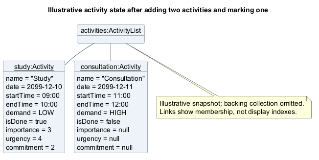

# UniEnable Developer Guide

UniEnable is a Java 25 command-line application that helps university students, particularly those with ASD, ADHD, or mobility constraints, organize academic and daily commitments and check campus accessibility information. It combines dated activities, optional importance, urgency and commitment ratings, priority and calendar views, completion tracking, and automatic local saving with facility searches and shortest recorded accessible-route queries using sample data for nine NUS FASS campus hubs.

This guide explains its components,
key implementation decisions, and how to test changes. For command syntax,
warnings, and worked examples, use the [User Guide](UserGuide.md).

## Table of contents

- [Acknowledgements](#acknowledgements)
- [Setting up and getting started](#setting-up-and-getting-started)
- [Design](#design)
  - [Architecture](#architecture)
  - [UI component](#ui-component)
  - [Logic component](#logic-component)
  - [Model component](#model-component)
  - [Storage component](#storage-component)
  - [Common classes and validation](#common-classes-and-validation)
  - [Source packages](#source-packages)
- [Implementation](#implementation)
  - [Activity creation, calendar views and help](#activity-creation-calendar-views-and-help)
  - [Activity views and deletion](#activity-views-and-deletion)
  - [Completion, storage, editing and search](#completion-storage-editing-and-search)
  - [Ratings and accessibility](#ratings-and-accessibility)
- [Documentation, testing and dev-ops](#documentation-testing-and-dev-ops)
- [Appendix A: Product scope](#product-scope)
- [Appendix B: User stories](#user-stories)
  - [Use cases](#use-cases)
- [Appendix C: Non-Functional Requirements](#non-functional-requirements)
- [Appendix D: Glossary](#glossary)
- [Appendix E: Instructions for manual testing](#instructions-for-manual-testing)

## Acknowledgements

UniEnable builds on the [CS2113 team-project starter](https://github.com/NUS-CS2113-AY2627-S1/tp),
whose history includes the [SE-EDU Duke starter](https://github.com/se-edu/duke).
Retained and adapted material includes the Gradle wrapper and build conventions,
Checkstyle configuration, GitHub Actions CI structure, and the original
README/setup and documentation scaffolding. The team updated the build for
Java 25 and developed UniEnable's activity and accessibility features and guides.
The inherited [contributors list](https://github.com/AY2627S1-CS2113-T10-4/tp/blob/master/CONTRIBUTORS.md)
records contributors to that starter foundation.

UniEnable's facility and connection datasets were compiled with reference to
the [NUS FASS *Access Routes / Faculty Map*](https://osa.nus.edu.sg/wp-content/uploads/2025/03/250224-FASS-Access-Route-Faculty-Map.pdf),
updated 24 February 2025. The map is an effort led by the Student Accessibility
Unit (SAU), Office of Student Affairs (OSA), National University of Singapore (NUS).

The PlantUML connectivity graph is UniEnable's own schematic representation of
its text datasets. The linked NUS PDF provides the original campus map.

Lou Yu Luke used Claude (through Claude Code) with relevant skills to validate
the code standard and code quality, and to apply the resulting formatting,
naming and small refactoring fixes to the code and affected diagrams.

## Setting up and getting started

The latest release is [UniEnable v2.1](https://github.com/AY2627S1-CS2113-T10-4/tp/releases/tag/v2.1).
Its executable JAR requires Java 25. To inspect or reproduce the released code,
use the repository's `v2.1` tag; `master` may contain later development changes.

Install **JDK 25** and clone the repository. Check `java -version` before building
or running the application. In IntelliJ IDEA, import the project as a Gradle
project and select JDK 25 for both the project SDK and Gradle JVM. The
[README](https://github.com/AY2627S1-CS2113-T10-4/tp/blob/master/README.md#setting-up-in-intellij) gives the IDE setup steps.

Run these commands from the project root using the included Gradle wrapper.
The first build needs internet access to download Gradle and dependencies.

| Purpose | Windows PowerShell | macOS / Linux |
| --- | --- | --- |
| Compile the application | `.\gradlew.bat classes` | `./gradlew classes` |
| Run automated tests | `.\gradlew.bat test` | `./gradlew test` |
| Run all configured checks | `.\gradlew.bat check` | `./gradlew check` |
| Run the console application | `.\gradlew.bat run --console=plain` | `./gradlew run --console=plain` |
| Build the executable JAR | `.\gradlew.bat shadowJar` | `./gradlew shadowJar` |

`check` runs tests, Checkstyle, and the configured JaCoCo coverage checks. The
application entry point is `seedu.unienable.UniEnable`. Gradle's `run` task enables
assertions; add `-ea` to the VM options when running the main method directly in
an IDE. After `shadowJar`, run the JAR with assertions enabled:

```text
java -ea -jar build/libs/unienable.jar
```

Enter `help` to see the commands and `bye` to exit. Activity data is stored at
`data/activities.txt`, relative to the directory where the application starts.
Use the same working directory between sessions to load the same activities.
Facility and connection data come from `src/main/resources/facilities.txt` and
`src/main/resources/connections.txt`; these resources are also included in the JAR.

<a id="design-and-implementation"></a>
<a id="system-design"></a>

## Design

### Architecture

UniEnable runs in one process. The diagram groups classes by responsibility;
the groups are not separate services. Editable diagrams are listed in the
[diagram index](diagrams/README.md). Select an embedded diagram to open its
full-size image using the link below it. Diagrams retain their original
text size in a horizontally scrollable region. Scroll sideways, or focus the
region with Tab and use the arrow keys; the enlarge link opens the entire image.

<!-- @@author lukelouyu -->

<div role="region" aria-label="UniEnable architecture (scroll horizontally)"
     tabindex="0" style="max-width: 100%; overflow-x: auto;">
  
</div>

[Enlarge diagram](images/luke/architecture/ArchitectureDiagram.png) | [PlantUML source](diagrams/luke/architecture/ArchitectureDiagram.puml).

<!-- @@author -->

At startup, `UniEnable` restores activities and `ConsoleHelper` loads facilities
before connections, then creates the parser and managers. Each input line follows
the same flow: `Ui` reads it, `Parser` creates a command, the command queries or
changes the model, and `ConsoleHelper` saves changes and displays the result.

| Component | Main classes | Responsibility |
| --- | --- | --- |
| Application | `UniEnable`, `ConsoleHelper` | Initialize the session, coordinate commands and saves, and handle exit. |
| UI | `Ui`, output formatters | Read terminal input and present results and warnings. |
| Logic | `Parser`, command parsers, `Command` subclasses | Interpret input, validate requests, and perform operations. |
| Model | `Activity`, `ActivityList`, `Facility`, `Connection` | Hold activity state and accessibility reference records. |
| Storage | `Storage`, `FacilityStorage`, `ConnectionStorage` | Load records, report problems, and persist activity changes. |

Recoverable failures display a warning and allow another command. If facilities
cannot load, activity commands, help and exit remain available. If only connections
fail, facility queries still work. An activity-file read failure starts an empty
list with recovery protection, described under [persistence](#completion-and-persistence).

### UI component

`Ui` handles text input and output. `ActivityListFormatter` formats activity
lists; the facility formatters build reference-data responses. `ViewCommand` and
`RouteCommand` format their own results. The UI does not own activity state or
write files. The main entry point uses UTF-8 console output for stored names.

### Logic component

`Parser` dispatches each command word to a feature parser or validates a simple
request directly. Commands implement `execute(ActivityList, Storage)` and return
a `CommandResult` containing a message, an exit flag and an activity-change flag.
`ConsoleHelper` uses these flags to coordinate automatic saving and shutdown.
Read-only commands leave the activity-change flag unset.

Time-sensitive edit validation and queries share an injected `Clock`. Production uses
the local clock; tests supply a fixed clock to reproduce boundary cases.

### Model component

`Activity` holds the name, date, same-day times, demand, completion state and
optional ratings. `ActivityList` owns the collection and supplies ordered or
filtered snapshots. Its canonical view sorts by date, start time and insertion
order; indexed changes resolve against that view.

`Facility`, `FacilityFeature` and `Connection` are immutable reference records.
Managers query snapshots of them. Defensive copies prevent callers from changing
reference data or reordering the activity collection through a returned view.

### Storage component

`Storage` loads and saves `data/activities.txt` relative to the working directory.
`FacilityStorage` and `ConnectionStorage` read bundled classpath resources and
return accepted records plus warnings in `LoadResult<T>`. Facilities load first
so connection endpoints can be checked against known hubs.

Only activity data is writable through commands. The
[persistence implementation](#completion-and-persistence) explains file formats,
compatibility and recovery; [accessibility](#ratings-and-accessibility) explains
reference-data queries.

### Common classes and validation

`UniEnableException` represents recoverable failures, with `ParseException` for
input errors and `InvalidIndexException` for invalid activity selections. Shared
validators keep add and edit consistent.

<!-- @@author lukelouyu -->

<a id="ascii-command-name-validation"></a>

**Command and name input:** Command words must be ASCII. Supplied activity names
must contain a non-whitespace character and use printable ASCII (0x20-0x7E).
Whitespace-only names, including Unicode spaces, are empty. Add and edit use
`ActivityNameValidator`; loading uses the separate
[stored-name compatibility rule](#historical-name-compatibility).

**Why names use printable ASCII.** Restricting new activity names to printable
ASCII keeps the supported input set small and predictable, reducing the character
cases that validation and testing must cover.

<a id="activity-name-punctuation"></a>

**Name punctuation and slash syntax:** **Commas and apostrophes are allowed.**
Names prohibit backslashes (`\`) and double quotation marks
(`"`), pipes and line breaks. Every slash in add/edit input must belong to a supported field prefix.
Both `/\` and `\/` contain a forbidden backslash. Quoting and slash escaping are
unsupported; [prefix-like text](#activity-parameter-validation) may still be reserved.

<a id="name-character-set-rationale"></a>

**Why the name character set is restricted.** Supplied activity names use a
conservative whitelist. The restricted punctuation (backslashes, single and
double quotes) carries special meaning in other grammars—escaping,
or quoting—so accepting it would add ambiguous edge cases in
parsing, storage, and any future data exchange. Keeping these characters out
shrinks the input space, which avoids unnecessary error analysis and incorrect
results, lowers the chance of bugs, and makes the parser and storage simpler to
implement and maintain. The cost is that a few names must be reworded; this is a
simplicity and robustness choice rather than a requirement of the current `|`
delimiter.

Raw add/edit arguments reject pipes, line breaks and unsupported slash tokens.
Extracted names receive the name checks; other fields use their own validators so errors
identify the field that failed. The [UG adding rules](UserGuide.md#adding-an-activity-add)
and [error handling](UserGuide.md#error-handling) provide the warning text.

<!-- @@author -->

<!-- @@author lukelouyu -->

<div role="region" aria-label="Name validation classes (scroll horizontally)"
     tabindex="0" style="max-width: 100%; overflow-x: auto;">
  
</div>

[Enlarge diagram](images/luke/class/ActivityNameValidatorClassDiagram.png) | [PlantUML source](diagrams/luke/class/ActivityNameValidatorClassDiagram.puml).

<div role="region" aria-label="Name validation sequence (scroll horizontally)"
     tabindex="0" style="max-width: 100%; overflow-x: auto;">
  
</div>

[Enlarge diagram](images/luke/sequence/ActivityNameValidationSequence.png) | [PlantUML source](diagrams/luke/sequence/ActivityNameValidationSequence.puml).

<!-- @@author -->

<!-- @@author lukelouyu -->

### Source packages

Java packages beneath `seedu.unienable` follow the source folders below.
The test tree mirrors these packages under `src/test/java/seedu/unienable`.

| Package | Contents and source location |
| --- | --- |
| `command.common` | [`Command`, `CommandResult`, `HelpCommand` and `ByeCommand`](https://github.com/AY2627S1-CS2113-T10-4/tp/tree/master/src/main/java/seedu/unienable/command/common). |
| `command.activity` | [Activity commands](https://github.com/AY2627S1-CS2113-T10-4/tp/tree/master/src/main/java/seedu/unienable/command/activity), including `ViewCommand`. |
| `command.accessibility.facility` | [Facility list, lookup, and feature-search commands](https://github.com/AY2627S1-CS2113-T10-4/tp/tree/master/src/main/java/seedu/unienable/command/accessibility/facility). |
| `command.accessibility.connection` | [`RouteCommand`](https://github.com/AY2627S1-CS2113-T10-4/tp/blob/master/src/main/java/seedu/unienable/command/accessibility/connection/RouteCommand.java). |
| `command.accessibility.connection.logic` | [`ConnectionManager`, `FacilityManager`, `DijkstraShortestPath`, and `DijkstraSolver`](https://github.com/AY2627S1-CS2113-T10-4/tp/tree/master/src/main/java/seedu/unienable/command/accessibility/connection/logic). |

The routing solver is package-private. The architecture diagram shows logical
components; the table above gives their Java package locations.

<!-- @@author -->

## Implementation

<!-- @@author Atharva005 -->

### Activity creation, calendar views and help

#### Adding activities

`AddCommandParser` validates the fields and creates an `AddCommand`, whose
constructor creates an incomplete activity.
Demand defaults to `MEDIUM`; omitted ratings remain unset. The end must be later
than the start on the same day. Activities whose end is at or before the current local time are rejected.
Ongoing activities with a future end are accepted; ended activities cannot be edited.

`AddCommand` applies the shared [schedule checks](#activity-schedule-validation)
before insertion. A successful insertion sets the activity-change flag, which
triggers the [automatic-save flow](#completion-and-persistence). Validation
failures leave the collection unchanged.

<!-- @@author -->

<!-- @@author lukelouyu -->

<div role="region" aria-label="Activity creation classes (scroll horizontally)"
     tabindex="0" style="max-width: 100%; overflow-x: auto;">
  
</div>

[Enlarge diagram](images/luke/class/ActivityCreationClassDiagram.png) | [PlantUML source](diagrams/luke/class/ActivityCreationClassDiagram.puml).

<!-- @@author -->

<!-- @@author Atharva005 -->

<div role="region" aria-label="Adding an activity (scroll horizontally)"
     tabindex="0" style="max-width: 100%; overflow-x: auto;">
  
</div>

[Enlarge diagram](images/atharva/sequence/AddActivitySequence.png) | [PlantUML source](diagrams/atharva/sequence/AddActivitySequence.puml).

#### Activity state snapshot

The illustrative snapshot below follows adding Study and Consultation, then
marking Study complete. Each `Activity` retains its own completion and optional
ratings; unset ratings are `null` in memory. The membership links abstract away
the backing collection. Display indexes are computed by ordered views rather
than stored on these objects.

<div role="region" aria-label="Illustrative activity state (scroll horizontally)"
     tabindex="0" style="max-width: 100%; overflow-x: auto;">
  
</div>

[Enlarge diagram](images/atharva/object/ActivityStateSnapshot.png) | [PlantUML source](diagrams/atharva/object/ActivityStateSnapshot.puml).

#### Calendar dashboards

`ViewCommand` uses the session clock to select today, tomorrow, or today through
six days ahead. `ActivityList.getViewBetween()` supplies the activities, including
completed ones. The command groups them by day and computes completion counts,
ratings and demand summaries without changing data.

Dashboard row numbers belong to the selected period; indexed changes use the full
chronological list. The rating table fits 80 terminal columns and shortens labels
to 26 columns without splitting grapheme clusters. Schedule rows pad names and indexes to align rating columns. Full names remain in schedules
and storage. See the [UG dashboard examples](UserGuide.md#viewing-calendar-dashboards-view).

<div role="region" aria-label="Calendar dashboard classes (scroll horizontally)"
     tabindex="0" style="max-width: 100%; overflow-x: auto;">
  
</div>

[Enlarge diagram](images/atharva/class/CalendarViewClassDiagram.png) | [PlantUML source](diagrams/atharva/class/CalendarViewClassDiagram.puml).

<div role="region" aria-label="Calendar dashboard sequence (scroll horizontally)"
     tabindex="0" style="max-width: 100%; overflow-x: auto;">
  
</div>

[Enlarge diagram](images/atharva/sequence/CalendarViewSequence.png) | [PlantUML source](diagrams/atharva/sequence/CalendarViewSequence.puml).

#### Categorized and topic help

`Parser` accepts `help` or one topic word. `HelpCommand` uses a static topic map
for the categorized menu and the 14 command topics. Unknown topics and extra
words produce a parsing warning. Help works without reference data and returns
text without executing the described command or saving activities.
See the [UG help reference](UserGuide.md#viewing-command-help-help).

<div role="region" aria-label="Help classes (scroll horizontally)"
     tabindex="0" style="max-width: 100%; overflow-x: auto;">
  
</div>

[Enlarge diagram](images/atharva/class/TopicHelpClassDiagram.png) | [PlantUML source](diagrams/atharva/class/TopicHelpClassDiagram.puml).

<div role="region" aria-label="Topic help sequence (scroll horizontally)"
     tabindex="0" style="max-width: 100%; overflow-x: auto;">
  
</div>

[Enlarge diagram](images/atharva/sequence/TopicHelpSequence.png) | [PlantUML source](diagrams/atharva/sequence/TopicHelpSequence.puml).

<!-- @@author -->

<!-- @@author officialasyrafrahim -->

### Activity views and deletion

#### Chronological listing

`ListCommand` passes `ActivityList.getCanonicalView()` to `ActivityListFormatter`.
This snapshot defines the one-based indexes used by edit, delete, mark and unmark.
Queries and formatting leave the backing collection unchanged.

Empty chronological, demand and priority views return `Sorry, the activity list is empty.`.

`ActivityList.NO_ACTIVITIES_MESSAGE` supplies empty-list feedback for listing and
indexed operations. Empty indexed operations return it through
`InvalidIndexException`; the console displays the message unchanged. Query-specific
feedback follows the [UG expected outputs](UserGuide.md#error-handling).
Invalid syntax or non-positive indexes produce warnings. No activity is changed
or saved when no record can be read or modified. Deleting the final activity saves
its removal and appends `Sorry, the activity list is empty.` to the confirmation.

<div role="region" aria-label="Chronological listing classes (scroll horizontally)"
     tabindex="0" style="max-width: 100%; overflow-x: auto;">
  
</div>

[Enlarge diagram](images/asyraf/class/ListActivityClassDiagram.png) | [PlantUML source](diagrams/asyraf/class/ListActivityClassDiagram.puml).

<div role="region" aria-label="Chronological listing sequence (scroll horizontally)"
     tabindex="0" style="max-width: 100%; overflow-x: auto;">
  
</div>

[Enlarge diagram](images/asyraf/sequence/ListActivitySequence.png) | [PlantUML source](diagrams/asyraf/sequence/ListActivitySequence.puml).

#### Demand-ordered listing

`ListDemandCommand` selects HIGH, MEDIUM, then LOW demand, ordering ties by date,
start time and insertion order. The formatter also receives the canonical view
to keep each activity's full-list index. Completed activities remain included.

<div role="region" aria-label="Demand listing classes (scroll horizontally)"
     tabindex="0" style="max-width: 100%; overflow-x: auto;">
  
</div>

[Enlarge diagram](images/asyraf/class/ListDemandClassDiagram.png) | [PlantUML source](diagrams/asyraf/class/ListDemandClassDiagram.puml).

<div role="region" aria-label="Demand listing sequence (scroll horizontally)"
     tabindex="0" style="max-width: 100%; overflow-x: auto;">
  
</div>

[Enlarge diagram](images/asyraf/sequence/ListDemandSequence.png) | [PlantUML source](diagrams/asyraf/sequence/ListDemandSequence.puml).

#### Activity deletion

`ListDeleteCommandParser` reads an unsigned ASCII integer. `DeleteCommand` asks
`ActivityList.deleteByDisplayedIndex()` to validate it and remove the selected
chronological activity. Zero and out-of-range indexes are rejected. Successful
deletion sets the activity-change flag, including when the last activity is removed.

<div role="region" aria-label="Deletion classes (scroll horizontally)"
     tabindex="0" style="max-width: 100%; overflow-x: auto;">
  
</div>

[Enlarge diagram](images/asyraf/class/DeleteActivityClassDiagram.png) | [PlantUML source](diagrams/asyraf/class/DeleteActivityClassDiagram.puml).

<div role="region" aria-label="Deletion sequence (scroll horizontally)"
     tabindex="0" style="max-width: 100%; overflow-x: auto;">
  
</div>

[Enlarge diagram](images/asyraf/sequence/DeleteActivitySequence.png) | [PlantUML source](diagrams/asyraf/sequence/DeleteActivitySequence.puml).

#### Priority listing

`Activity.getPriorityScore()` calculates `URG * URG * (IMP + COM)`: squaring urgency
gives it more weight, while importance and commitment contribute equally.
All three ratings must be set; scores range from 2 to 250 and do not change
automatically with time. Demand and completion do not affect the score.

`ListPriorityCommand` includes completed activities, sorts available scores highest
first and puts unavailable scores last. Ties use canonical order. The formatter
retains canonical indexes; missing ratings display `-` and unavailable scores `NA`.

<div role="region" aria-label="Priority listing classes (scroll horizontally)"
     tabindex="0" style="max-width: 100%; overflow-x: auto;">
  
</div>

[Enlarge diagram](images/asyraf/class/ListPriorityClassDiagram.png) | [PlantUML source](diagrams/asyraf/class/ListPriorityClassDiagram.puml).

<div role="region" aria-label="Priority listing sequence (scroll horizontally)"
     tabindex="0" style="max-width: 100%; overflow-x: auto;">
  
</div>

[Enlarge diagram](images/asyraf/sequence/ListPrioritySequence.png) | [PlantUML source](diagrams/asyraf/sequence/ListPrioritySequence.puml).

#### Overdue activities

`OverdueCommand` captures local time once and selects incomplete activities with
an end strictly before that time. Ongoing activities and ends exactly now are
excluded. `ActivityListFormatter` labels results as today, earlier this Monday-to-
Sunday week, or earlier. Results retain chronological indexes and are read-only.

<div role="region" aria-label="Overdue query classes (scroll horizontally)"
     tabindex="0" style="max-width: 100%; overflow-x: auto;">
  
</div>

[Enlarge diagram](images/asyraf/class/OverdueActivityClassDiagram.png) | [PlantUML source](diagrams/asyraf/class/OverdueActivityClassDiagram.puml).

<div role="region" aria-label="Overdue query sequence (scroll horizontally)"
     tabindex="0" style="max-width: 100%; overflow-x: auto;">
  
</div>

[Enlarge diagram](images/asyraf/sequence/OverdueActivitySequence.png) | [PlantUML source](diagrams/asyraf/sequence/OverdueActivitySequence.puml).

#### Next activity

`NextCommand` uses the captured local time to select the earliest incomplete
activity whose start is strictly later than now. Starts exactly now are excluded;
equal starts retain insertion order. The formatter keeps the selected activity's
canonical index, or returns `Sorry, no upcoming incomplete activities exist.`.

See the [UG time queries](UserGuide.md#viewing-the-next-activity-next).

<div role="region" aria-label="Next activity classes (scroll horizontally)"
     tabindex="0" style="max-width: 100%; overflow-x: auto;">
  
</div>

[Enlarge diagram](images/asyraf/class/NextActivityClassDiagram.png) | [PlantUML source](diagrams/asyraf/class/NextActivityClassDiagram.puml).

<div role="region" aria-label="Next activity sequence (scroll horizontally)"
     tabindex="0" style="max-width: 100%; overflow-x: auto;">
  
</div>

[Enlarge diagram](images/asyraf/sequence/NextActivitySequence.png) | [PlantUML source](diagrams/asyraf/sequence/NextActivitySequence.puml).

<!-- @@author -->

<!-- @@author Oliver-koh -->

### Completion, storage, editing and search

#### Editing activities

> **Design constraint: ended activities cannot be edited or rescheduled.** The
> existing end date/time is checked before any replacement is built. An end at
> or before local now rejects every edit, even if the requested date is in the future.

`EditCommandParser` collects changes in immutable `EditCommand.Fields`.
`EditCommand` selects the activity by its chronological index and checks the
clock once. Activities ending at or before now reject every edit, including
metadata changes and rescheduling into the future.

Omitted fields and completion stay unchanged. Date/time edits must end after
both the start and now, on the same day. Every edit checks duplicates, excluding the original activity. Only actual
date/time changes require a fresh overlap approval; name, demand and rating
changes preserve existing overlaps. Validation finishes before replacement, so rejected edits
change nothing. Refresh indexes after a successful edit.

<a id="ended-activity-edit-rationale"></a>

**Why ended activities cannot be edited.** One edit rule keeps validation and
testing simpler: ended activities are locked for editing. This avoids separate
rules for changing historical details or moving records back into the future.
To repeat a past activity, add a new one and preserve the original record.

<div role="region" aria-label="Editing classes (scroll horizontally)"
     tabindex="0" style="max-width: 100%; overflow-x: auto;">
  
</div>

[Enlarge diagram](images/oliver/class/EditActivityClassDiagram.png) | [PlantUML source](diagrams/oliver/class/EditActivityClassDiagram.puml).

<div role="region" aria-label="Editing an eligible activity (scroll horizontally)"
     tabindex="0" style="max-width: 100%; overflow-x: auto;">
  
</div>

[Enlarge diagram](images/oliver/sequence/EditActivitySequence.png) | [PlantUML source](diagrams/oliver/sequence/EditActivitySequence.puml).

<a id="name-search"></a>

#### Find Activities

`FindCommand` delegates case-insensitive literal substring matching to
`ActivityList.findByName()`. The formatter receives matches and the canonical
view to retain full-list indexes. Searching changes no state and requests no save.

<div role="region" aria-label="Find Activities - Class Diagram (scroll horizontally)"
     tabindex="0" style="max-width: 100%; overflow-x: auto;">
  
</div>

[Enlarge diagram](images/oliver/class/FindActivityClassDiagram.png) | [PlantUML source](diagrams/oliver/class/FindActivityClassDiagram.puml).

<div role="region" aria-label="Find Activities - Sequence Diagram (scroll horizontally)"
     tabindex="0" style="max-width: 100%; overflow-x: auto;">
  
</div>

[Enlarge diagram](images/oliver/sequence/FindActivitySequence.png) | [PlantUML source](diagrams/oliver/sequence/FindActivitySequence.puml).

#### Marking activities

`MarkCommand` sets completion through `ActivityList.setDoneAtDisplayedIndex()`.
The result requests saving only when completion changes; an invalid index or an
already-complete activity produces a warning. Other fields are preserved.

<div role="region" aria-label="Marking classes (scroll horizontally)"
     tabindex="0" style="max-width: 100%; overflow-x: auto;">
  
</div>

[Enlarge diagram](images/oliver/class/MarkActivityClassDiagram.png) | [PlantUML source](diagrams/oliver/class/MarkActivityClassDiagram.puml).

<div role="region" aria-label="Marking sequence (scroll horizontally)"
     tabindex="0" style="max-width: 100%; overflow-x: auto;">
  
</div>

[Enlarge diagram](images/oliver/sequence/MarkActivitySequence.png) | [PlantUML source](diagrams/oliver/sequence/MarkActivitySequence.puml).

#### Unmarking activities

`UnmarkCommand` uses the same index and change-flag contract to clear completion.
An already-incomplete activity produces a warning without saving. Completion
commands can act on past records; the
[ended-activity edit restriction](#ended-activity-edit-rationale) applies to `edit`.

<div role="region" aria-label="Unmarking classes (scroll horizontally)"
     tabindex="0" style="max-width: 100%; overflow-x: auto;">
  
</div>

[Enlarge diagram](images/oliver/class/UnmarkActivityClassDiagram.png) | [PlantUML source](diagrams/oliver/class/UnmarkActivityClassDiagram.puml).

<div role="region" aria-label="Unmarking sequence (scroll horizontally)"
     tabindex="0" style="max-width: 100%; overflow-x: auto;">
  
</div>

[Enlarge diagram](images/oliver/sequence/UnmarkActivitySequence.png) | [PlantUML source](diagrams/oliver/sequence/UnmarkActivitySequence.puml).

#### Completion and persistence

`Storage` decodes each UTF-8 record independently in insertion order. Invalid
encoding skips only that row and produces a line-numbered warning. Raw bytes are
preserved until a recovery save verifies the original backup. Saves use nine pipe-separated
fields; unset ratings are `-`, and `DONE` is `true` or `false`:

```text
NAME|DATE|START|END|DEMAND|DONE|IMP|URG|COM
```

Legacy six-field rows load with ratings unset. Malformed rows are skipped with
line-numbered warnings, including invalid time ranges.

<a id="historical-name-compatibility"></a>

**Stored-name compatibility:** Valid historical records and existing Unicode
names load, display and remain searchable. New-input restrictions apply to supplied
names. An eligible edit that omits the name retains it, subject to the
[ended-activity rule](#ended-activity-edit-rationale). Loading alone does not rewrite files.

**Saving and recovery:** `ConsoleHelper` marks changes dirty and saves before
showing a successful command result. Storage writes a temporary file, then replaces
the activity file. After detected corruption or a read failure, it first preserves
and verifies the original bytes in `.corrupt.bak`; backup failure prevents replacement.

A failed save leaves the change in memory and keeps the unsaved warning visible.
`bye` retries dirty data and closes only after saving succeeds; clean exits make
no extra write. Read-only commands do not retry writes. See the
[UG storage and recovery instructions](UserGuide.md#error-handling).

The shared sequence below begins after a command returns its `CommandResult`.
Add, edit and delete reference this interaction for saving and display; it does
not execute another command. The separate [marking sequence](#marking-activities)
shows how a completion command produces its result.

<div role="region" aria-label="Persistence classes (scroll horizontally)"
     tabindex="0" style="max-width: 100%; overflow-x: auto;">
  
</div>

[Enlarge diagram](images/oliver/class/ActivityPersistenceClassDiagram.png) | [PlantUML source](diagrams/oliver/class/ActivityPersistenceClassDiagram.puml).

<div role="region" aria-label="Conditional automatic saving (scroll horizontally)"
     tabindex="0" style="max-width: 100%; overflow-x: auto;">
  
</div>

[Enlarge diagram](images/oliver/sequence/CompletionAndSaveSequence.png) | [PlantUML source](diagrams/oliver/sequence/CompletionAndSaveSequence.puml).

<!-- @@author -->

<!-- @@author lukelouyu -->

<a id="luke-ratings-and-accessibility"></a>

### Ratings and accessibility

#### Optional ratings integration

`Activity.validateRating()` accepts unset values or integers from 1 to 5 for
importance, urgency and commitment. Add and edit handle each rating independently;
omitted add ratings stay unset. Ratings are stored unchanged and used by the
[priority view](#priority-listing).

#### Activity parameter validation

Before field extraction, `ActivityParameterValidator` checks every slash token,
including slash text in the first word of a name. Only `n/`, `d/`, `s/`, `e/`,
`dem/`, `imp/`, `urg/`, `com/`, and `overlap/` are supported, ignoring case, and
prefixes must start at a whitespace boundary. Unsupported words before `/` warn
before command construction or mutation. Literal slashes in names are unsupported.

One insertion, deletion, substitution or adjacent swap can add a correction
suggestion: `demm/` and `dem1/` suggest `dem/`. Suggestions do not determine
validity: every unsupported token is rejected, including single-letter tokens
such as `t/`. This prevents unknown fields being absorbed into a preceding name,
date or time. Historical names loaded from storage keep their original text.

<!-- @@author -->

<!-- @@author lukelouyu -->

<div role="region" aria-label="Parameter validation classes (scroll horizontally)"
     tabindex="0" style="max-width: 100%; overflow-x: auto;">
  
</div>

[Enlarge diagram](images/luke/class/ActivityParameterValidatorClassDiagram.png) | [PlantUML source](diagrams/luke/class/ActivityParameterValidatorClassDiagram.puml).

<div role="region" aria-label="Parameter validation sequence (scroll horizontally)"
     tabindex="0" style="max-width: 100%; overflow-x: auto;">
  
</div>

[Enlarge diagram](images/luke/sequence/ActivityParameterValidationSequence.png) | [PlantUML source](diagrams/luke/sequence/ActivityParameterValidationSequence.puml).

<!-- @@author -->

<!-- @@author lukelouyu -->

#### Activity schedule validation

`ActivityScheduleValidator` checks duplicates first, then time overlaps.

| Check | Rule |
| --- | --- |
| Duplicate | Same date, start, end and name, ignoring name case, surrounding spaces and repeated internal spaces. Demand, ratings and completion do not affect identity. Always rejected. |
| Time overlap | Same-date ranges overlap when `candidate.start < existing.end` and `existing.start < candidate.end`. Touching endpoints are allowed. Completed activities still participate. |
| `overlap/ALLOW` | Permits a time clash, but never a duplicate. It is not stored; supply it again for a conflicting schedule edit. |
| When validation runs | Before add or edit. Edits exclude the original record. Duplicate checks always run; only actual date/time changes require fresh overlap approval. |

For an existing activity from **09:00 to 10:00**, these examples use different
names to isolate the time-overlap check:

| Proposed time | Date relative to existing activity | Result |
| --- | --- | --- |
| 09:30–10:30 | Same date | Overlap; requires `overlap/ALLOW`. |
| 10:00–11:00 | Same date | Allowed: endpoints only touch. |
| 09:00–10:00 | Different date | Allowed: no time clash. |

The helper reads a snapshot without changing data or performing I/O. Other
add/edit validation rules still apply.

<!-- @@author -->

<!-- @@author Atharva005 -->

<div role="region" aria-label="Schedule validation classes (scroll horizontally)"
     tabindex="0" style="max-width: 100%; overflow-x: auto;">
  
</div>

[Enlarge diagram](images/atharva/class/ActivityScheduleValidatorClassDiagram.png) | [PlantUML source](diagrams/atharva/class/ActivityScheduleValidatorClassDiagram.puml).

<div role="region" aria-label="Schedule validation sequence (scroll horizontally)"
     tabindex="0" style="max-width: 100%; overflow-x: auto;">
  
</div>

[Enlarge diagram](images/atharva/sequence/ActivityScheduleValidationSequence.png) | [PlantUML source](diagrams/atharva/sequence/ActivityScheduleValidationSequence.puml).

<!-- @@author -->

<!-- @@author lukelouyu -->

#### Facility accessibility data (`facilities.txt`)

The [facility dataset](https://github.com/AY2627S1-CS2113-T10-4/tp/blob/master/src/main/resources/facilities.txt)
is bundled sample data for AS1-AS8 and CLB, with IDs F01-F09. Records use:

```text
FACILITY|ID|NAME|DESCRIPTION
FEATURE|FACILITY_ID|TYPE|STATUS|NOTES
```

`FacilityStorage` associates feature rows with exact facility IDs after reading
the resource. It skips malformed rows, duplicate facilities, unknown references
and invalid enums with warnings; the first valid conflicting feature status wins.
`YES`, `NO` and `UNKNOWN` are distinct, and an absent feature is not `UNKNOWN`.
The [dataset](https://github.com/AY2627S1-CS2113-T10-4/tp/blob/master/src/main/resources/facilities.txt)
contains the recorded notes; loading matches IDs and enum values exactly.

#### Facility lookup

`FacilityCommandParser` creates list, view or feature-search commands.
`FacilityManager` queries its immutable snapshot without file I/O. Lookup checks
IDs before names, ignoring case; feature searches match the requested status
exactly and return each matching facility once in dataset order. A missing status
defaults to `YES`. Formatters add the sample-data disclaimer.

Separating loading from queries allows manager tests to supply small datasets.
Unknown facilities, invalid filters and empty searches produce recoverable
messages. See the [UG facility commands](UserGuide.md#listing-and-viewing-facilities-facility).

<div role="region" aria-label="Facility loading and query classes (scroll horizontally)"
     tabindex="0" style="max-width: 100%; overflow-x: auto;">
  
</div>

[Enlarge diagram](images/luke/class/FacilityClassDiagram.png) | [PlantUML source](diagrams/luke/class/FacilityClassDiagram.puml).

<div role="region" aria-label="Facility search sequence (scroll horizontally)"
     tabindex="0" style="max-width: 100%; overflow-x: auto;">
  
</div>

[Enlarge diagram](images/luke/sequence/FacilityLookupSequence.png) | [PlantUML source](diagrams/luke/sequence/FacilityLookupSequence.puml).

#### Accessibility route connections (`connections.txt`)

The [connection dataset](https://github.com/AY2627S1-CS2113-T10-4/tp/blob/master/src/main/resources/connections.txt)
records ten bidirectional links. Each link uses the
[Connection model](https://github.com/AY2627S1-CS2113-T10-4/tp/blob/master/src/main/java/seedu/unienable/model/Connection.java):

```text
CONNECTION|ID|FROM|TO|DISTANCE|ACCESSIBILITY|TYPE|SHELTER|KNOWN_BARRIER|NOTES
```

The first eight fields are required; barrier and notes are optional. IDs are
unique integers, endpoints must exactly match distinct loaded hub names, and
distance is a positive integer in metres. Accessibility and shelter each use
`YES`, `NO` or `UNKNOWN`; traversal types are `PATH`, `RAMP`, `SHELTERED_RAMP`,
`LIFT` or `OTHER`. Invalid rows are skipped with warnings. Shelter is independent
of accessibility. This graph shows recorded connectivity, not geographical layout.

<a id="connectivity-graph"></a>

<div role="region" aria-label="Campus connectivity graph (scroll horizontally)"
     tabindex="0" style="max-width: 100%; overflow-x: auto;">
  
</div>

[Enlarge diagram](images/luke/graph/fass-accessibility-network.svg) | [PlantUML source](diagrams/luke/graph/fass-accessibility-network.puml).

#### Accessible route search

`RouteParser` resolves facility IDs through `FacilityManager` when available,
then creates a `RouteCommand` for two hub names, matched ignoring case. Unknown
endpoints report the valid graph hubs. `ConnectionManager` keeps one reusable
`DijkstraShortestPath` graph with both directions of each `YES` connection.
Each query creates a fresh `DijkstraSolver` with independent search state.

<div role="region" aria-label="Routing classes (scroll horizontally)"
     tabindex="0" style="max-width: 100%; overflow-x: auto;">
  
</div>

[Enlarge diagram](images/luke/class/RoutingClassDiagram.png) | [PlantUML source](diagrams/luke/class/RoutingClassDiagram.puml).

The solver uses a priority queue to relax distances, accumulates totals in `long`,
and reconstructs stops and segments from predecessors. Positive weights make
Dijkstra suitable for shortest recorded distance. Reusing the graph avoids
rebuilding it; a fresh solver prevents one query's state affecting the next.

Only accessibility status controls eligibility. Shelter, type and barrier notes
do not alter the cost or exclude links. Results include stops, segments, distance
and the sample-data disclaimer. Unknown endpoints and same-hub requests warn;
known disconnected endpoints produce the two-line no-route warning described in
the [UG route section](UserGuide.md#finding-an-accessible-route-route). It means
the local dataset has no eligible path, not that campus has no accessible route.

<div role="region" aria-label="Shortest recorded accessible route (scroll horizontally)"
     tabindex="0" style="max-width: 100%; overflow-x: auto;">
  
</div>

[Enlarge diagram](images/luke/sequence/RouteSearchSequence.png) | [PlantUML source](diagrams/luke/sequence/RouteSearchSequence.puml).

#### Exiting the application

`ByeCommand` returns an exit result. `ConsoleHelper` applies the
[save-recovery policy](#completion-and-persistence) before displaying goodbye;
`UniEnable` then ends the input loop. End of input also ends the loop. See
[UG exit instructions](UserGuide.md#exiting-the-application-bye).

<!-- @@author -->

<a id="testing-and-defensive-programming"></a>

## Documentation, testing and dev-ops

### Documentation and diagrams

The UG is the command reference; this DG explains components, implementation
contracts and verification. When behavior changes, update the relevant guide and
tests. Diagram sources and rendered images are indexed under
[diagrams](diagrams/README.md) and [images](images/README.md). Regenerate an image
when changing its PlantUML source and check that labels remain readable.

Sequence lifelines use `objectName:ClassName` or `:ClassName` for instances.
Participants marked `<<class>>` represent static calls rather than objects.
Object snapshots underline instance labels and show concrete state and membership;
they do not specify class inheritance or multiplicity constraints.

### Continuous integration

The Java CI workflow runs `./gradlew check` with JDK 25 on Linux, macOS and Windows.
Use the same checks locally before submitting changes. The executable artifact
comes from `shadowJar`; building it is separate from publishing a release.

### Automated testing

JUnit Jupiter tests are under `src/test/java/seedu/unienable`. Run `test` for
the test suite, or `check` for tests, Checkstyle, and the configured coverage
checks, using the wrapper commands in [Setting up](#setting-up-and-getting-started).
To focus on one class on Windows, for example:

```text
.\gradlew.bat test --tests "seedu.unienable.parser.AddCommandParserTest"
```

<!-- @@author lukelouyu -->

The same `--tests` filter accepts a full class name or package pattern.

<!-- @@author -->

On macOS or Linux, replace `.\gradlew.bat` with `./gradlew`. Test results are
written to `build/reports/tests/test/index.html`; the JaCoCo HTML report is at
`build/reports/jacoco/test/html/index.html` after `check` or `jacocoTestReport`.

| Area | Representative tests | Main checks |
| --- | --- | --- |
| Command input | Parser tests | Valid syntax and rejected input. |
| Editing | `EditCommandTest` | Partial edits; rejected edits leave all fields unchanged. |
| Finding activities | `FindCommandTest` | Name matching and chronological indexes. |
| Calendar dashboards | `ViewCommandTest` | Date ranges, empty periods, counts, totals, 80-column rating tables and read-only results. |
| Help | `HelpCommandTest` | Menu, topic pages and invalid requests. |
| Demand and priority lists | `ListDemandCommandTest`, `ListPriorityCommandTest` | Ordering, chronological indexes, missing scores and completion states. |
| Time queries | `OverdueCommandTest`, `NextCommandTest` | Selection rules and exact start/end boundaries. |
| Activity formatting | `ActivityListFormatterTest` | Displayed indexes, ordering and result formatting. |
| Storage | `StorageTest` | Save/load round trips, legacy rows, malformed data, backups and failed writes. |
| Save recovery | `ConsoleSaveRecoveryTest` | Unsaved warnings, blocked exits and saving again on exit. |
| Application sessions | `UniEnableTest` | Command sessions and persistence across restarts. |
| Facility data | `FacilityStorageTest`, `FacilityManagerTest` | Loading records and matching feature statuses exactly. |
| Facility commands | `FacilityCommandParserTest`, facility command tests | Input parsing, output formatting and unavailable data. |
| Route calculation | `DijkstraSolverTest`, `DijkstraShortestPathTest` | Distances, predecessors, route segments and accessibility filtering. |
| Route requests | Manager, parser and command tests | Invalid endpoints, disconnected hubs and same-hub requests. |

<!-- @@author lukelouyu -->

These tests check input validation at three levels:

| Level | Tests | What they verify |
| --- | --- | --- |
| Individual validator | `ActivityNameValidatorTest` | The [name rules](#ascii-command-name-validation): allowed character boundaries, forbidden punctuation and blank names. |
| Command parsing | Add/edit parser tests | Both parsers apply the shared rules and report the appropriate warning. |
| Complete application | `UniEnableProcessTest` | Commands work through the real entry point, including input rejection, parameter and schedule checks, UTF-8 display of stored names, and persistence across restarts. |

`UniEnableProcessTest` starts a separate Java process (JVM), sends commands and
checks the output and saved files. This tests the application's main
execution path rather than calling a validator directly. It also checks that
rejected commands leave activities unchanged and do not create an activity file
unnecessarily.

<!-- @@author -->

<!-- TEAM: All members maintain validation, assertions, and defensive collection contracts. -->

### Defensive programming

Input is validated before data changes: parsers check syntax, while commands and
models check values, indexes and rating ranges. Checked exceptions report
recoverable errors so the user can correct the input and continue.

For activity names, add and edit apply the shared
[name-input policy](#ascii-command-name-validation), illustrated below:

| Input example | Validation and rationale |
| --- | --- |
| `n/学习`, `n/படி`, `n/पढ़ाई`, `n/చదువు`, `n/공부`, `n/勉強`, `n/Study 🎉`, `n/Café` | These foreign-language characters (Chinese, Tamil, Hindi, Telugu, Korean and Japanese), emoji and accented characters are outside printable ASCII.<br>Supporting more character sets requires broader testing of input handling and terminal display.<br>Restricting new names to printable ASCII keeps the supported input predictable and the validation scope manageable. See the [design rationale](#ascii-command-name-validation).<br>Existing Unicode names remain loadable under the separate [stored-name rules](#historical-name-compatibility). |
| `n/"Study"`, `n/Study\notes` | Double quotes and backslashes are forbidden; quoted names and escaping are unsupported. |
| `n/Study\|Review` or a name containing a line break | Pipes and line breaks conflict with record boundaries. |
| A blank name or one containing a tab, NUL or DEL | Names must be nonblank and contain only printable characters. |
| `n/Planning and/or review` (rejected) | `and/` is not a supported prefix. Reword the name using spaces or hyphens; see the [prefix rules](#activity-parameter-validation). |

Collection copies protect shared data from external changes. Assertions help
detect internal ordering and deletion errors during debugging. Input validation
remains responsible for checking user commands.

<!-- @@author Oliver-koh -->

`Storage` validates saved time ranges separately from
[new-input rules](#ascii-command-name-validation) and
[stored-name compatibility](#historical-name-compatibility).
It distinguishes invalid records from read failures, using backups for
recovery writes and temporary files for saves. Recoverable errors let the console
continue; failed saves may leave unsaved changes in memory, so follow the
[recovery steps](UserGuide.md#error-handling) before exiting.

<!-- @@author -->

<!-- @@author lukelouyu -->

Reference-data failures use the [architecture fallback](#architecture).

<!-- @@author -->

<!-- TEAM: Add and edit validation spans activity-creation and editing responsibilities. -->

Parser tests and `UniEnableTest` check the shared
[input-validation contract](#ascii-command-name-validation), rejection without
state changes, and restart behavior.

<a id="appendix-requirements"></a>
<a id="product-scope"></a>

## Appendix A: Product scope

### Target users and value proposition

| Aspect | Description |
| --- | --- |
| Target users | Tertiary students with ASD, ADHD, or mobility constraints who are adapting to university routines. |
| Value proposition | A keyboard-operated terminal application that combines commitment planning with campus reference queries and stores activities locally. |

### Current boundaries

The current build supports dated, same-day activities, optional ratings,
chronological, demand, and priority views, overdue and next queries,
today's and tomorrow's dashboards, the next seven days' dashboard,
activity editing and name search, completion, deletion, persistence,
facility queries, and shortest recorded accessible routes.
Reference information covers the nine bundled hubs; it is sample data without
live campus updates.

Recurring activities, alerts, categories, demand-limit warnings, and live campus
updates are not implemented. The [user stories](#user-stories) record feature status.

### Team contributions

Feature responsibility follows the table below. See the [team pages](team/README.md).

| Team member | Feature area | V1.0 work | V2.0 work | Diagram contribution |
| --- | --- | --- | --- | --- |
| [Lou Yu Luke](team/lukelouyu.md) | Ratings, shared validation and accessibility | Exit (`bye`); [facility listing, lookup, and feature search](#facility-lookup). | [Accessible routes](#accessible-route-search); [optional ratings](#optional-ratings-integration); [command/name validation](#ascii-command-name-validation); [duplicate/clash checks](#activity-schedule-validation). | [Activity-creation class diagram, name/parameter validation, facility lookup and routing](diagrams/README.md#luke): five class diagrams and four sequence diagrams. Additional diagrams: [architecture](diagrams/README.md#architecture) and [campus connectivity graph](diagrams/README.md#connectivity-graph). |
| [Atharva Rege](team/atharva005.md) | Activity creation, calendar views and help | [Adding activities](#adding-activities) (`add`) and command help (`help`). | [Calendar dashboards](#calendar-dashboards) (`view today`, `view tomorrow`, `view week`); [topic help](#categorized-and-topic-help) (`help TOPIC`). | [Add sequence, calendar dashboards, topic help, and schedule validation](diagrams/README.md#atharva): eight diagrams (three class/sequence pairs, the add sequence and an activity-state object diagram). |
| [Muhammad Asyraf Bin Abdul Rahim](team/officialasyrafrahim.md) | Activity views and deletion | [Chronological/demand listing and deletion](#activity-views-and-deletion) (`list`, `list demand`, `delete`). | [Priority, overdue, and next views](#activity-views-and-deletion) (`list priority`, `overdue`, `next`). | [Chronological listing, demand listing, deletion, priority, overdue, and next](diagrams/README.md#asyraf): six class/sequence pairs. |
| [Koh Li Wei Oliver](team/oliver-koh.md) | Completion, storage, editing and search | [Persistence and recovery](#completion-and-persistence); completion changes (`mark`, `unmark`). | [Editing](#editing-activities) (`edit`); [Find Activities](#name-search) (`find`); failed-save retry on exit (`bye`). | [Editing, Find Activities, marking, unmarking, and persistence](diagrams/README.md#oliver): five class/sequence pairs. |


<!-- TEAM: All members maintain story status; feature ownership is defined in Team contributions. -->

<a id="user-stories"></a>

## Appendix B: User stories

### Core schedule

| ID | Priority | As a/an ... | I can ... | So that ... | Current status |
| --- | --- | --- | --- | --- | --- |
| US01 | Must-Have | student managing multiple commitments | add an activity with a name, date, and time | I can record what I need to attend | Implemented |
| US02 | Must-Have | student planning my routine | list all my activities in chronological order | I can review my commitments and anticipate what comes next | Implemented |
| US03 | Must-Have | student with a long schedule | find activities by keyword | I can locate a specific commitment quickly | Implemented |
| US04 | Must-Have | student whose plans change | delete an activity | obsolete commitments do not clutter my schedule | Implemented |
| US05 | Must-Have | student whose details change | edit an existing activity's name, date, or time | I can correct my plan without deleting and re-adding it | Partial: ended activities are locked against editing and rescheduling |
| US06 | Must-Have | student who finds it difficult to track completion | mark and unmark an activity as done | I know what is finished and what remains | Implemented |
| US07 | Nice-to-Have | student balancing responsibilities | assign a category (academic, CCA, daily) to an activity | I can distinguish types of commitments | Not implemented |
| US08 | Nice-to-Have | student who finds timetable entry tedious | add a recurring activity by specifying its day, time, and week numbers | I do not re-enter the same class repeatedly | Not implemented |
| US09 | Nice-to-Have | student whose day changes unexpectedly | reschedule an activity to a new date or time | my plan stays realistic when disruptions occur | Partial: ended activities are locked against editing and rescheduling |

### Views and reminders

| ID | Priority | As a/an ... | I can ... | So that ... | Current status |
| --- | --- | --- | --- | --- | --- |
| US10 | Must-Have | student who benefits from predictable routines | view all of today's activities in one summary | I can prepare for the day ahead | Implemented |
| US11 | Nice-to-Have | student preparing in advance | view tomorrow's activity summary | I can plan before the next morning | Implemented |
| US12 | Nice-to-Have | student who struggles to track a full timetable | view a week's activities grouped by day | I have an overview of my upcoming week | Implemented |
| US13 | Nice-to-Have | student who forgets tasks easily | see my overdue and next-upcoming activities highlighted | I know what needs attention first | Implemented |
| US14 | Future | student who finds it difficult to keep track of time | get an alert 10 minutes before an activity starts | I can mentally prepare for the transition | Not implemented |

### Energy and priority

| ID | Priority | As a/an ... | I can ... | So that ... | Current status |
| --- | --- | --- | --- | --- | --- |
| US15 | Must-Have | student with sensory or attention limits | assign a demand level to an activity | I can record how demanding I expect it to be | Implemented |
| US16 | Must-Have | student with sensory limits | see the count of high-demand activities scheduled today | I can anticipate a potentially stressful day | Implemented |
| US17 | Nice-to-Have | student managing my energy | set importance, commitment, and urgency levels on an activity | I can capture how much each one matters | Implemented |
| US18 | Nice-to-Have | student unsure what to do first | view my activities, including completed ones, ordered by combined priority score | I can decide what to tackle next | Implemented |
| US19 | Nice-to-Have | student aware of my workload | view the commitment level of a specific activity | I can decide whether to take it on | Implemented |
| US20 | Nice-to-Have | student aware of my sensory limits | get a warning when the total demand of a day exceeds my personal daily limit | I can avoid overloading myself | Not implemented |
| US21 | Future | student with a short gap between classes | see pending activities whose estimated duration fits a given gap | I can use the available time realistically | Not implemented |
| US22 | Future | student managing my energy | get reminders to take a short break after a sustained work interval | I keep my energy up instead of burning out | Not implemented |

### Accessible navigation

| ID | Priority | As a/an ... | I can ... | So that ... | Current status |
| --- | --- | --- | --- | --- | --- |
| US23 | Must-Have | student with mobility constraints | list accessible facilities at a supported hub | I can identify useful facilities before travelling there | Implemented |
| US24 | Future | student who avoids stairs | get textual directions to a lift at a supported hub | I can move between levels more easily | Not implemented |
| US25 | Future | student using a mobility aid | get textual directions to a ramp at a supported hub | I can avoid step-only entrances | Not implemented |
| US26 | Must-Have | student navigating an unfamiliar campus | get the shortest recorded accessible route between two supported hubs | I can follow a suitable path without interpreting a map | Implemented |
| US27 | Nice-to-Have | student assessing a stored route | see which lifts, ramps, or accessible entrances occur along it | I can judge whether the route suits my needs | Partial |
| US28 | Future | student whose mobility needs affect travel time | record my own travel duration between two locations | my planning reflects the journey I can actually make | Not implemented |
| US29 | Future | student overwhelmed by ambient noise | view which supported locations are flagged as high-noise | I can avoid visiting them | Not implemented |
| US30 | Future | student overwhelmed by ambient noise | request a route between hubs that avoids locations flagged as high-noise | my emotional wellbeing is protected while travelling | Not implemented |

### Foundation

| ID | Priority | As a/an ... | I can ... | So that ... | Current status |
| --- | --- | --- | --- | --- | --- |
| US31 | Must-Have | returning user | have my activities saved automatically and reloaded when I reopen the app | I can continue from my saved schedule between sessions | Implemented |
| US32 | Future | student estimating my time | record an estimated duration on an activity | gap-fitting and planning features have data to work with | Not implemented |
| US33 | Must-Have | new user | see a list of available commands and their formats | I can learn to use the product without external documentation | Implemented |

### Use cases

These summarize interactions; the [implementation](#implementation) gives the
validation and persistence contracts.

| Use case | Main success flow | Extensions |
| --- | --- | --- |
| Add an activity | User supplies fields; UniEnable validates, inserts, saves and confirms. | Invalid fields, duplicates or an unapproved clash leave the list unchanged. A save failure keeps the change in memory and reports unsaved data. |
| Edit an activity | User selects a canonical index and replacements; UniEnable validates the whole replacement, saves and confirms. | Invalid indexes and ended activities are rejected. Invalid replacements leave all fields unchanged. |
| Find an accessible route | User supplies known, distinct hubs; UniEnable finds and displays the shortest eligible recorded path with a disclaimer. | Invalid endpoints warn. Known disconnected hubs produce a no-route result scoped to the dataset. |

<a id="non-functional-requirements"></a>

## Appendix C: Non-Functional Requirements

Use these checks for maintenance and release acceptance, recording results
separately for each platform tested.

| ID | Requirement | Acceptance check |
| --- | --- | --- |
| NFR-01 | The executable uses Java 25 and a text terminal on Windows, macOS, or Linux, without requiring an IDE at runtime. | On each release platform, build with JDK 25, launch the JAR with `java -ea -jar unienable.jar`, and complete an add/list/bye/restart smoke test. |
| NFR-02 | Activity management, facility lookup, help, and routing work offline once the JAR is built or downloaded. | Disconnect networking and run the activity, facility, route, and help manual scenarios using the bundled reference data. The initial Gradle dependency download is outside this runtime constraint. |
| NFR-03 | After a successful activity save, restarting from the same working directory restores all activity fields, ratings, completion state, and insertion order. | Run the restart scenario below and compare the nine-field UTF-8 file and reloaded activities. Repeat with a legacy six-field row. |
| NFR-04 | Read-only commands, rejected input, and repeated mark/unmark requests do not rewrite the activity file. | Compare saved bytes and modification time before and after queries, invalid commands, and completion no-ops. |
| NFR-05 | Detected malformed activity rows produce line-numbered warnings. A later recovery save must preserve and verify the original bytes in `.corrupt.bak` before replacing the activity file; a failed backup must preserve the original file. | Run the corruption and blocked-backup scenarios below and the storage regression suite. |
| NFR-06 | Invalid user input produces an informative warning and allows another command. Users can discover supported syntax through `help` and `help TOPIC`. | Run the invalid-input and topic-help scenarios, then issue `list` and `bye` to confirm the session remains usable. |
| NFR-07 | Date-sensitive behavior uses the session's local time consistently and can be reproduced without changing the computer clock. | Run the automated fixed-clock boundary and calendar tests. |
| NFR-08 | Changes remain buildable and follow the configured style and accessibility coverage constraints. | Run `check` with Java 25 before release; it must pass JUnit, Checkstyle, and the configured JaCoCo verification. |

The supported runtime assumes a writable local data directory and one running
instance per activity file. Concurrent editing and synchronization across devices
are outside the current scope. Performance targets require a measured workload,
hardware, and procedure; this guide sets no timing benchmark.

<a id="glossary"></a>

## Appendix D: Glossary

| Term | Meaning in UniEnable |
| --- | --- |
| Activity | A named commitment with a date, start/end times, demand, completion state, and optional ratings. |
| Demand | The activity's `LOW`, `MEDIUM`, or `HIGH` level; separate from its numeric ratings. |
| Ratings | Independent importance, urgency, and commitment values from 1 to 5. An omitted value is unset, stored as `-`. |
| Priority score | `URG * URG * (IMP + COM)`, available only when all three ratings are set. |
| Canonical view | Activities sorted by date and start time, retaining insertion order for ties. |
| Displayed index | A one-based position in chronological `list`, used by edit, delete, mark, and unmark and retained by demand, find, priority, overdue, and next. Calendar dashboards number their selected rows separately. |
| Seven-day dashboard | `view week`: today through today plus six days, including completed activities and grouped by date. |
| Hub | A supported facility name: AS1 to AS8 or CLB in the bundled dataset. |
| Facility ID | A stable lookup identifier, F01 to F09. Route input accepts IDs when facility data is available, resolving them to hub names. |
| Connection | A bidirectional recorded link with distance, accessibility, traversal type, shelter, and optional barrier information or notes. |
| Accessibility status | A recorded `YES`, `NO`, or `UNKNOWN` value. A missing feature is distinct from an explicit `UNKNOWN`. |
| Route | Ordered stops and their connecting segments, with total recorded distance. |
| Recovery backup | The original activity-file bytes copied to `.corrupt.bak` before a save following detected corruption; not a backup history. |

<a id="instructions-for-manual-testing"></a>

## Appendix E: Instructions for manual testing

### Prepare a separate test folder

Build with Java 25 using `check shadowJar`. Run the JAR from a separate folder
so tests cannot change personal activity data. Use future dates for new activities
and restart from the same folder to verify persistence.

To test the released application, download `unienable.jar` from the
[v2.1 release](https://github.com/AY2627S1-CS2113-T10-4/tp/releases/tag/v2.1)
and run it in the separate test folder instead of using a local build.

Copy `build/libs/unienable.jar` into an empty test folder, open a terminal there,
and run `java -ea -jar unienable.jar`. Enter `help`, then `bye`: the menu and
goodbye message should appear. Relaunch from that same folder for the scenarios
below. Use a new empty folder when a scenario requires a fresh state.

<!-- TEAM: This walkthrough combines Atharva's add/help, Asyraf's listing/deletion, and Oliver's completion/storage. -->

### Activities and restart persistence

In a fresh test folder, enter the following commands one line at a time. The
dates must be in the future; replace the example dates if necessary.

```text
add n/Study d/2030-12-10 s/09:00 e/10:00 dem/LOW imp/3 urg/4 com/2
add n/Consultation d/2030-12-11 s/11:00 e/12:00 dem/HIGH
list
list demand
mark 1
unmark 1
delete 2
bye
```

`list` shows Study as 1 and Consultation as 2. `list demand` reverses the rows
but retains those numbers. Mark/unmark changes only Study's completion; delete
removes Consultation. Restart: Study and its ratings should reload, with completion
unset. Read-only commands and repeated completion requests must leave the saved
file unchanged. Use a fresh folder for independent tests below.

<!-- @@author lukelouyu -->

#### Printable-ASCII input and historical UTF-8 output

Exercise the [input-validation contract](#ascii-command-name-validation) in disposable
storage using Chinese (`复习`), Tamil (`வணக்கம்`, `படி`), accented (`Café`), and emoji
(`Study 🎉`) names in both add and multi-field edit requests. Repeat with an
internal tab, NUL, DEL, blank names, and forbidden punctuation. Check rejection
without partial changes and confirm the original activities after restart.
Include a non-ASCII command word to check warning selection against the
[UG error-handling examples](UserGuide.md#error-handling).

Use accepted ASCII names such as `Planning review` and `C++ @ COM1 #2` to
exercise add, edit, search, and restart. Exercise
[stored-name compatibility](#historical-name-compatibility) with a pre-existing
UTF-8 fixture, including an eligible edit that omits the name. `UniEnableProcessTest`
covers these scenarios through the real entry point with redirected output.

### Duplicate activities and time clashes

Use a fresh test folder. Enter these commands one at a time, keeping the dates
in the future:

```text
add n/Session d/2030-12-10 s/09:00 e/10:00
add n/session d/2030-12-10 s/09:00 e/10:00 overlap/ALLOW
add n/Practice d/2030-12-10 s/09:30 e/10:30
add n/Practice d/2030-12-10 s/09:30 e/10:30 overlap/ALLOW
edit 2 s/09:45 e/10:45
edit 2 s/09:45 e/10:45 overlap/ALLOW
list
```

The second command is a duplicate and the third a clash; both are rejected.
The fourth adds Practice. The first edit is rejected and the second succeeds.
The final list contains only Session (1) and Practice (2). Adjacent ranges and
equal times on different dates are accepted; completed records still occupy
their scheduled time.

<!-- @@author -->

<!-- @@author officialasyrafrahim -->

### Priority and strict local-time boundaries

With the app closed in a fresh test folder, create `data/activities.txt` with
these records. The first date must be past and the other dates future:

```text
Old|2000-01-01|09:00|10:00|LOW|false|1|5|1
Future rated|2030-12-10|09:00|10:00|HIGH|false|3|4|2
Future unrated|2030-12-11|11:00|12:00|LOW|false|-|-|-
```

Start the app, then enter:

```text
list priority
next
overdue
mark 2
next
mark 1
overdue
unmark 1
overdue
edit 1 imp/5
edit 1 d/2030-12-12
```

Priority order is indexes 2 (80), 1 (50), then 3 (`NA`). The first `next` selects
2; after marking it, `next` selects 3. Priority listing still includes completed
activities. `overdue` initially shows Old (1), becomes empty after `mark 1`, and
shows Old again after `unmark 1`. Both edits are rejected because the original
activity has ended, including the attempt to move it into the future.

Neither `add` nor `edit` can create an ended activity. Once an activity has ended,
`edit` cannot change its details or reschedule it. For this test, prepare the supplied
data file while the app is closed so that completion states and ratings match
the expected results.

Ongoing activities appear in neither `overdue` nor `next`. To verify exact
start/end boundaries without changing the computer clock, run from the project root:

```text
.\gradlew.bat test --tests "seedu.unienable.command.activity.OverdueCommandTest" --tests "seedu.unienable.command.activity.NextCommandTest"
```

On macOS/Linux, replace `.\gradlew.bat` with `./gradlew`.

<!-- @@author -->

<!-- @@author Atharva005 -->

### Calendar dashboards and topic help

Use a fresh test folder and close the app. Prepare `data/activities.txt` below,
replacing `<TODAY>`, `<TOMORROW>`, `<DAY_6>` and `<DAY_7>` with actual dates in
`YYYY-MM-DD` format: today, tomorrow, six days ahead and seven days ahead. Refresh
the dates if the test crosses midnight. File preparation gives this scenario
reproducible dates, completion states and ratings.

```text
Today|<TODAY>|09:00|10:00|HIGH|false|3|4|2
Tomorrow|<TOMORROW>|11:00|12:00|LOW|true|-|-|-
Day six|<DAY_6>|13:00|14:00|MEDIUM|false|2|3|4
Day seven|<DAY_7>|15:00|16:00|LOW|false|-|-|-
```

Start the app and enter:

```text
view today
view tomorrow
view week
help
help view
help edit
```

The daily views show Today and Tomorrow respectively. The week includes the first
three records and excludes Day seven: three activities, one completed and one
HIGH-demand activity. Rating totals are importance 5, urgency 7 and commitment 6.
Help displays the menu or requested topic without executing it or changing data.
In a separate empty folder, the three view commands should show the period-specific no-activities
message.

Rating rows fit 80 terminal columns. Long table labels shorten to at most 26
columns with `...`, while schedules retain full names. Dashboard numbers belong
to the selected period. For a repeatable year rollover check, run:

```text
.\gradlew.bat test --tests "seedu.unienable.command.activity.ViewCommandTest"
```

This suite uses fixed clocks; it does not change the computer clock. On
macOS/Linux, replace `.\gradlew.bat` with `./gradlew`.

<!-- @@author -->

<!-- TEAM: Each member maintains invalid-input cases for their commands in this combined table. -->

### Invalid activity and command input

In a fresh test folder, enter:

```text
add n/Valid d/2030-12-10 s/09:00 e/10:00
add n/Missing
add n/"Student meeting" d/2030-12-11 s/09:00 e/10:00
edit 1 imp/1,5
edit 1 n/Changed imp/0
help add extra
view year
delete 0
list
```

Only the first add succeeds. Check the missing-field, name-punctuation,
integer-rating, rating-range, help, view and index warnings respectively.
`imp/1,5` must identify a rating error. The failed multi-field edit must preserve
the name Valid. The final list contains that one original activity, and the
session accepts another command after each rejection.

<!-- @@author Oliver-koh -->

### Editing and name search

Start in a fresh test folder with future dates and enter:

```text
add n/Study d/2030-12-10 s/09:00 e/10:00 dem/LOW imp/3 urg/4 com/2
add n/Consultation d/2030-12-11 s/11:00 e/12:00
mark 1
edit 1 n/Revision dem/HIGH
find revision
edit 1 d/2030-12-12 s/13:00 e/14:00
find revision
edit 2 n/Should stay unchanged imp/0
list
delete 2
delete 1
find Revision
bye
```

The first search shows completed Revision at index 1 with its ratings preserved.
Rescheduling moves it after Consultation, so the second search uses index 2.
The invalid rating rejects the entire subsequent edit; the name remains Revision.
Both deletions leave an empty list. The last search returns the
`Sorry, no activity names match your search.` message. Restart
from the same folder and run `list`: the empty state must persist. All edits in
this scenario target an activity whose original end is still in the future.

<!-- @@author -->

<!-- @@author lukelouyu -->

### Facility queries and routes

| Command | Expected result |
| --- | --- |
| `facility list` | Nine facilities, F01-F09, with recorded features. |
| `facility F04` | AS4, including lift and accessible washroom records. |
| `facility find type/LIFT status/NO` | AS1 and AS2. |
| `facility find type/REST_POINT` | AS8. |
| `route from/AS6 to/AS7` | AS6 -> AS1 -> AS4 -> AS7, 200 metres. |
| `route from/AS6 to/AS6` | Same-endpoint warning. |

Successful accessibility results and confirmed no-route responses include the
sample-data notice. Input warnings have no sample-data notice because no
accessibility result was calculated. Check these rejected inputs separately:

| Command | Expected warning | Sample-data notice |
| --- | --- | --- |
| `route from/UTown to/AS6` | Unknown connection startpoint, followed by route usage. | Absent |
| `route from/ZZZ to/AS6` | Unknown connection startpoint, followed by route usage. | Absent |
| `route to/AS7 from/AS6` | Invalid route command, followed by route usage. | Absent |
| `route from/AS6 to/AS6` | Source and destination are the same. | Absent |
| `facility find type/LIFT status/MAYBE` | Invalid facility status, supported statuses and usage. | Absent |

After each rejection, the session must accept another command and the saved
activity file must remain unchanged.

<!-- @@author -->

<!-- @@author Oliver-koh -->

### Legacy data, corruption warnings, and save failures

With the app closed in a fresh test folder, create `data/activities.txt` containing:

```text
Legacy|2000-01-01|09:00|10:00|LOW|true
Broken row
```

Start the app, enter `unmark 1`, then `bye`. Startup warns about line 2 and loads
Legacy with unset ratings. Unmarking a past activity is allowed. The recovery
backup `data/activities.txt.corrupt.bak` must match the original two-line file;
the saved file must contain one nine-field Legacy record with completion `false`.
Restart: Legacy remains incomplete and the malformed-row warning is gone.

For the blocked-backup variant, start again in a separate fresh folder with the
same original two-line file. Before launch, create a **directory** named
`data/activities.txt.corrupt.bak` and put a file such as `keep.txt` inside it.
Start the app and enter `unmark 1`: saving must fail, preserving the original
activity file and showing an unsaved notice. `list` still shows the in-memory
incomplete activity. Entering `bye` while the backup remains blocked must keep
the session open. Move the blocking directory to a safe separate location, then
enter `bye` again; saving should succeed and exit. Restart and verify the change.
Follow the [UG recovery instructions](UserGuide.md#error-handling) when preserving
existing files and backups.

<!-- @@author -->
