# UniEnable Developer Guide

<!--
RESPONSIBILITY SCOPES (feature responsibility, not the most recent Git editor):
Atharva005: activity creation, calendar dashboards, command help, add sequence and schedule validation diagrams.
officialasyrafrahim: listing, deletion, priority, overdue, and next.
Oliver-koh: completion changes, activity persistence/recovery, editing, and search.
lukelouyu: optional add ratings, facilities, routes, exit, package moves, architecture, activity-creation class and name/parameter validation diagrams.
Sections marked TEAM are maintained jointly and have no single-author override.
Named author comments begin a feature scope; the unnamed author comment ends it.
-->

<!-- TEAM: All members maintain the contents, introduction and setup instructions. -->

## Table of contents

- [Introduction](#introduction)
- [Setting up and getting started](#setting-up-and-getting-started)
- [Design and implementation](#design-and-implementation)
  - [System design](#system-design)
    - [Architecture](#architecture)
    - [Source packages](#source-packages)
  - [Activity creation, calendar views and help](#activity-creation-calendar-views-and-help)
    - [Adding activities](#adding-activities)
    - [Calendar dashboards](#calendar-dashboards)
    - [Categorized and topic help](#categorized-and-topic-help)
  - [Activity views and deletion](#activity-views-and-deletion)
    - [Chronological listing](#chronological-listing)
    - [Demand-ordered listing](#demand-ordered-listing)
    - [Activity deletion](#activity-deletion)
    - [Priority listing](#priority-listing)
    - [Overdue activities](#overdue-activities)
    - [Next activity](#next-activity)
  - [Completion, storage, editing and search](#completion-storage-editing-and-search)
    - [Editing activities](#editing-activities)
    - [Name search](#name-search)
    - [Marking activities](#marking-activities)
    - [Unmarking activities](#unmarking-activities)
    - [Completion and persistence](#completion-and-persistence)
  - [Ratings and accessibility](#ratings-and-accessibility)
    - [Optional ratings integration](#optional-ratings-integration)
    - [Activity parameter validation](#activity-parameter-validation)
    - [Activity schedule validation](#activity-schedule-validation)
    - [Facility accessibility data ](#facility-accessibility-data-facilitiestxt)
    - [Facility lookup](#facility-lookup)
    - [Accessibility route connections ](#accessibility-route-connections-connectionstxt)
    - [Accessible route search](#accessible-route-search)
    - [Exiting the application](#exiting-the-application)
- [Testing and defensive programming](#testing-and-defensive-programming)
  - [Automated testing](#automated-testing)
  - [Defensive programming](#defensive-programming)
- [Product scope](#product-scope)
  - [Target users and value proposition](#target-users-and-value-proposition)
  - [Current boundaries](#current-boundaries)
  - [Team contributions](#team-contributions)
- [User stories](#user-stories)
  - [Core schedule](#core-schedule)
  - [Views and reminders](#views-and-reminders)
  - [Energy and priority](#energy-and-priority)
  - [Accessible navigation](#accessible-navigation)
  - [Foundation](#foundation)
- [Non-Functional Requirements](#non-functional-requirements)
- [Glossary](#glossary)
- [Instructions for manual testing](#instructions-for-manual-testing)
  - [Prepare a separate test folder](#prepare-a-separate-test-folder)
  - [Activities and restart persistence](#activities-and-restart-persistence)
  - [Duplicate activities and time clashes](#duplicate-activities-and-time-clashes)
  - [Priority and strict local-time boundaries](#priority-and-strict-local-time-boundaries)
  - [Calendar dashboards and topic help](#calendar-dashboards-and-topic-help)
  - [Invalid activity and command input](#invalid-activity-and-command-input)
  - [Editing and name search](#editing-and-name-search)
  - [Facility queries and routes](#facility-queries-and-routes)
  - [Legacy data, corruption warnings, and save failures](#legacy-data-corruption-warnings-and-save-failures)
- [Acknowledgements](#acknowledgements)

## Introduction

UniEnable is a Java command-line application for managing dated activities and
checking campus accessibility reference information. It combines activity
planning with facility lookup and route search.

The target users are tertiary students with ASD, ADHD, or mobility constraints
who are adapting to university routines and managing commitments independently.

This guide explains the current design for developers maintaining the application.
See the [User Guide](UserGuide.md) for commands and examples. Accessibility records
are bundled sample data; check results against current campus information before use.

## Setting up and getting started

Install **JDK 25** and clone the repository. Check `java -version` before building
or running the application. In IntelliJ IDEA, import the project as a Gradle
project and select JDK 25 for both the project SDK and Gradle JVM. The
[README](https://github.com/lukelouyu/tp/blob/master/README.md#setting-up-in-intellij) gives the IDE setup steps.

Run these commands from the project root using the included Gradle wrapper.
The first build needs internet access to download Gradle and dependencies.

| Purpose | Windows PowerShell | macOS / Linux |
| --- | --- | --- |
| Compile the application | `.\gradlew.bat classes` | `./gradlew classes` |
| Run automated tests | `.\gradlew.bat test` | `./gradlew test` |
| Run all configured checks | `.\gradlew.bat check` | `./gradlew check` |
| Run the console application | `.\gradlew.bat run --console=plain` | `./gradlew run --console=plain` |
| Build the executable JAR | `.\gradlew.bat shadowJar` | `./gradlew shadowJar` |

`check` runs tests, Checkstyle, and the configured JaCoCo coverage checks. The
application entry point is `seedu.unienable.UniEnable`. Gradle's `run` task enables
assertions; add `-ea` to the VM options when running the main method directly in
an IDE. After `shadowJar`, run the JAR with assertions enabled:

```text
java -ea -jar build/libs/unienable.jar
```

Enter `help` to see the commands and `bye` to exit. Activity data is stored at
`data/activities.txt`, relative to the directory where the application starts.
Use the same working directory between sessions to load the same activities.
Facility and connection data come from `src/main/resources/facilities.txt` and
`src/main/resources/connections.txt`; these resources are also included in the JAR.

## Design and implementation

<!-- TEAM: All members maintain this ownership overview and the diagram index. -->

Implementation sections and diagram folders follow the responsibility assignments
in [Team contributions](#team-contributions). The write-ups are grouped by feature
responsibility below.

| Implementation sections | PlantUML sources | Rendered images |
| --- | --- | --- |
| [System design](#system-design) | [Architecture](diagrams/README.md#luke) | [Architecture](images/README.md#luke) |
| [Activity creation, calendar views and help](#activity-creation-calendar-views-and-help) | [Creation class](diagrams/README.md#luke) and [add sequence/calendar/help](diagrams/README.md#atharva) | [Creation class](images/README.md#luke) and [add sequence/calendar/help](images/README.md#atharva) |
| [Activity views and deletion](#activity-views-and-deletion) | [Class and sequence](diagrams/README.md#asyraf) | [Class and sequence](images/README.md#asyraf) |
| [Completion, storage, editing and search](#completion-storage-editing-and-search) | [Class and sequence](diagrams/README.md#oliver) | [Class and sequence](images/README.md#oliver) |
| [Ratings and accessibility](#ratings-and-accessibility) | [Name/parameter validation and accessibility](diagrams/README.md#luke); [schedule validation](diagrams/README.md#atharva) | [Name/parameter validation and accessibility](images/README.md#luke); [schedule validation](images/README.md#atharva) |

Each member's source and image folders use matching `class/` and `sequence/`
subfolders. Luke's architecture diagram uses `luke/architecture/`; the campus
connectivity graph uses `graph/` within its feature's folders. The
[diagram index](diagrams/README.md) records source/image paths and regeneration instructions.

<!-- BEGIN TEAM: All members maintain common models; the architecture diagram is Luke's. -->

### System design

Luke maintains the architecture diagram. Shared models and cross-feature contracts
are maintained jointly.

#### Architecture

<!-- @@author lukelouyu -->

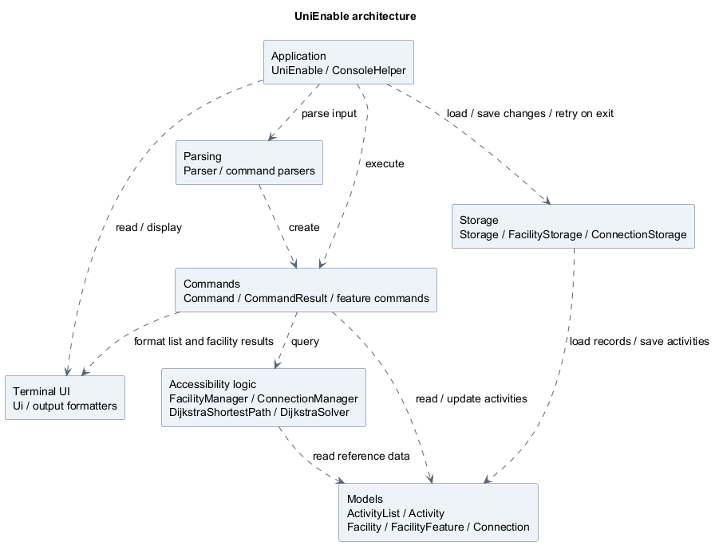

[Open the full-size architecture diagram](images/luke/architecture/ArchitectureDiagram.png).
Source: [ArchitectureDiagram.puml](diagrams/luke/architecture/ArchitectureDiagram.puml).

<!-- @@author -->

`UniEnable` restores activities; `ConsoleHelper` loads facilities before connections
and creates the managers and parser. `Ui` reads input, `Parser` creates a command,
and the command queries or updates a model or manager. Its `CommandResult` carries
a message, an exit flag and an activity-change flag. `ConsoleHelper` saves only
when activities changed, then displays the message; the exit flag ends the loop.

<!-- @@author lukelouyu -->

`UniEnable.main()` writes console output as UTF-8 so activity names
display correctly. Injected `UniEnable.run()` sessions use the caller's output stream.

<a id="ascii-command-name-validation"></a>

`Parser` requires ASCII command words. Names supplied to add and edit must use
printable ASCII (0x20 through 0x7E) and contain a non-whitespace character.
Parsers retain their blank-name, pipe, and line-break checks; the shared
`ActivityNameValidator` also rejects Unicode-only whitespace as empty and rejects
non-ASCII and non-printable characters before constructing a command. Invalid
names produce `[WARNING] Please write the activity name in English (ASCII characters only).`
The entire add or edit is rejected without changing model state or saved bytes.
Storage does not apply this input restriction: historical Unicode names still
load, display, and match find keywords in UTF-8. Edits omitting `n/` preserve them.

<!-- @@author -->
<!-- @@author lukelouyu -->

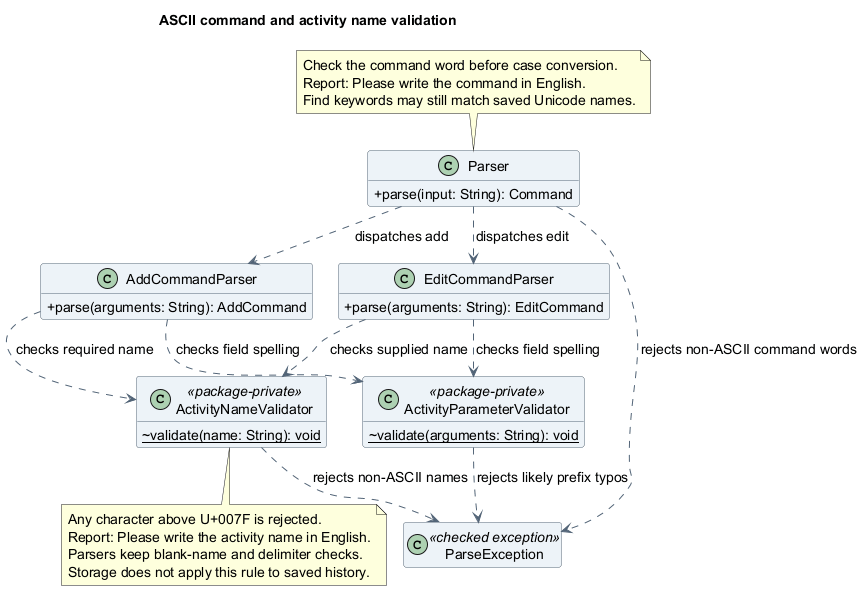

Source: [ActivityNameValidatorClassDiagram.puml](diagrams/luke/class/ActivityNameValidatorClassDiagram.puml).

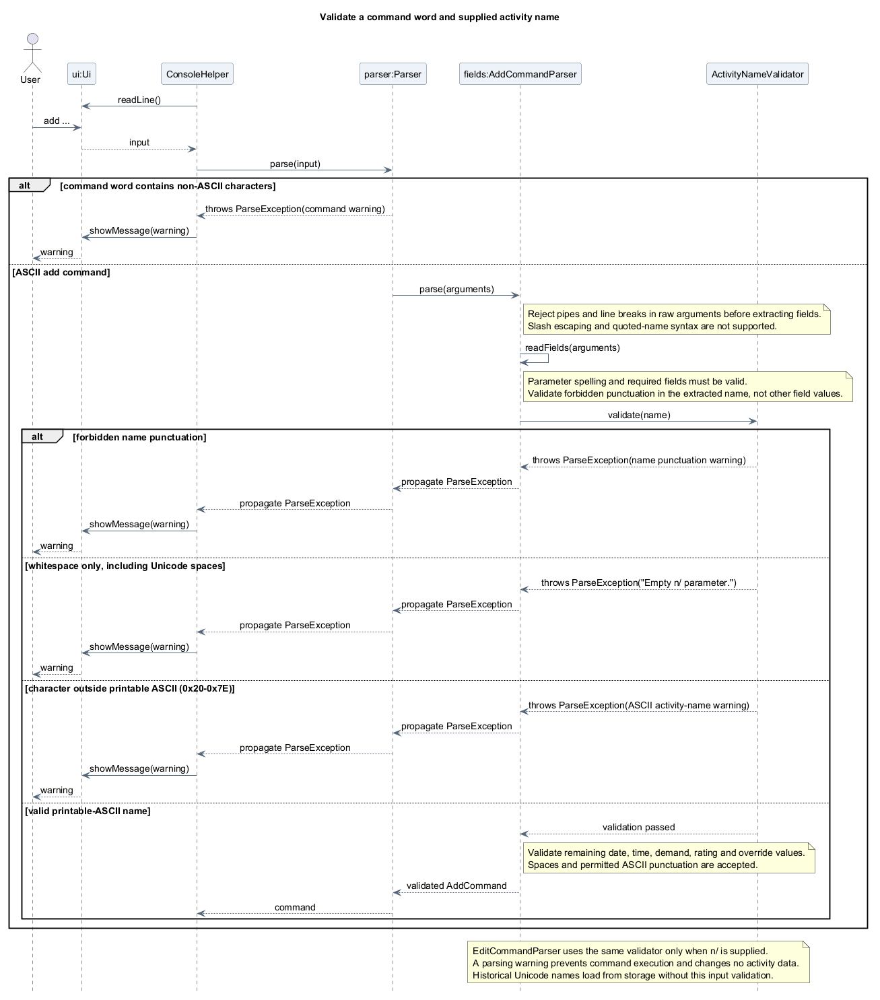

Source: [ActivityNameValidationSequence.puml](diagrams/luke/sequence/ActivityNameValidationSequence.puml).

<!-- @@author -->

Read-only commands leave the activity-change flag unset.

| Area | Main classes and responsibilities |
| --- | --- |
| Startup and console loop | `UniEnable` runs until `bye` or end of input. `ConsoleHelper` loads reference data, creates the parser, executes commands and saves changes. |
| User interface | `Ui` reads and displays text. `ActivityListFormatter`, `FacilityOutputFormatter` and `FacilityDetailsFormatter` build messages; `RouteCommand` and `ViewCommand` format their own results. |
| Parsing | `Parser` dispatches to `AddCommandParser`, `EditCommandParser`, `ListDeleteCommandParser`, `MarkCommandParser`, `FacilityCommandParser` or `RouteParser`. It checks `find`, `overdue`, `next`, `view` and `help` directly. A shared injected `Clock` makes time checks repeatable. |
| Command execution | Subclasses implement `Command.execute(ActivityList, Storage)` and return a `CommandResult`; both shared types live in `command.common`, alongside `HelpCommand` and `ByeCommand`. |
| Calendar dashboards and help | `ViewCommand` groups activities by date and displays completion, ratings, priority scores, and demand. `HelpCommand` provides a categorized menu and detailed pages for `help TOPIC`. |
| Activity model | `Activity` stores details, completion and ratings and calculates priority. `ActivityList` owns the collection, supplies filtered and ordered views, and resolves displayed indexes against chronological order. |
| Accessibility logic | `FacilityManager` handles facility queries. `ConnectionManager` delegates routes to `DijkstraShortestPath`, with a fresh `DijkstraSolver` per search. |
| Reference models | Immutable `Facility` and `FacilityFeature` objects describe hubs. Immutable `Connection` objects hold endpoints, distance, statuses, traversal type, barriers and notes. |
| Storage | `Storage` loads six- or nine-field activity rows and saves nine-field rows, with recovery backups when needed. `FacilityStorage` and `ConnectionStorage` load bundled reference records and return records plus warnings in `LoadResult<T>`. |
| Exceptions | `UniEnableException` is the checked error contract for recoverable failures. `ParseException` reports invalid commands, while `InvalidIndexException` reports indexes outside the current activity view. |

Recoverable failures use `UniEnableException`; the console displays the problem
and accepts another command. Failed facility loading leaves activity commands,
help and exit available. Failed connection loading disables routes but keeps
facility queries available. Activity-load warnings and failures appear at startup;
a fatal read failure starts an empty list with `Storage` recovery protection.

Luke maintains the architecture source and image together in
`docs/diagrams/luke/architecture` and `docs/images/luke/architecture`.
Regenerate the PNG after changing components or dependencies using the
[diagram regeneration instructions](diagrams/README.md#regenerating-images).

<!-- @@author lukelouyu -->

#### Source packages

Java packages beneath `seedu.unienable` follow the source folders below.
The test tree mirrors these packages under `src/test/java/seedu/unienable`.

| Package | Contents and source location |
| --- | --- |
| `command.common` | [`Command`, `CommandResult`, `HelpCommand` and `ByeCommand`](https://github.com/lukelouyu/tp/tree/master/src/main/java/seedu/unienable/command/common). |
| `command.activity` | [Activity commands](https://github.com/lukelouyu/tp/tree/master/src/main/java/seedu/unienable/command/activity), including `ViewCommand`. |
| `command.accessibility.facility` | [Facility list, lookup, and feature-search commands](https://github.com/lukelouyu/tp/tree/master/src/main/java/seedu/unienable/command/accessibility/facility). |
| `command.accessibility.connection` | [`RouteCommand`](https://github.com/lukelouyu/tp/blob/master/src/main/java/seedu/unienable/command/accessibility/connection/RouteCommand.java). |
| `command.accessibility.connection.logic` | [`ConnectionManager`, `FacilityManager`, `DijkstraShortestPath`, and `DijkstraSolver`](https://github.com/lukelouyu/tp/tree/master/src/main/java/seedu/unienable/command/accessibility/connection/logic). |

The routing solver is package-private. The architecture diagram shows logical
components; the table above gives their Java package locations.

<!-- @@author -->

<!-- END TEAM -->

<!-- BEGIN OWNER: Atharva Rege (@Atharva005). Maintain activity creation, calendar views and help here. -->

<!-- @@author Atharva005 -->

### Activity creation, calendar views and help

This section covers activity creation, calendar dashboards, and built-in help.
See [Optional ratings integration](#optional-ratings-integration) for the rating fields.

#### Adding activities

`Parser` delegates the arguments after `add` to `AddCommandParser`. The parser
uses the injected `Clock` to validate a real date and strict `HH:mm` times, a
non-blank name, supported prefixes, and optional demand and ratings. Demand
defaults to `MEDIUM`; each omitted rating remains `null`. The same-day end must
follow the start and the current local time. Historical activities cannot be added;
there is no override. Invalid input produces a
`ParseException` without adding an activity.

`AddCommandParser` checks supplied names through `ActivityNameValidator`.
Both add and edit parsers use `ActivityParameterValidator` to reject one-edit
misspellings of multi-letter fields, including adjacent swaps, before parsing
values. See [Activity parameter validation](#activity-parameter-validation).
`AddCommand` checks the proposed activity with the shared
[schedule validator](#activity-schedule-validation) before inserting it. The
add diagrams include both checks and the rejection path without a save.

`AddCommand` creates an initially incomplete `Activity` and appends it through
`ActivityList.addActivity()`. Its result sets the activity-change flag, so the
console saves the list before displaying the confirmation. See the
[user examples](UserGuide.md#adding-an-activity-add).

<!-- @@author -->
<!-- @@author lukelouyu -->

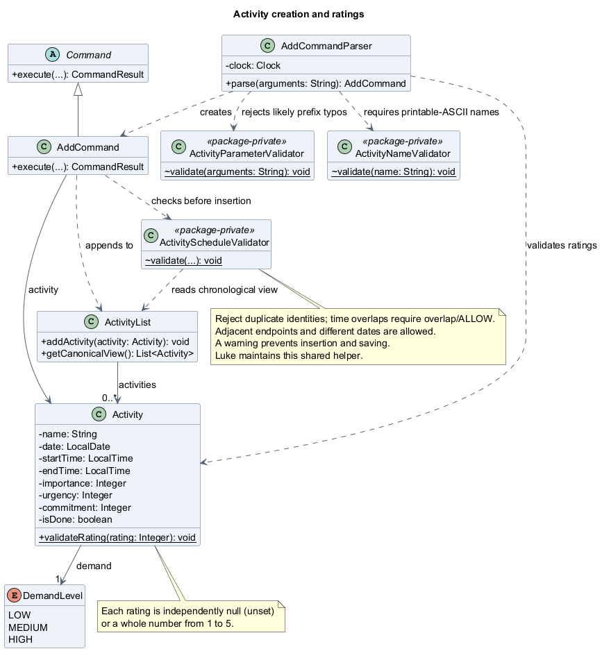

Source: [ActivityCreationClassDiagram.puml](diagrams/luke/class/ActivityCreationClassDiagram.puml).

<!-- @@author -->
<!-- @@author Atharva005 -->

Optional ratings are described in [Optional ratings integration](#optional-ratings-integration);
saving follows the [shared persistence flow](#completion-and-persistence).

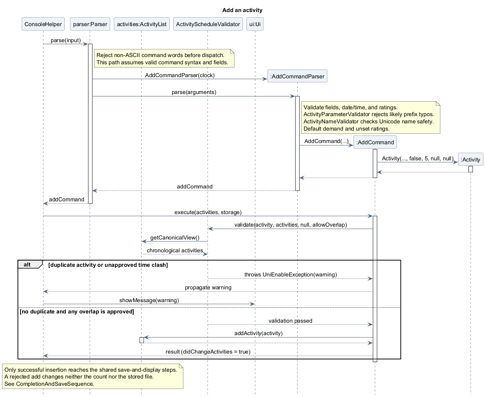

Source: [AddActivitySequence.puml](diagrams/atharva/sequence/AddActivitySequence.puml).

#### Calendar dashboards

`Parser` accepts exactly `view today`, `view tomorrow`, or `view week`, ignoring
letter case, and creates `ViewCommand` with a `Range` and the session's `Clock`.
At execution, `LocalDate.now(clock)` determines the date once:

| Range | Inclusive start | Inclusive end |
| --- | --- | --- |
| `TODAY` | Today | Today |
| `TOMORROW` | Today plus one day | Today plus one day |
| `WEEK` | Today | Today plus six days |

`ActivityList.getViewBetween(start, end)` filters the canonical chronological view
by date, retaining completed activities. A seven-day view crosses month and year
boundaries naturally and does not use the Monday boundary of `overdue` labels.
`ViewCommand` groups the results by day and returns a read-only `CommandResult`;
it never requests a save or exit.

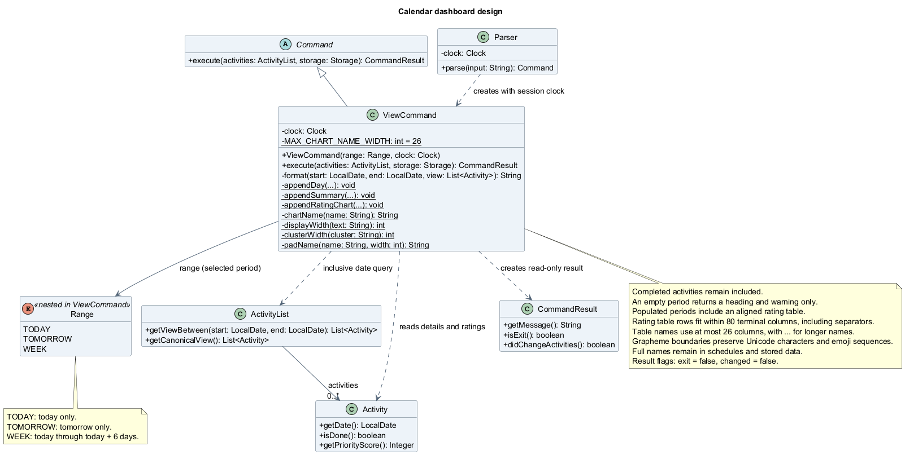

Source: [CalendarViewClassDiagram.puml](diagrams/atharva/class/CalendarViewClassDiagram.puml).

For a populated period, the formatter appends:

- Daily schedules, completion and high-demand counts, rating totals, and demand distribution.
- A rating table with aligned columns and a divider. Names use at most 26
  terminal columns, including a trailing `...` when shortened; every table row fits
  within 80 terminal columns. Truncation keeps grapheme clusters intact. Full names remain in schedules and storage.
- Rating marks `*`, `!`, and `+`; unset ratings display `-`, and unavailable
  priority displays `N`. Recorded ratings contribute to totals even if others are unset.

An empty period shows only its heading and warning. Empty days within a populated
week show a plain no-activities message. Dashboard row numbers are local to the
selected period; indexed changes use the full chronological list.

See the [User Guide](UserGuide.md#viewing-calendar-dashboards-view) for an example.

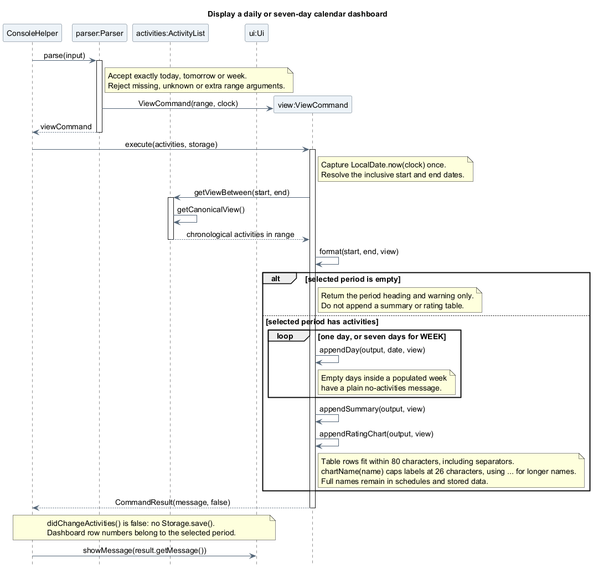

Source: [CalendarViewSequence.puml](diagrams/atharva/sequence/CalendarViewSequence.puml).

#### Categorized and topic help

`HelpCommand` lives in `command.common`. Its default constructor selects a menu
with five categories: activity management, planning and priorities, completion
and deletion, facilities and routes, and help and exit. A static `TOPIC_HELP` map
keeps detailed usage, rules, and examples beside each supported topic.

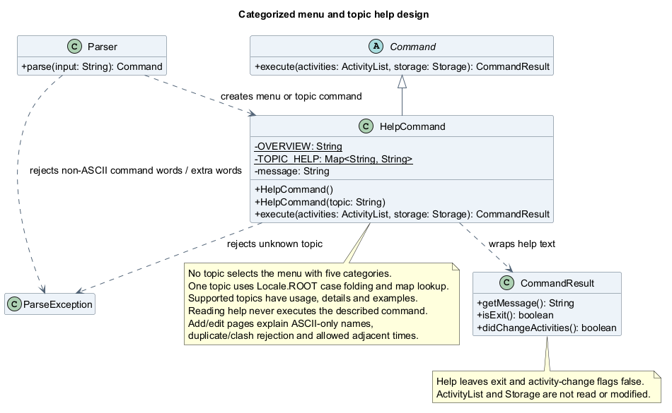

Source: [TopicHelpClassDiagram.puml](diagrams/atharva/class/TopicHelpClassDiagram.puml).

`Parser` accepts zero or one topic word after `help`. For one word,
`HelpCommand(String topic)` normalizes it with `Locale.ROOT`, looks it up, and
adds a prompt to return to the menu. Unknown topics and extra words produce a
`ParseException` with a warning and `Usage: help [TOPIC]`.

The 14 supported topics are `add`, `edit`, `find`, `list`, `view`,
`overdue`, `next`, `mark`, `unmark`, `delete`, `facility`, `route`, `help`,
and `bye`. `help list` includes the demand and priority variants; `help facility`
includes feature search. The topic never executes the command it describes:
`help delete` does not delete and `help bye` does not exit. Help remains available
without facility or connection data and leaves both result flags unset.

The sequence below illustrates `help view`.

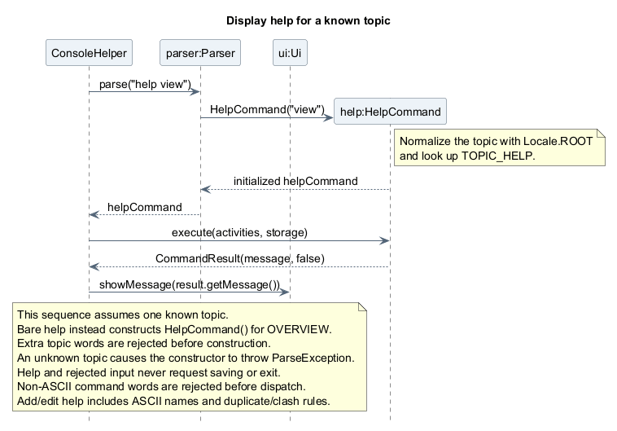

Source: [TopicHelpSequence.puml](diagrams/atharva/sequence/TopicHelpSequence.puml).

<!-- @@author -->

<!-- END OWNER: Atharva Rege (@Atharva005) -->

<!-- BEGIN OWNER: Muhammad Asyraf Bin Abdul Rahim (@officialasyrafrahim). Add listing, deletion, priority, overdue and next documentation here. -->

<!-- @@author officialasyrafrahim -->

### Activity views and deletion

This section covers chronological and demand listing, deletion, priority ordering,
and overdue/next queries, including their displayed-index rules.

#### Chronological listing

`list` selects `ActivityList.getCanonicalView()` and passes the result to
`ActivityListFormatter.formatList()`. The view sorts by date and start time;
ties retain insertion order. It is a separate, unmodifiable snapshot, so listing
does not reorder the backing collection or request a save.

Displayed indexes start at 1 and form the common index contract for delete,
edit, mark, and unmark. An empty view displays `[WARNING] No activities yet.`.

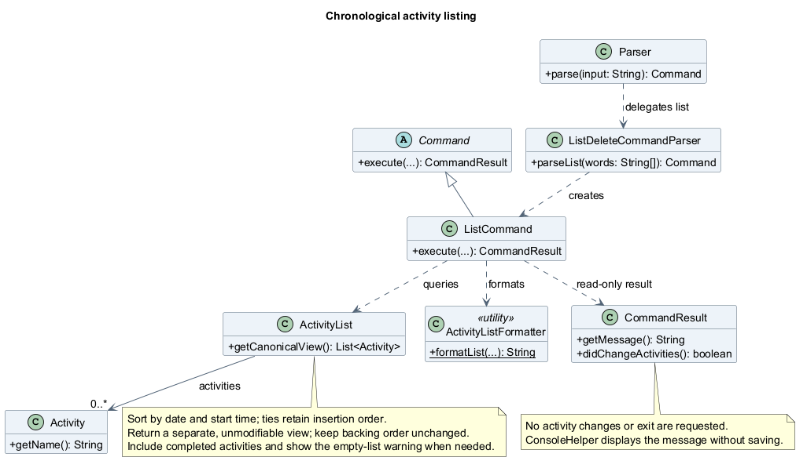

Source: [ListActivityClassDiagram.puml](diagrams/asyraf/class/ListActivityClassDiagram.puml).

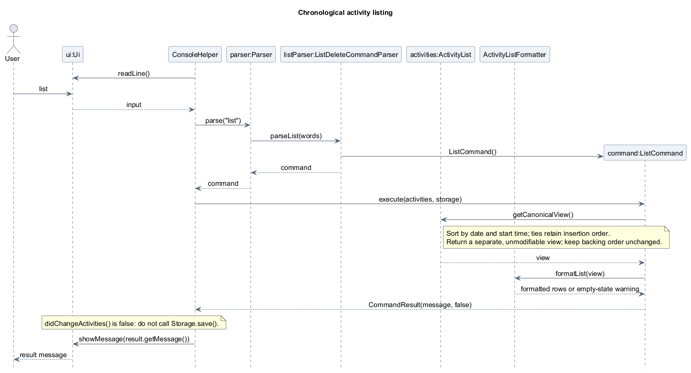

Source: [ListActivitySequence.puml](diagrams/asyraf/sequence/ListActivitySequence.puml).

#### Demand-ordered listing

`list demand` selects `getDemandView()` and passes it with `getCanonicalView()`
to `formatDemandList()`. Demand sorts HIGH, MEDIUM, LOW, with date/start-time
ordering for ties. Completed activities remain included. Listing is read-only.

The formatter uses `chronologicalIndex()` to retain each activity's index from
the full chronological view, just as the priority view does. The notice explains
this shared index contract, so mark, unmark, edit, and delete select the activity
beside the displayed number even when demand sorting changes the row order.

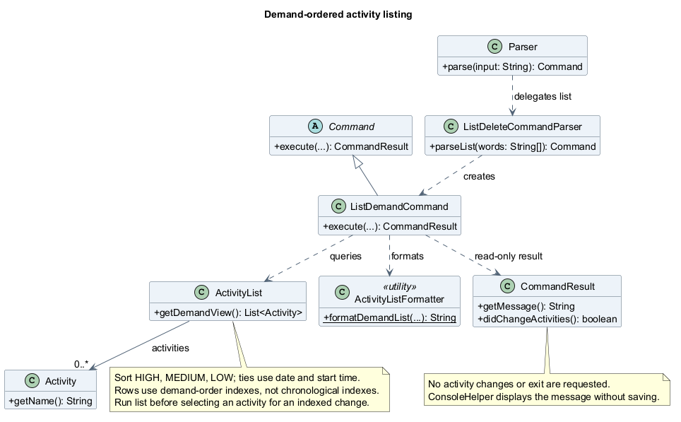

Source: [ListDemandClassDiagram.puml](diagrams/asyraf/class/ListDemandClassDiagram.puml).

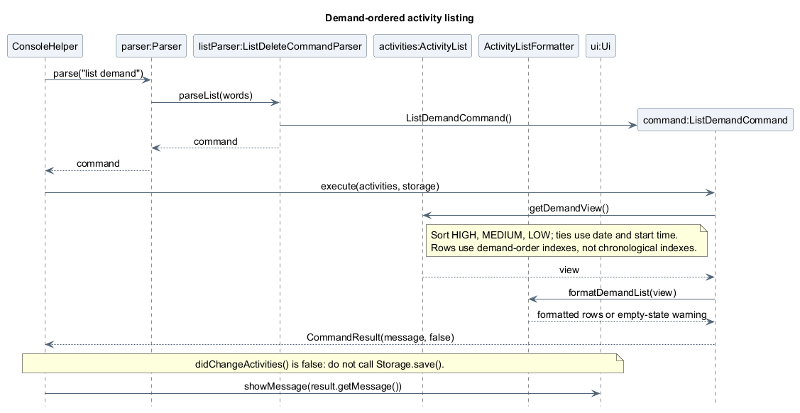

Source: [ListDemandSequence.puml](diagrams/asyraf/sequence/ListDemandSequence.puml).

#### Activity deletion

`ListDeleteCommandParser.parseDelete()` accepts one unsigned ASCII integer that
fits in `int`. `ActivityList.deleteByDisplayedIndex()` then checks the index against
the full chronological view. Zero, an empty list, and out-of-range indexes raise
`InvalidIndexException` without changing activities.

The model selects the chronological activity object and removes that object from
the backing list. `DeleteCommand` returns its details and the remaining count,
with the activity-change flag set. The last deletion uses
`There is no activity recorded` and still requests saving the now-empty list.
`ConsoleHelper` saves before displaying the confirmation.

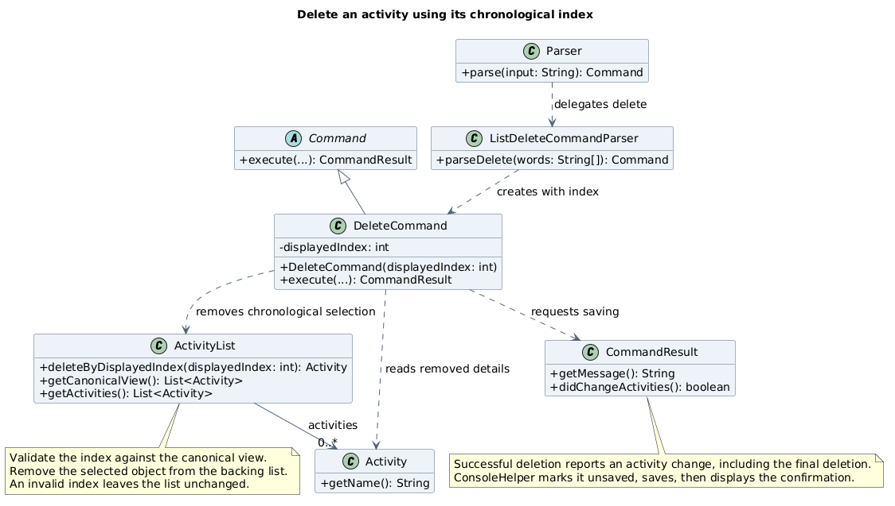

Source: [DeleteActivityClassDiagram.puml](diagrams/asyraf/class/DeleteActivityClassDiagram.puml).

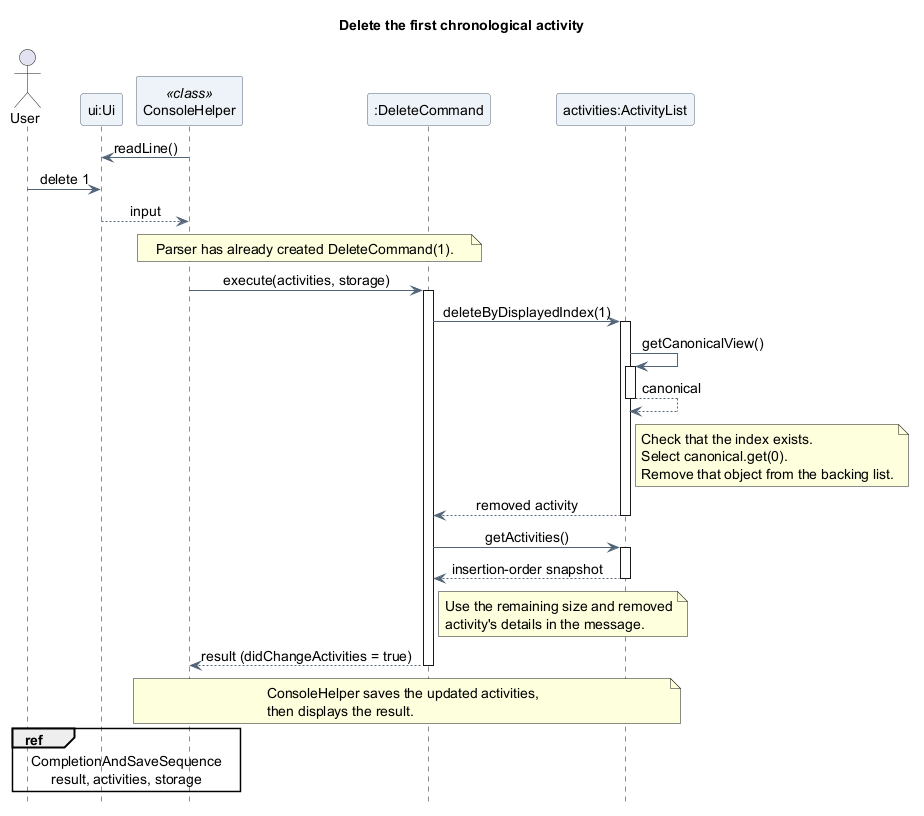

Source: [DeleteActivitySequence.puml](diagrams/asyraf/sequence/DeleteActivitySequence.puml).

#### Priority listing

`list priority` includes every activity, including completed ones. The command
obtains both `getCanonicalView()` and `getPriorityView()`; the formatter uses the
full chronological view for indexes, so sorted results do not renumber activities.

`Activity.getPriorityScore()` calculates:

```text
URG * URG * (IMP + COM)
```

Squaring urgency gives it greater weight; importance and commitment contribute
equally. Ratings are user-assigned and do not increase automatically with time.

The score is available only when all three ratings are set, ranges from 2 to 250,
and is independent of demand and completion. Missing ratings display `-` and
unavailable scores display `NA`. Available scores sort first, highest to lowest;
ties use date, start time, then insertion order.

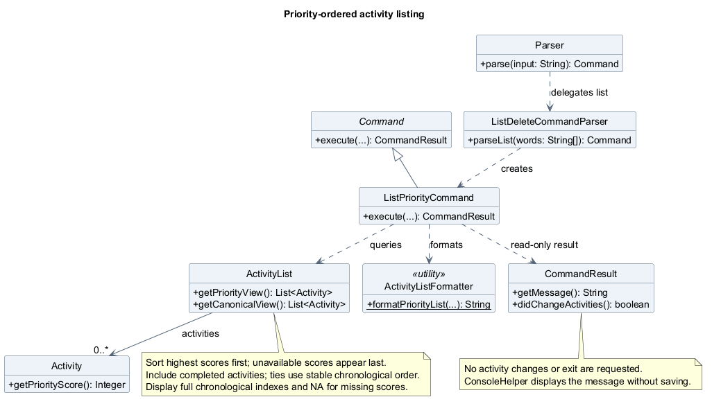

Source: [ListPriorityClassDiagram.puml](diagrams/asyraf/class/ListPriorityClassDiagram.puml).

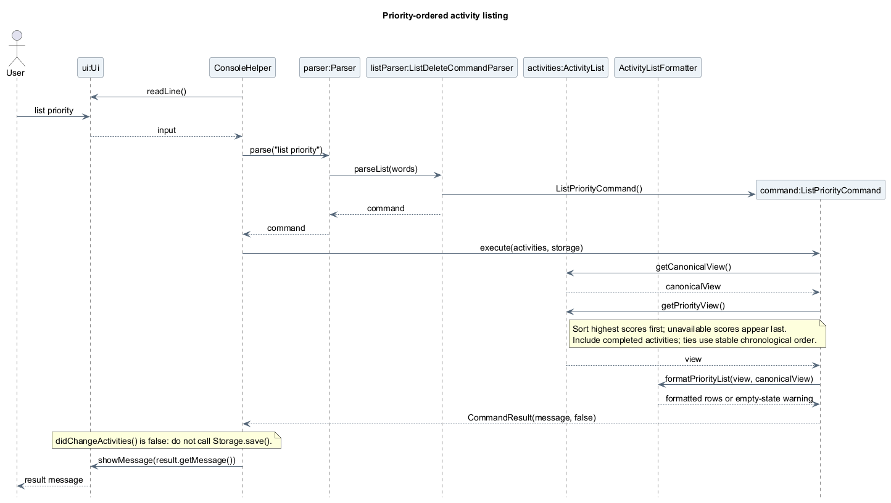

Source: [ListPrioritySequence.puml](diagrams/asyraf/sequence/ListPrioritySequence.puml).

#### Overdue activities

`overdue` captures `LocalDateTime.now(clock)` once and selects incomplete
activities whose end is strictly before that instant. Ongoing activities and
activities ending exactly now are excluded. Results retain chronological order and full-list indexes.

`formatOverdueList()` uses the same captured time to label activities as today,
earlier in the current Monday-to-Sunday week, or earlier. An empty result displays
`[WARNING] No overdue activities.`. The query changes no completion state or file.

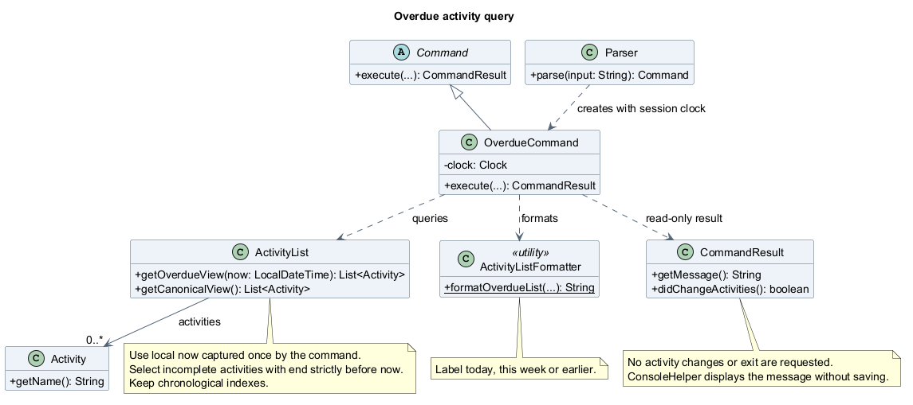

Source: [OverdueActivityClassDiagram.puml](diagrams/asyraf/class/OverdueActivityClassDiagram.puml).

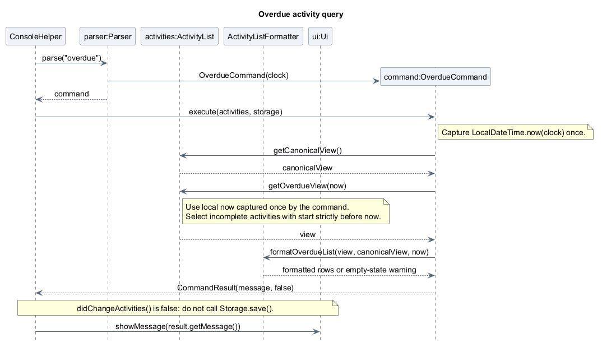

Source: [OverdueActivitySequence.puml](diagrams/asyraf/sequence/OverdueActivitySequence.puml).

#### Next activity

`next` captures the session's local time once and calls `getNext(now)`. The model
selects the earliest incomplete activity whose start is strictly after now;
equal starts retain insertion order. Completed activities and starts exactly now
are excluded.

`formatNext()` receives the full chronological view to keep the selected index.
An empty `Optional` produces `[WARNING] No upcoming incomplete activities.`.
This command does not mark, reschedule, or save an activity.

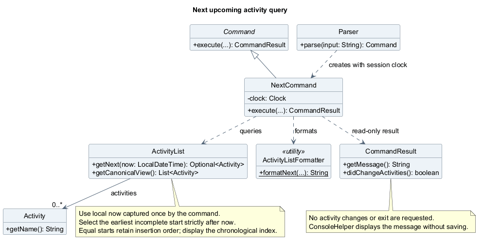

Source: [NextActivityClassDiagram.puml](diagrams/asyraf/class/NextActivityClassDiagram.puml).

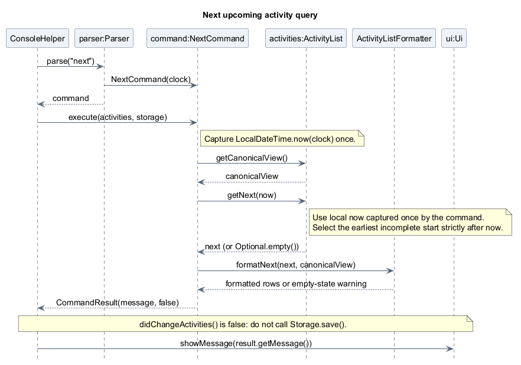

Source: [NextActivitySequence.puml](diagrams/asyraf/sequence/NextActivitySequence.puml).

List and time-query parsers reject unsupported variants and extra arguments.
An injected `Clock` makes time boundaries deterministic.

<!-- @@author -->

<!-- END OWNER: Muhammad Asyraf Bin Abdul Rahim (@officialasyrafrahim) -->

<!-- BEGIN OWNER: Oliver (@Oliver-koh). Maintain completion, storage/recovery, editing and search here. -->

<!-- @@author Oliver-koh -->

### Completion, storage, editing and search

Activity editing, name search, completion changes, and persistence use the same
chronological index contract as `list`.

#### Editing activities

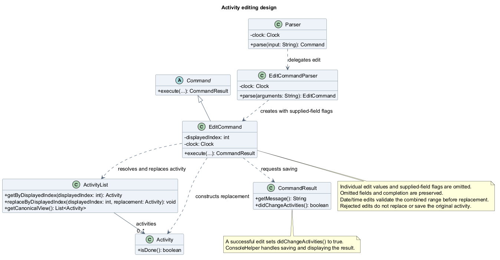

Source: [EditActivityClassDiagram.puml](diagrams/oliver/class/EditActivityClassDiagram.puml).

`EditCommandParser` groups supplied replacements in the immutable `EditCommand.Fields`
record; a null component means omitted. `EditCommand` resolves the
index, combines old and new values, and validates the replacement before calling
`ActivityList.replaceByDisplayedIndex()`. Omitted fields and completion state stay
unchanged. Before combining fields, execution captures the injected clock once
and rejects every edit when the existing activity ends at or before that time.
This includes metadata-only edits and attempts to reschedule historical activities
into the future. Date/time replacements must also end strictly after that captured
time. Rejected edits leave the activity and saved bytes intact. Historical records
remain loadable, listable, and searchable; this restriction applies to Add/Edit.

The edit diagrams show `ActivityNameValidator` checking a supplied name
and `ActivityScheduleValidator` checking name/schedule changes before replacement.
The original activity is excluded from the conflict search. Duplicate or clash
warnings preserve the entire record and do not request a save; demand/rating-only
edits skip schedule validation.

**Design choice:** Validate a replacement before changing the list so edits are
atomic. Callers must obtain a fresh view after an edit.

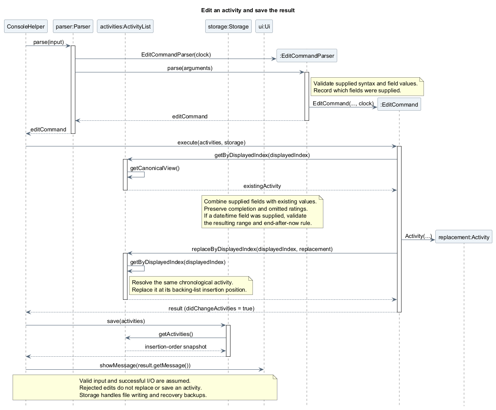

Source: [EditActivitySequence.puml](diagrams/oliver/sequence/EditActivitySequence.puml).

#### Name search

`FindCommand` uses case-insensitive literal substring matching through
`ActivityList.findByName()`. Results retain full chronological indexes and do not
request a save.

The class diagram separates keyword validation, name matching, and formatting.
The formatter receives both the matches and the full chronological view so it
can display the indexes used by activity-changing commands.

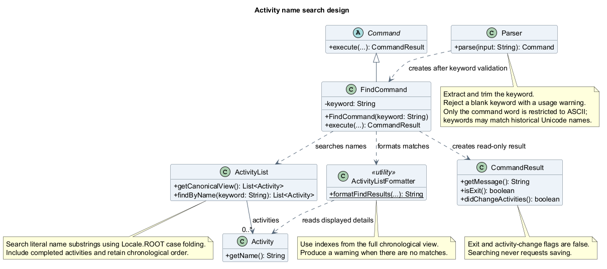

Source: [FindActivityClassDiagram.puml](diagrams/oliver/class/FindActivityClassDiagram.puml).

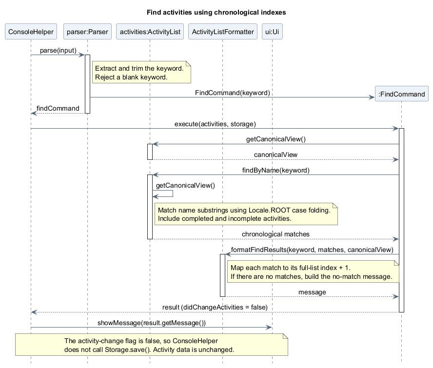

Source: [FindActivitySequence.puml](diagrams/oliver/sequence/FindActivitySequence.puml).

The activity-change flag stays unset, so the console displays the result without saving.

#### Marking activities

`MarkCommand` resolves the chronological index and calls
`ActivityList.setDoneAtDisplayedIndex(index, true)`. Other fields are preserved.
The result requests saving only when completion changes; repeated requests warn
without saving. Invalid indexes raise a recoverable warning.

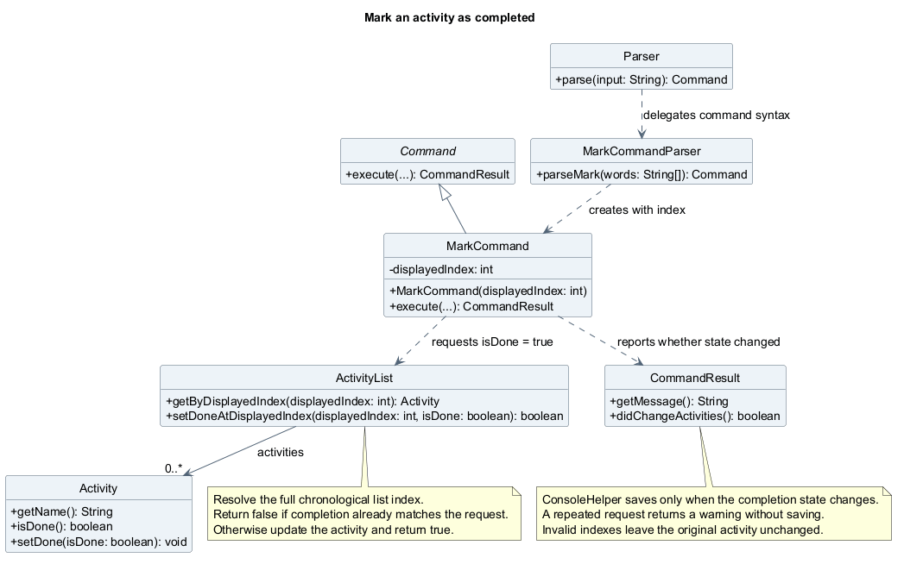

Source: [MarkActivityClassDiagram.puml](diagrams/oliver/class/MarkActivityClassDiagram.puml).

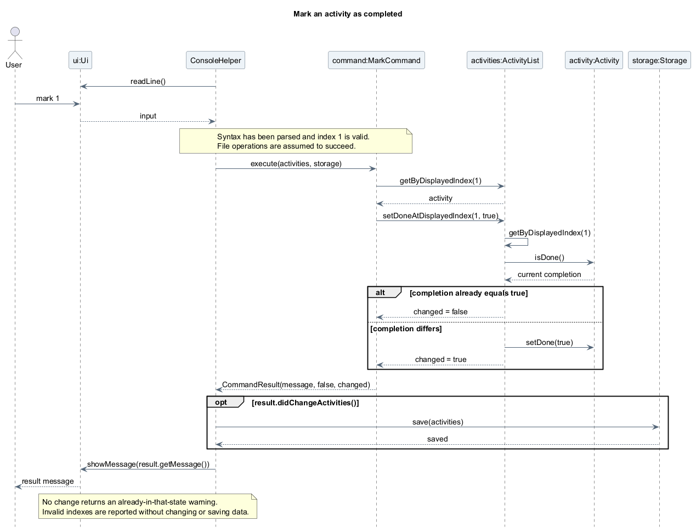

Source: [MarkActivitySequence.puml](diagrams/oliver/sequence/MarkActivitySequence.puml).

#### Unmarking activities

`UnmarkCommand` uses the same index contract and calls
`ActivityList.setDoneAtDisplayedIndex(index, false)`. It preserves other fields
and requests saving only when completion changes. Invalid indexes and repeated
requests produce recoverable warnings.

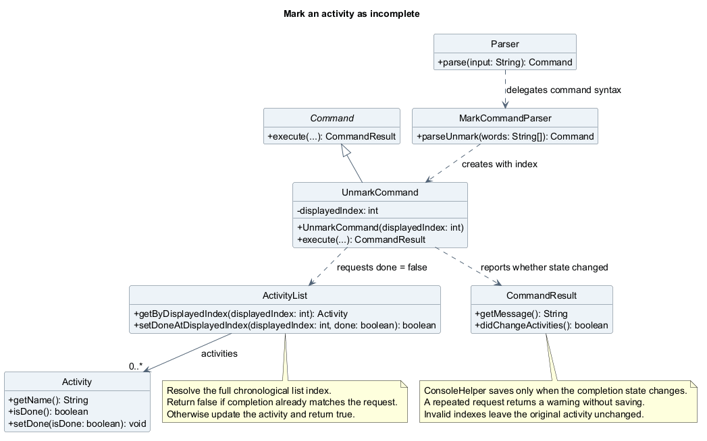

Source: [UnmarkActivityClassDiagram.puml](diagrams/oliver/class/UnmarkActivityClassDiagram.puml).

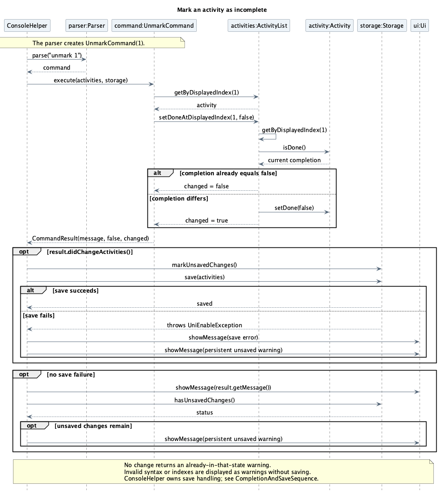

Source: [UnmarkActivitySequence.puml](diagrams/oliver/sequence/UnmarkActivitySequence.puml).

#### Completion and persistence

`MarkCommand` and `UnmarkCommand` use the same canonical indexes as `list`;
they request persistence only when completion actually changes. The class diagram
focuses on the result flag that controls saving and on the storage recovery state.

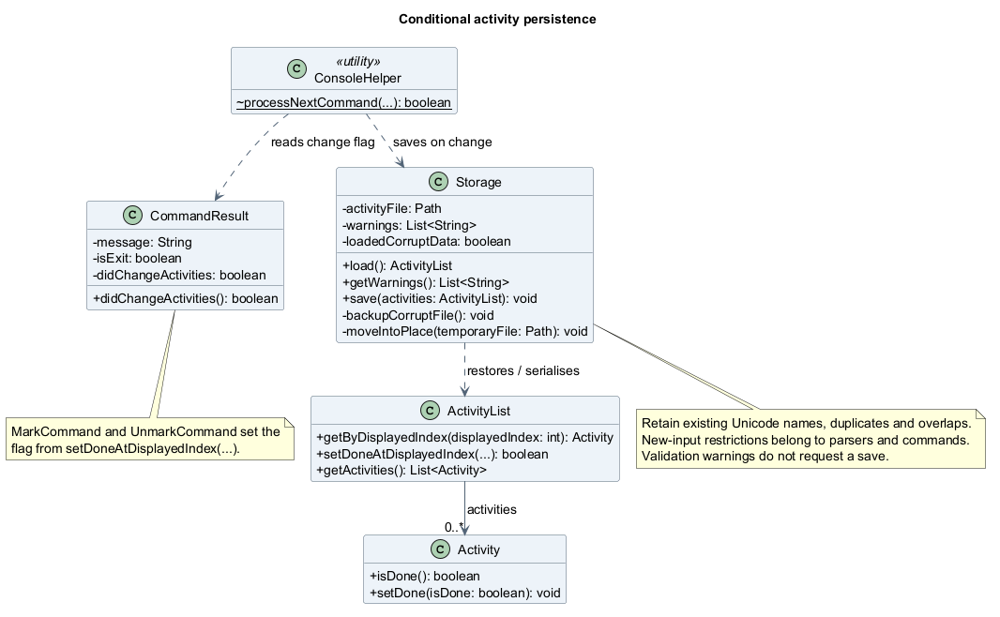

Source: [ActivityPersistenceClassDiagram.puml](diagrams/oliver/class/ActivityPersistenceClassDiagram.puml).

`Storage` reads UTF-8 rows in insertion order. The current format is:

```text
NAME|DATE|START|END|DEMAND|DONE|IMP|URG|COM
```

`DONE` is `true` or `false`; an unset rating is `-`. Legacy six-field rows
omit the ratings and load with those values unset. Saves always write nine fields.
Malformed rows, including an end time at or before the start, produce
line-numbered warnings. Valid historical activities remain loadable.
Before a save following corruption
or a read failure, storage preserves and verifies the original bytes in
`activities.txt.corrupt.bak`; a failed backup prevents replacement of the original.
Loading alone does not rewrite the file. See [recovery](UserGuide.md#error-handling).

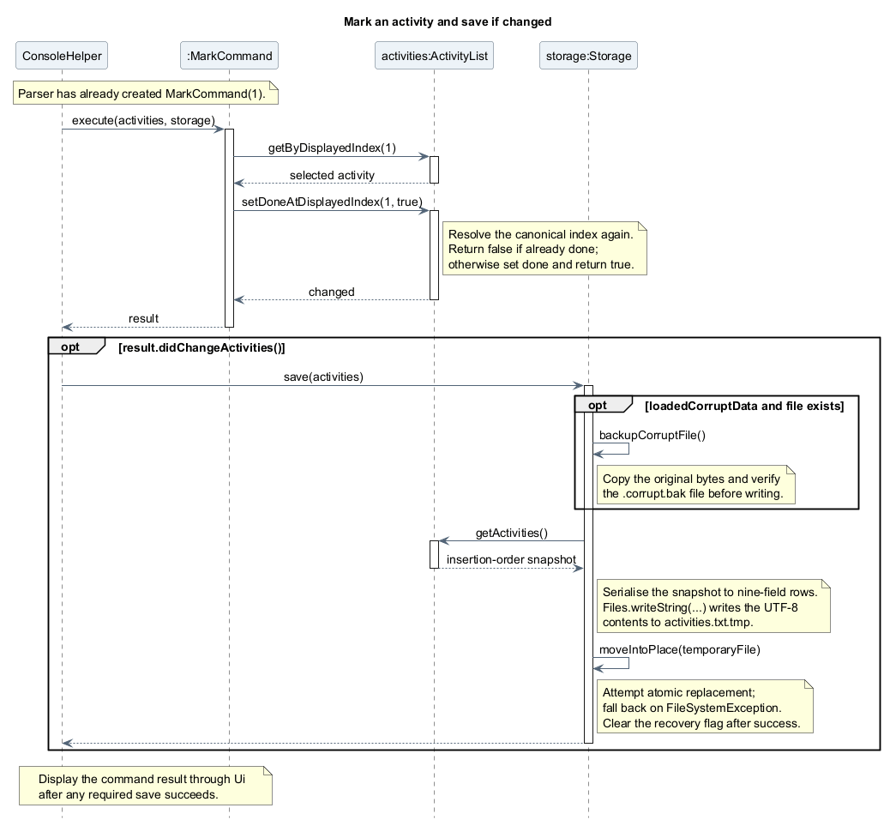

Source: [CompletionAndSaveSequence.puml](diagrams/oliver/sequence/CompletionAndSaveSequence.puml).

**Automatic saves:** `ConsoleHelper` saves when the command's activity-change flag
is set, then displays the result. Other callers must honour that flag themselves.
Saving follows the in-memory change, so a failed write leaves unsaved data in memory.

**Save recovery:** Storage tracks unsaved changes until saving succeeds. Failed
saves keep a warning visible. When a command requests exit and storage is dirty,
`ConsoleHelper` retries saving the current list before displaying the goodbye
message. A failed retry preserves dirty state and keeps the console running.
Read-only commands do not retry writes, and a clean exit performs no extra write.

<!-- @@author -->

<!-- END OWNER: Oliver (@Oliver-koh) -->

<!-- BEGIN OWNER: Lou Yu Luke (@lukelouyu). Maintain optional add ratings, facilities, routes and exit documentation here. -->

<!-- @@author lukelouyu -->

<a id="luke-ratings-and-accessibility"></a>

### Ratings and accessibility

This section covers optional add ratings, shared activity schedule validation, facility reference data and queries,
accessible route search, and the exit command.
These features use the shared activity models and command/result flow.

#### Optional ratings integration

`add` accepts optional `imp/`, `urg/`, and `com/` ratings.
`AddCommandParser` parses each rating independently into a nullable `Integer`;
omitting a field leaves it unset. `Activity.validateRating()` accepts `null` or
an integer from 1 to 5, so add, edit and storage use the same validation rule.
The add sequence passes supplied `importance`, `urgency`, and `commitment`
values unchanged; omitted ratings remain `null`.
The class diagram in [Adding activities](#adding-activities) shows
how ratings fit into activity creation. The priority view uses
these ratings; editing and persistence update and preserve them.

#### Activity parameter validation

`ActivityParameterValidator` is a package-private shared parser helper. Add and
edit call `validate(arguments)` before extracting fields, so likely typos cannot
silently become part of an activity name. The helper scans alphanumeric prefix-like tokens,
skips known prefixes, and compares unknown multi-letter tokens with recognised
multi-letter prefixes. One insertion, deletion, substitution, or adjacent swap
produces a `ParseException` suggesting the intended prefix.

For example, `demm/HIGH` and `dem1/HIGH` produce an unknown-parameter warning suggesting `dem/`.
`ConsoleHelper` displays that warning; no add/edit command executes and neither
activities nor saved data changes. Ordinary slash text such as `and/or` and `w/o`
remains valid. Single-letter slash text is excluded from the typo check.
Supplied names prohibit backslashes (`\`), commas (`,`), single quotation marks
(`'`, including apostrophes), and double quotation marks (`"`). Slash (`/`) remains
allowed subject to the prefix grammar; `/\` and `\/` are rejected because they
contain backslashes. There is no decoding, slash escaping, or quoted-name syntax.
Both parsers call `ActivityNameValidator.rejectForbiddenPunctuation()` on raw
arguments before typo detection or field extraction. Direct name validation
repeats this guard. The exact warning is:

```text
[WARNING] Activity names must not contain backslashes (\), commas (,), or quotation marks (' or "). Slash (/) is allowed; /\ and \/ are not.
```

Historical stored names remain loadable. Rejection creates no command and saves
no data. Ordinary slash names such as `and/or` and `w/o` remain valid. Known
prefixes and likely typo tokens such as `dim/sum` or `dem1/HIGH` at field boundaries
remain reserved; users must reword literal name text with spaces or hyphens.

<!-- @@author -->
<!-- @@author lukelouyu -->

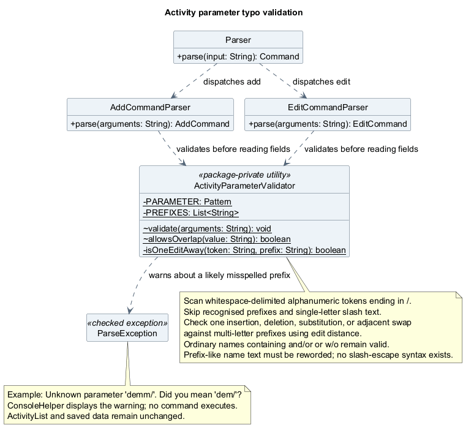

Source: [ActivityParameterValidatorClassDiagram.puml](diagrams/luke/class/ActivityParameterValidatorClassDiagram.puml).

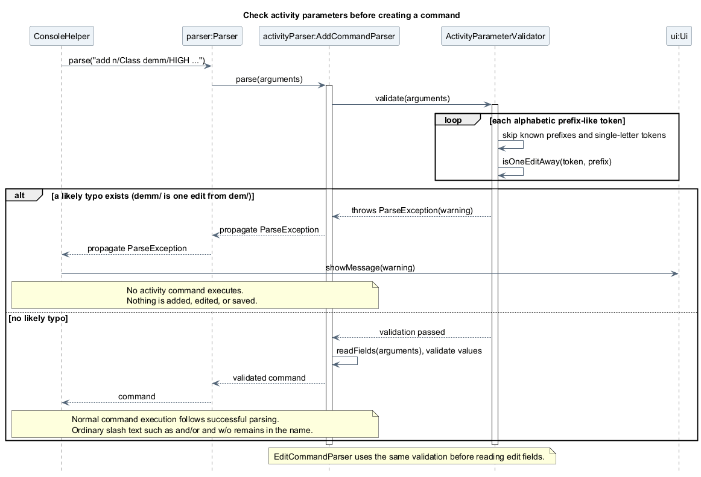

Source: [ActivityParameterValidationSequence.puml](diagrams/luke/sequence/ActivityParameterValidationSequence.puml).

<!-- @@author -->
<!-- @@author lukelouyu -->

#### Activity schedule validation

`ActivityScheduleValidator` is a package-private helper in `command.activity`.
`AddCommand` calls it before insertion; `EditCommand` calls it before replacement
when a name, date, start time, or end time is supplied.

The helper reads `ActivityList.getCanonicalView()` without changing the list.
It checks duplicates first: name equality ignores case and surrounding whitespace,
while date, start and end must match exactly. Demand, ratings and completion do
not change duplicate identity. The overlap override never bypasses this check.
Without `overlap/ALLOW`, it checks positive-duration overlap on the same date:
`candidate.start < existing.end && existing.start < candidate.end`.
Equal endpoints are allowed, and completed activities participate in both checks.

An edit passes the original activity reference so only that record is excluded.
Warnings identify the conflicting chronological index and activity. A checked
`UniEnableException` stops the command before mutation or a save request, preserving
counts, fields, saved bytes and modification times. Demand/rating-only edits do
not create a new schedule and skip this check. Add/edit parsers accept
`overlap/ALLOW` as explicit permission for an intentional time overlap; the
flag is not persisted and must be supplied again for a conflicting schedule edit.
Saved duplicates and overlaps remain loadable; the validator preserves historical data.

<!-- @@author -->
<!-- @@author Atharva005 -->


Source: [ActivityScheduleValidatorClassDiagram.puml](diagrams/atharva/class/ActivityScheduleValidatorClassDiagram.puml).

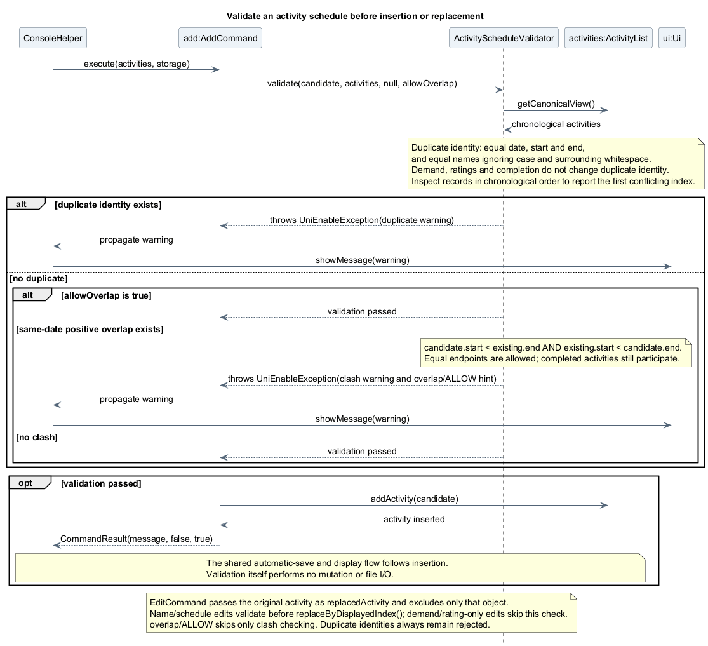

Source: [ActivityScheduleValidationSequence.puml](diagrams/atharva/sequence/ActivityScheduleValidationSequence.puml).

<!-- @@author -->
<!-- @@author lukelouyu -->

#### Facility accessibility data (`facilities.txt`)

The [facility dataset](https://github.com/lukelouyu/tp/blob/master/src/main/resources/facilities.txt) stores nine
facilities: AS1 to AS8 and Central Library (CLB), identified by F01 to F09.
It is bundled with the application and loaded from the classpath, including
when running the packaged JAR.

The facility and connection records were adapted with reference to the
[NUS FASS accessibility map](https://osa.nus.edu.sg/wp-content/uploads/2025/03/250224-FASS-Access-Route-Faculty-Map.pdf),
updated 24 February 2025. UniEnable maintains these text datasets separately;
the source credits are listed in [Acknowledgements](#acknowledgements).

Each pipe-separated facility row has one of two formats:

```text
FACILITY|ID|NAME|DESCRIPTION
FEATURE|FACILITY_ID|TYPE|STATUS|NOTES
```

For `FACILITY`, `NAME` is the short hub code used by `Facility.getName()`, such
as AS1; `DESCRIPTION` supplies the longer building description. The row requires
four fields, although the description may be empty. A `FEATURE` row references
the stable facility ID and records a feature type, a `YES`, `NO`, or `UNKNOWN`
status, and optional notes. The notes field may be omitted or left empty.

##### Facilities covered

IDs F01-F08 refer to AS1-AS8; F09 refers to CLB. An omitted feature is distinct
from an explicit `NO` or `UNKNOWN`. The [dataset](https://github.com/lukelouyu/tp/blob/master/src/main/resources/facilities.txt)
contains the recorded features and notes.

`FacilityStorage` associates features with facilities by exact ID after reading
all rows, so a feature can precede its facility declaration. It constructs
immutable `Facility` objects containing their `FacilityFeature` lists and skips
unknown facility references with warnings. [Facility lookup](#facility-lookup)
explains how commands query these records.

#### Facility lookup

##### Overview

The `facility` commands list reference facilities, show one hub's recorded
features, or search by feature and accessibility status. They read the
[bundled dataset](#facility-accessibility-data-facilitiestxt) without changing
activities or facility records.

##### High-level design

`FacilityStorage` parses the bundled resource into immutable `Facility` and
`FacilityFeature` objects. `FacilityManager` takes a snapshot of the loaded list
and handles queries without file I/O. `LoadResult<Facility>` carries accepted
records and load warnings.

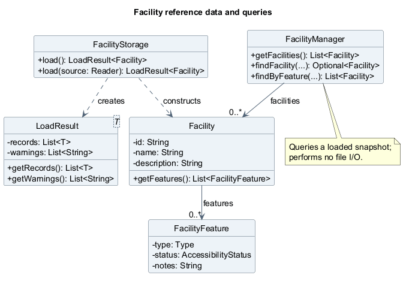

Source: [FacilityClassDiagram.puml](diagrams/luke/class/FacilityClassDiagram.puml).

##### Implementation and sequence diagram

1. At startup, `ConsoleHelper` loads facilities, displays warnings and passes a
   `FacilityManager` to `Parser` and its `FacilityCommandParser`.
2. The feature parser creates `FacilityListCommand`, `FacilityViewCommand`, or
   `FacilityFindCommand`. For searches, `type/` must precede the optional
   `status/`; the omitted status defaults to `YES`.
3. The manager uses `getFacilities()`, `findFacility()` or `findByFeature(type, status)`.
   Lookup checks IDs before names, ignoring case and surrounding spaces. Searches
   match statuses exactly, exclude absent features from `UNKNOWN`, and return each
   matching facility once in dataset order.
4. `FacilityOutputFormatter` builds responses and adds the accessibility disclaimer,
   using `FacilityDetailsFormatter` for details in lists and single-hub lookups.
   The command returns a `CommandResult` with no activity change, so no save occurs.

The sequence shows `facility find type/LIFT status/NO`, which returns AS1 and AS2
in the bundled dataset.


Source: [FacilityLookupSequence.puml](diagrams/luke/sequence/FacilityLookupSequence.puml).

##### Design considerations

Separating the loader from the manager lets query tests supply small lists
without creating files. Defensive copies keep callers from changing the loaded
collection or a facility's feature list. Explicit `YES`, `NO`, and `UNKNOWN`
values preserve the difference between confirmed absence and unconfirmed data;
treating missing features as `UNKNOWN` would lose that distinction.

##### Error handling

The loader skips malformed rows, duplicate IDs/names, unknown facility references
and invalid enums with line-numbered warnings. For conflicting statuses of the
same feature, it keeps the first valid status. Loading matches tags, enums and
facility IDs exactly; command input ignores case.

A missing or unreadable resource raises `UniEnableException` and uses the
fallback described in [Architecture](#architecture). Invalid command filters
raise `ParseException`. An unknown hub produces a warning with supported names;
a valid search with no matches returns `[WARNING] No matching facilities found.`

#### Accessibility route connections (`connections.txt`)

The [connection dataset](https://github.com/lukelouyu/tp/blob/master/src/main/resources/connections.txt) stores ten
bidirectional links between the nine facilities. Hub names form graph vertices;
links form edges weighted by the [Connection model's](https://github.com/lukelouyu/tp/blob/master/src/main/java/seedu/unienable/model/Connection.java)
recorded `distanceInMetres` values.

Each pipe-separated row follows this format:

```text
CONNECTION|ID|FROM|TO|DISTANCE|ACCESSIBILITY|TYPE|SHELTER|KNOWN_BARRIER|NOTES
```

| Column | Field | Meaning and validation |
| --- | --- | --- |
| 1 | `CONNECTION` | Required record tag, matched exactly. |
| 2 | `ID` | Unique connection identifier, parsed as a Java `int`. |
| 3 | `FROM` | One endpoint's facility name, such as AS6; must exactly match a loaded facility name. |
| 4 | `TO` | The other endpoint's facility name; must be known and different from `FROM`. Endpoint order does not restrict travel direction. |
| 5 | `DISTANCE` | Positive integer distance in metres, used as the routing weight. |
| 6 | `ACCESSIBILITY` | `YES`, `NO`, or `UNKNOWN`. Only `YES` connections are eligible for route search. |
| 7 | `TYPE` | Traversal category: `PATH`, `RAMP`, `SHELTERED_RAMP`, `LIFT`, or `OTHER`. |
| 8 | `SHELTER` | Independent `YES`, `NO`, or `UNKNOWN` shelter status; `UNKNOWN` means unconfirmed. |
| 9 | `KNOWN_BARRIER` | Optional description of a recorded barrier. |
| 10 | `NOTES` | Optional additional route information. |

`ConnectionStorage` accepts eight to ten fields. Omitted or empty optional
fields become `null`; to supply notes without a barrier, keep an empty ninth
field. Tags and enum values are case-sensitive when loading.

Example: a bidirectional, 90-metre accessible path between AS6 and AS1:

```text
CONNECTION|3|AS6|AS1|90|YES|PATH|YES||Main covered walkway
```

Shelter and accessibility are independent: an accessible connection may be unsheltered.

At startup, `ConnectionStorage` validates endpoints against facilities already
loaded from `facilities.txt`. [Accessible route search](#accessible-route-search)
explains how the graph is built and how routes are found and displayed.

##### Connectivity graph

This schematic connectivity graph shows the ten recorded connections; it is
not a geographical map.

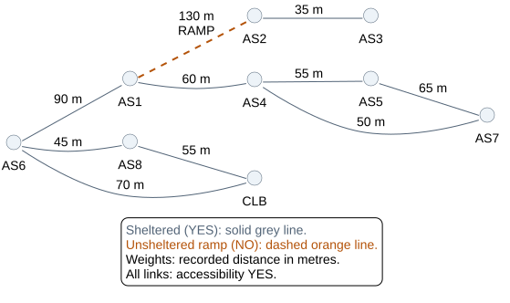

Source: [fass-accessibility-network.puml](diagrams/luke/graph/fass-accessibility-network.puml).
Regenerate its SVG when the source changes.

#### Accessible route search

##### Overview

`route from/START to/END` finds a shortest route by recorded distance between
two hub names. Connections are bidirectional, and only those marked `YES` for
accessibility can be traversed. The result includes ordered stops, segment
details, total metres, and the sample-data disclaimer.

##### High-level design

`ConnectionManager` keeps a connection snapshot and constructs one reusable
`DijkstraShortestPath` graph. Each query creates a fresh package-private
`DijkstraSolver` to track distances and predecessors. The nested
`DijkstraShortestPath.Route` record copies its stop and segment lists to protect
the result from later changes.


Source: [RoutingClassDiagram.puml](diagrams/luke/class/RoutingClassDiagram.puml).

##### Implementation and sequence diagram

1. `ConsoleHelper` loads facilities before connections so
   `ConnectionStorage` can validate endpoint names.
   `DijkstraShortestPath` builds a reusable graph with two directed adjacency
   entries for every accessible bidirectional connection.
2. `RouteParser` creates a `RouteCommand`, which queries `ConnectionManager`.
   Hub names are matched ignoring case; facility IDs are not route endpoints.
3. A fresh `DijkstraSolver` tracks distances and predecessors for each query.
   It uses a priority queue to relax shorter paths and `long` totals to avoid
   overflowing a segment's `int` range.
4. Predecessors reconstruct the stops and segments, or an unreachable destination
   produces `Optional.empty()`. The command formats the route without saving activities.

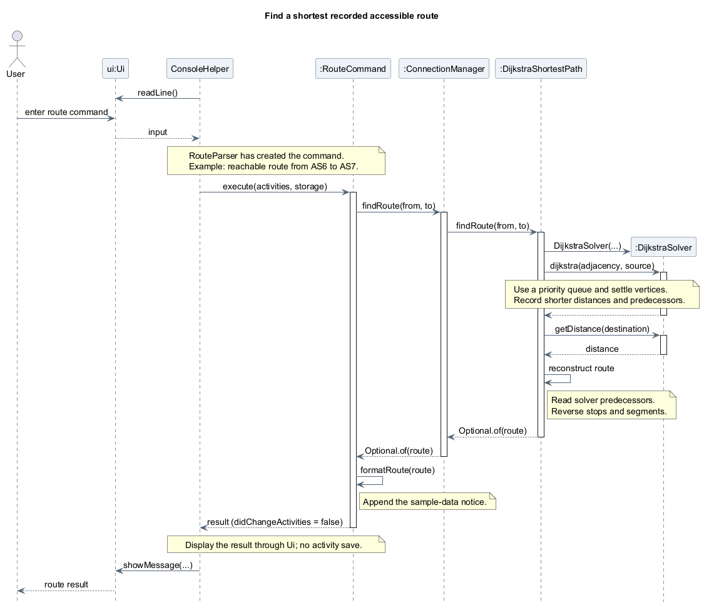

Source: [RouteSearchSequence.puml](diagrams/luke/sequence/RouteSearchSequence.puml).

##### Design considerations

Positive edge weights make Dijkstra suitable for finding the shortest recorded
distance. Reusing the graph avoids rebuilding adjacency lists; a fresh solver
keeps each query's search state independent. Computing paths from connections
also avoids maintaining a separate route for every hub pair.

The cost is distance alone. Shelter, traversal type, and recorded barriers do
not add routing restrictions or preferences, so a selected route may include
an unsheltered section or a narrow passage. The result describes recorded links
and needs checking against current campus conditions and the user's needs.

##### Error handling

The connection loader skips invalid rows with line-numbered warnings, including
unknown endpoints, self-connections, duplicate IDs, non-positive distances, and
invalid enum values. Missing or unreadable data makes route commands unavailable
without disabling successfully loaded facility queries.

`RouteParser` reports malformed prefixes or missing endpoints through
`ParseException`. Unknown or blank graph endpoints raise `IllegalArgumentException`,
which `RouteCommand` converts to a checked `UniEnableException` with usage text.
Known but disconnected endpoints return a `[WARNING] No confirmed accessible route
recorded` message; this describes the local dataset rather than proving that
no accessible route exists on campus.

For the same known hub at both ends, the graph returns a zero-distance route
with one stop and no segments. `RouteCommand` rejects that result with
`[WARNING] Sorry, the source and destination are the same.`

#### Exiting the application

`ByeCommand.execute()` returns `Goodbye from UniEnable!` with the exit flag
set and the activity-change flag unset. `ConsoleHelper` displays the message,
then `UniEnable` stops the console loop. Before displaying the goodbye message,
`ConsoleHelper` retries persistence if `Storage.hasUnsavedChanges()` is true.
It exits only after that retry succeeds. If writing fails, users fix the reported
problem and enter `bye` again. Clean exits do not write the activity file.

<!-- @@author -->

<!-- END OWNER: Lou Yu Luke (@lukelouyu) -->

<!-- TEAM: All members maintain testing guidance and cross-feature validation notes. -->

## Testing and defensive programming

### Automated testing

JUnit Jupiter tests are under `src/test/java/seedu/unienable`. Run `test` for
the test suite, or `check` for tests, Checkstyle, and the configured coverage
checks, using the wrapper commands in [Setting up](#setting-up-and-getting-started).
To focus on one class on Windows, for example:

```text
.\gradlew.bat test --tests "seedu.unienable.parser.AddCommandParserTest"
```

<!-- @@author lukelouyu -->

The same `--tests` filter accepts a full class name or package pattern.

<!-- @@author -->

On macOS or Linux, replace `.\gradlew.bat` with `./gradlew`. Test results are
written to `build/reports/tests/test/index.html`; the JaCoCo HTML report is at
`build/reports/jacoco/test/html/index.html` after `check` or `jacocoTestReport`.

| Area | Representative tests and purpose |
| --- | --- |
| Activity input and commands | Parser tests cover valid and rejected syntax. `EditCommandTest` checks partial changes and atomic rejection; `FindCommandTest` checks name matching and chronological indexes. |
| Calendar dashboards and help | `ViewCommandTest` covers date ranges, counts, empty periods, totals, 80-column rating tables, and read-only results. `HelpCommandTest` covers menus, topics, and invalid requests. |
| Activity lists and time queries | `ListDemandCommandTest`, `ListPriorityCommandTest`, `OverdueCommandTest`, `NextCommandTest`, and `ActivityListFormatterTest` cover chronological indexes, ordering, missing scores, completion, and strict time boundaries. |
| Activity persistence | `StorageTest` covers round trips, legacy data, malformed rows, backups and failed writes. `ConsoleSaveRecoveryTest` covers unsaved warnings, blocked exits, and retry on exit; `UniEnableTest` covers sessions and restarts. |
| Facility reference data | `FacilityStorageTest`, `FacilityManagerTest`, `FacilityCommandParserTest` and facility command tests cover loading, exact status matching, formatting and unavailable data. |
| Routing | `DijkstraSolverTest` and `DijkstraShortestPathTest` check distances, predecessors, route segments, and accessibility filtering. Manager, parser, and command tests cover endpoint errors and disconnected/same-hub routes. |

<!-- @@author lukelouyu -->

`ActivityNameValidatorTest` checks printable-ASCII boundaries, punctuation, and
blank names; add/edit parser tests check the shared policy and specific warnings.
`UniEnableProcessTest` runs isolated JVMs to check ASCII input, historical Unicode
output, conflict rejection, and persisted names across restarts. Rejected adds
must not create a data file, and rejected multi-field edits must preserve saved
bytes and modification times.

<!-- @@author -->

<!-- TEAM: All members maintain validation, assertions, and defensive collection contracts. -->

### Defensive programming

Parsers reject malformed command syntax; commands and models validate resulting
values, displayed-index bounds and rating ranges. Recoverable failures use checked
exceptions. Defensive collection copies protect activity views and reference
data. Assertions check internal ordering and deletion invariants; enable them
as described in the setup section. They support debugging rather than input validation.

<!-- @@author Oliver-koh -->

`Storage` rejects invalid same-day time ranges while retaining valid historical
activities. It distinguishes invalid records from read failures, using backups for
recovery writes and temporary files for saves. Recoverable errors let the console
continue; failed saves may leave unsaved changes in memory, so follow the
[recovery steps](UserGuide.md#error-handling) before exiting.

<!-- @@author -->

<!-- @@author lukelouyu -->

Reference-data failures use the [architecture fallback](#architecture).

<!-- @@author -->

<!-- TEAM: Add and edit validation spans activity-creation and editing responsibilities. -->

Add and edit
[reject blank names, including Unicode whitespace](UserGuide.md#editing-an-activity-edit) with
`[WARNING]` without changing data; loaders retain their handling of
historical names. Parser tests and `UniEnableTest` check validation, unchanged
file bytes and restarts.

<!-- TEAM: All members maintain product scope and the team responsibility table. -->

## Product scope

### Target users and value proposition

UniEnable combines commitment planning and campus reference queries in a
keyboard-operated terminal application, with activities stored locally.

### Current boundaries

The current build supports dated, same-day activities, optional ratings,
chronological, demand, and priority views, overdue and next queries,
today's and tomorrow's dashboards, the next seven days' dashboard,
activity editing and name search, completion, deletion, persistence,
facility queries, and shortest recorded accessible routes.
Reference information covers the nine bundled hubs; it is sample data without
live campus updates.

Recurring activities, alerts, categories, demand-limit warnings, and live campus
updates are not implemented. The [user stories](#user-stories) record feature status.

### Team contributions

Feature responsibility follows the table below. See the [team pages](team/README.md).

| Team member | Feature area | V1.0 work | V2.0 work | Diagram contribution |
| --- | --- | --- | --- | --- |
| [Lou Yu Luke](team/lukelouyu.md) | Ratings, shared validation and accessibility | Exit (`bye`); [facility listing, lookup, and feature search](#facility-lookup). | [Accessible routes](#accessible-route-search); [optional ratings](#optional-ratings-integration); [command/name validation](#ascii-command-name-validation); [duplicate/clash checks](#activity-schedule-validation). | [Activity-creation class diagram, name/parameter validation, facility lookup and routing](diagrams/README.md#luke): five class diagrams and four sequence diagrams. Additional diagrams: [architecture](diagrams/README.md#architecture) and [campus connectivity graph](diagrams/README.md#connectivity-graph). |
| [Atharva Rege](team/atharva005.md) | Activity creation, calendar views and help | [Adding activities](#adding-activities) (`add`) and command help (`help`). | [Calendar dashboards](#calendar-dashboards) (`view today`, `view tomorrow`, `view week`); [topic help](#categorized-and-topic-help) (`help TOPIC`). | [Add sequence, calendar dashboards, topic help, and schedule validation](diagrams/README.md#atharva): seven diagrams (three class/sequence pairs plus the add sequence). |
| [Muhammad Asyraf Bin Abdul Rahim](team/officialasyrafrahim.md) | Activity views and deletion | [Chronological/demand listing and deletion](#activity-views-and-deletion) (`list`, `list demand`, `delete`). | [Priority, overdue, and next views](#activity-views-and-deletion) (`list priority`, `overdue`, `next`). | [Chronological listing, demand listing, deletion, priority, overdue, and next](diagrams/README.md#asyraf): six class/sequence pairs. |
| [Koh Li Wei Oliver](team/oliver-koh.md) | Completion, storage, editing and search | [Persistence and recovery](#completion-and-persistence); completion changes (`mark`, `unmark`). | [Editing](#editing-activities) (`edit`); [name search](#name-search) (`find`); failed-save retry on exit (`bye`). | [Editing, name search, marking, unmarking, and persistence](diagrams/README.md#oliver): five class/sequence pairs. |


<!-- TEAM: All members maintain story status; feature ownership is defined in Team contributions. -->

## User stories

### Core schedule

| ID | Priority | As a/an ... | I can ... | So that ... | Current status |
| --- | --- | --- | --- | --- | --- |
| US01 | Must-Have | student managing multiple commitments | add an activity with a name, date, and time | I can record what I need to attend | Implemented |
| US02 | Must-Have | student planning my routine | list all my activities in chronological order | I can review my commitments and anticipate what comes next | Implemented |
| US03 | Must-Have | student with a long schedule | find activities by keyword | I can locate a specific commitment quickly | Implemented |
| US04 | Must-Have | student whose plans change | delete an activity | obsolete commitments do not clutter my schedule | Implemented |
| US05 | Must-Have | student whose details change | edit an existing activity's name, date, or time | I can correct my plan without deleting and re-adding it | Implemented |
| US06 | Must-Have | student who finds it difficult to track completion | mark and unmark an activity as done | I know what is finished and what remains | Implemented |
| US07 | Nice-to-Have | student balancing responsibilities | assign a category (academic, CCA, daily) to an activity | I can distinguish types of commitments | Not implemented |
| US08 | Nice-to-Have | student who finds timetable entry tedious | add a recurring activity by specifying its day, time, and week numbers | I do not re-enter the same class repeatedly | Not implemented |
| US09 | Nice-to-Have | student whose day changes unexpectedly | reschedule an activity to a new date or time | my plan stays realistic when disruptions occur | Implemented |

### Views and reminders

| ID | Priority | As a/an ... | I can ... | So that ... | Current status |
| --- | --- | --- | --- | --- | --- |
| US10 | Must-Have | student who benefits from predictable routines | view all of today's activities in one summary | I can prepare for the day ahead | Implemented |
| US11 | Nice-to-Have | student preparing in advance | view tomorrow's activity summary | I can plan before the next morning | Implemented |
| US12 | Nice-to-Have | student who struggles to track a full timetable | view a week's activities grouped by day | I have an overview of my upcoming week | Implemented |
| US13 | Nice-to-Have | student who forgets tasks easily | see my overdue and next-upcoming activities highlighted | I know what needs attention first | Implemented |
| US14 | Future | student who finds it difficult to keep track of time | get an alert 10 minutes before an activity starts | I can mentally prepare for the transition | Not implemented |

### Energy and priority

| ID | Priority | As a/an ... | I can ... | So that ... | Current status |
| --- | --- | --- | --- | --- | --- |
| US15 | Must-Have | student with sensory or attention limits | assign a demand level to an activity | I can record how demanding I expect it to be | Implemented |
| US16 | Must-Have | student with sensory limits | see the count of high-demand activities scheduled today | I can anticipate a potentially stressful day | Implemented |
| US17 | Nice-to-Have | student managing my energy | set importance, commitment, and urgency levels on an activity | I can capture how much each one matters | Implemented |
| US18 | Nice-to-Have | student unsure what to do first | view my activities, including completed ones, ordered by combined priority score | I can decide what to tackle next | Implemented |
| US19 | Nice-to-Have | student aware of my workload | view the commitment level of a specific activity | I can decide whether to take it on | Implemented |
| US20 | Nice-to-Have | student aware of my sensory limits | get a warning when the total demand of a day exceeds my personal daily limit | I can avoid overloading myself | Not implemented |
| US21 | Future | student with a short gap between classes | see pending activities whose estimated duration fits a given gap | I can use the available time realistically | Not implemented |
| US22 | Future | student managing my energy | get reminders to take a short break after a sustained work interval | I keep my energy up instead of burning out | Not implemented |

### Accessible navigation

| ID | Priority | As a/an ... | I can ... | So that ... | Current status |
| --- | --- | --- | --- | --- | --- |
| US23 | Must-Have | student with mobility constraints | list accessible facilities at a supported hub | I can identify useful facilities before travelling there | Implemented |
| US24 | Future | student who avoids stairs | get textual directions to a lift at a supported hub | I can move between levels more easily | Not implemented |
| US25 | Future | student using a mobility aid | get textual directions to a ramp at a supported hub | I can avoid step-only entrances | Not implemented |
| US26 | Must-Have | student navigating an unfamiliar campus | get the shortest recorded accessible route between two supported hubs | I can follow a suitable path without interpreting a map | Implemented |
| US27 | Nice-to-Have | student assessing a stored route | see which lifts, ramps, or accessible entrances occur along it | I can judge whether the route suits my needs | Partial |
| US28 | Future | student whose mobility needs affect travel time | record my own travel duration between two locations | my planning reflects the journey I can actually make | Not implemented |
| US29 | Future | student overwhelmed by ambient noise | view which supported locations are flagged as high-noise | I can avoid visiting them | Not implemented |
| US30 | Future | student overwhelmed by ambient noise | request a route between hubs that avoids locations flagged as high-noise | my emotional wellbeing is protected while travelling | Not implemented |

### Foundation

| ID | Priority | As a/an ... | I can ... | So that ... | Current status |
| --- | --- | --- | --- | --- | --- |
| US31 | Must-Have | returning user | have my activities saved automatically and reloaded when I reopen the app | I can continue from my saved schedule between sessions | Implemented |
| US32 | Future | student estimating my time | record an estimated duration on an activity | gap-fitting and planning features have data to work with | Not implemented |
| US33 | Must-Have | new user | see a list of available commands and their formats | I can learn to use the product without external documentation | Implemented |

## Non-Functional Requirements

These are acceptance constraints for maintenance and release testing. The checks
below describe how to verify them; they do not claim every platform has already
been tested or establish an unmeasured performance benchmark.

| ID | Requirement | Acceptance check |
| --- | --- | --- |
| NFR-01 | The executable uses Java 25 and a text terminal on Windows, macOS, or Linux, without requiring an IDE at runtime. | On each release platform, build with JDK 25, launch the JAR with `java -ea -jar unienable.jar`, and complete an add/list/bye/restart smoke test. |
| NFR-02 | Activity management, facility lookup, help, and routing work offline once the JAR is built or downloaded. | Disconnect networking and run the activity, facility, route, and help manual scenarios using the bundled reference data. The initial Gradle dependency download is outside this runtime constraint. |
| NFR-03 | After a successful activity save, restarting from the same working directory restores all activity fields, ratings, completion state, and insertion order. | Run the restart scenario below and compare the nine-field UTF-8 file and reloaded activities. Repeat with a legacy six-field row. |
| NFR-04 | Read-only commands, rejected input, and repeated mark/unmark requests do not rewrite the activity file. | Compare saved bytes and modification time before and after queries, invalid commands, and completion no-ops. |
| NFR-05 | Detected malformed activity rows produce line-numbered warnings. A later recovery save must preserve and verify the original bytes in `.corrupt.bak` before replacing the activity file; a failed backup must preserve the original file. | Run the corruption and blocked-backup scenarios below and the storage regression suite. |
| NFR-06 | Invalid user input produces an informative warning and allows another command. Users can discover supported syntax through `help` and `help TOPIC`. | Run the invalid-input and topic-help scenarios, then issue `list` and `bye` to confirm the session remains usable. |
| NFR-07 | Date-sensitive behavior uses the session's local time consistently and can be reproduced without changing the computer clock. | Run the automated fixed-clock boundary and calendar tests. |
| NFR-08 | Changes remain buildable and follow the configured style and accessibility coverage constraints. | Run `check` with Java 25 before release; it must pass JUnit, Checkstyle, and the configured JaCoCo verification. |

The supported runtime assumes a writable local data directory and one running
instance per activity file. Concurrent editing and synchronization across devices
are outside the current scope. Timing targets require a separately recorded
workload, hardware, and measurement procedure before they can be claimed.

## Glossary

| Term | Meaning in UniEnable |
| --- | --- |
| Activity | A named commitment with a date, start/end times, demand, completion state, and optional ratings. |
| Demand | The activity's `LOW`, `MEDIUM`, or `HIGH` level; separate from its numeric ratings. |
| Ratings | Independent importance, urgency, and commitment values from 1 to 5. An omitted value is unset, stored as `-`. |
| Priority score | `URG * URG * (IMP + COM)`, available only when all three ratings are set. |
| Canonical view | Activities sorted by date and start time, retaining insertion order for ties. |
| Displayed index | A one-based position in chronological `list`, used by edit, delete, mark, and unmark and retained by demand, find, priority, overdue, and next. Calendar dashboards number their selected rows separately. |
| Seven-day dashboard | `view week`: today through today plus six days, including completed activities and grouped by date. |
| Hub | A supported facility name: AS1 to AS8 or CLB in the bundled dataset. |
| Facility ID | A stable lookup identifier, F01 to F09. Route endpoints use hub names instead. |
| Connection | A bidirectional recorded link with distance, accessibility, traversal type, shelter, and optional barrier information or notes. |
| Accessibility status | A recorded `YES`, `NO`, or `UNKNOWN` value. A missing feature is distinct from an explicit `UNKNOWN`. |
| Route | Ordered stops and their connecting segments, with total recorded distance. |
| Recovery backup | The original activity-file bytes copied to `.corrupt.bak` before a save following detected corruption; not a backup history. |

<!-- TEAM: All members maintain manual regression scenarios and expected results. -->

## Instructions for manual testing

### Prepare a separate test folder

Build with Java 25 using `check shadowJar`. Run the JAR from a separate folder
so tests cannot change personal activity data. Use future dates for new activities
and restart from the same folder to verify persistence.

<!-- TEAM: This walkthrough combines Atharva's add/help, Asyraf's listing/deletion, and Oliver's completion/storage. -->

### Activities and restart persistence

Start with an empty activity file and add two future activities with different
dates and demand levels. Check chronological order in `list` and demand order in
`list demand`; both must assign the same number to each activity. Use those
numbers for mark, unmark, and delete. Restart and confirm that all successful
changes and ratings reload. Read-only commands and repeated completion requests
must leave the saved file unchanged.

<!-- @@author lukelouyu -->

#### Printable-ASCII input and historical UTF-8 output

In disposable storage, try adding activities named `复习`, `வணக்கம்`, `படி`,
`Café`, and `Study 🎉`, then try those names with `edit 1 n/NAME imp/5` on an
existing activity. Each must show the exact ASCII activity-name warning and
leave all fields and saved bytes unchanged, including after restart. Repeat
with an internal tab, NUL, and DEL. Blank names and delimiter violations retain
their specific warnings. Printable ASCII names such as `Planning and/or review`
and `C++ @ COM1 #2` must survive add, edit, search, and restart.

Load a pre-existing UTF-8 activity file containing Unicode names and confirm
that listing, searching, and restart preserve them. Edits omitting `n/` must keep
the historical name. Non-ASCII command words still produce the separate
English-command warning.
`UniEnableProcessTest` verifies redirected output through the real entry point.

### Duplicate activities and time clashes

Repeat an add with the same name (ignoring case), date, and times; then try an
overlapping add or edit without an override. Both must warn without changing data.
Repeat the clash with `overlap/ALLOW`: it must succeed. Duplicates remain rejected.
Adjacent time ranges and equal times on different dates must be accepted.
Completed activities still occupy their scheduled time.

<!-- @@author -->

<!-- @@author officialasyrafrahim -->

### Priority and strict local-time boundaries

Add activities with complete and missing ratings. `list priority` must sort
complete scores from highest to lowest, place `NA` scores last, and retain the
indexes from `list`. Marking an activity removes it from `next` and `overdue`
but leaves it in the priority list.

Use dates and times relative to the current local time. `overdue` must show only
unfinished activities whose end time has passed; `next` must select the earliest
unfinished activity whose start time is still ahead. Ongoing activities appear
in neither query. Automated fixed-clock tests cover exact start/end boundaries.

<!-- @@author -->

<!-- @@author Atharva005 -->

### Calendar dashboards and topic help

Add activities dated today, tomorrow, and six and seven days from today, with
mixed demand levels, completion states, and ratings. `view today` and
`view tomorrow` must show only their selected dates; `view week` must include
today through six days ahead and exclude the seventh day. Compare summaries,
HIGH-demand counts, and rating totals against the activities entered.

Check empty periods, empty days within a populated week, and year rollover.
Rating table rows must fit within 80 terminal columns; labels are shortened to
at most 26 columns with `...`, while full names remain in the schedule. Dashboard row numbers
belong to the selected period. `help` and `help TOPIC` must work without saving
or executing the command being described.

<!-- @@author -->

<!-- TEAM: Each member maintains invalid-input cases for their commands in this combined table. -->

### Invalid activity and command input

Try missing/duplicate fields, an invalid date or time, ratings outside 1-5,
an out-of-range index, and extra arguments to help or view. Each case must
produce a warning, preserve activities and saved data, and accept the next command.

<!-- @@author Oliver-koh -->

### Editing and name search

Edit one field and confirm that omitted fields and completion are preserved.
Reschedule the activity and refresh its index; search results must retain the
new full-list index. A rejected multi-field edit must apply no changes. Delete
all activities, restart, and confirm the empty-list and no-match messages.

<!-- @@author -->

<!-- @@author lukelouyu -->

### Facility queries and routes

| Command | Expected result |
| --- | --- |
| `facility list` | Nine facilities, F01-F09, with recorded features. |
| `facility F04` | AS4, including lift and accessible washroom records. |
| `facility find type/LIFT status/NO` | AS1 and AS2. |
| `facility find type/REST_POINT` | AS8. |
| `route from/AS6 to/AS7` | AS6 -> AS1 -> AS4 -> AS7, 200 metres. |
| `route from/AS6 to/AS6` | Same-endpoint warning. |

Unknown hubs, invalid filters, and reversed route prefixes must warn. Responses
must include the sample-data notice and leave the activity file unchanged.

<!-- @@author -->

<!-- @@author Oliver-koh -->

### Legacy data, corruption warnings, and save failures

With the app closed, create a disposable `data/activities.txt` containing:

```text
Legacy|2000-01-01|09:00|10:00|LOW|true
Broken row
```

Startup must warn about line 2 while loading Legacy with unset ratings.
After a successful activity change, the recovery backup must match the original
file and the saved file must contain valid nine-field rows. A blocked backup
path must prevent replacement of the original file. Follow the
[User Guide recovery steps](UserGuide.md#error-handling) before exiting after a failed save.

<!-- @@author -->

<!-- TEAM: All members maintain acknowledgements and source references. -->

## Acknowledgements

UniEnable builds on the [CS2113 team-project starter](https://github.com/NUS-CS2113-AY2627-S1/tp),
whose history includes the [SE-EDU Duke starter](https://github.com/se-edu/duke).
Retained and adapted material includes the Gradle wrapper and build conventions,
Checkstyle configuration, GitHub Actions CI structure, and the original
README/setup and documentation scaffolding. The team updated the build for
Java 25 and developed UniEnable's activity and accessibility features and guides.
The inherited [contributors list](../CONTRIBUTORS.md)
records contributors to that starter foundation.

UniEnable's facility and connection datasets were compiled with reference to
the [NUS FASS *Access Routes / Faculty Map*](https://osa.nus.edu.sg/wp-content/uploads/2025/03/250224-FASS-Access-Route-Faculty-Map.pdf),
updated 24 February 2025. The map is an effort led by the Student Accessibility
Unit (SAU), Office of Student Affairs (OSA), National University of Singapore (NUS).

The PlantUML connectivity graph is UniEnable's own schematic representation of
its text datasets. The linked NUS PDF provides the original campus map.
