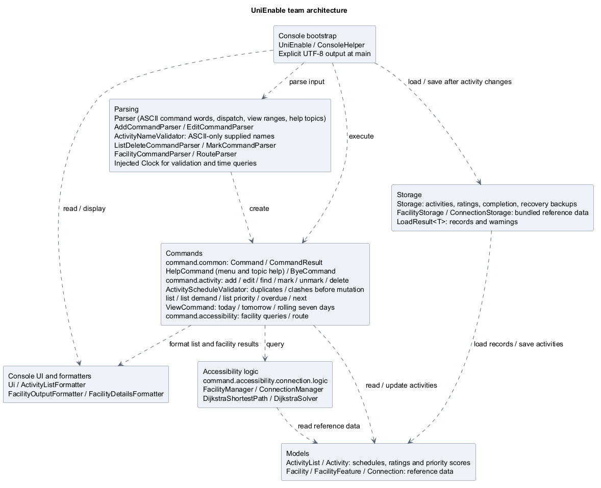
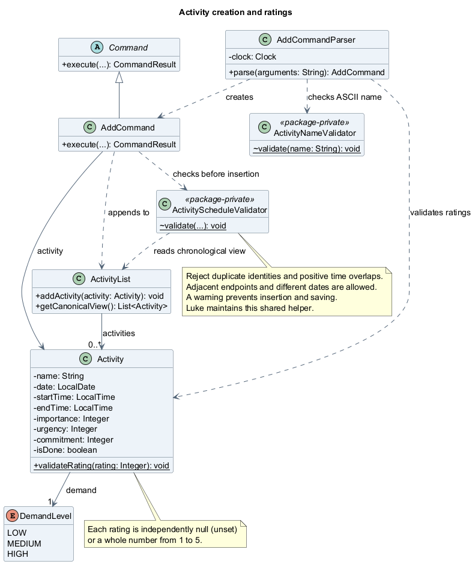
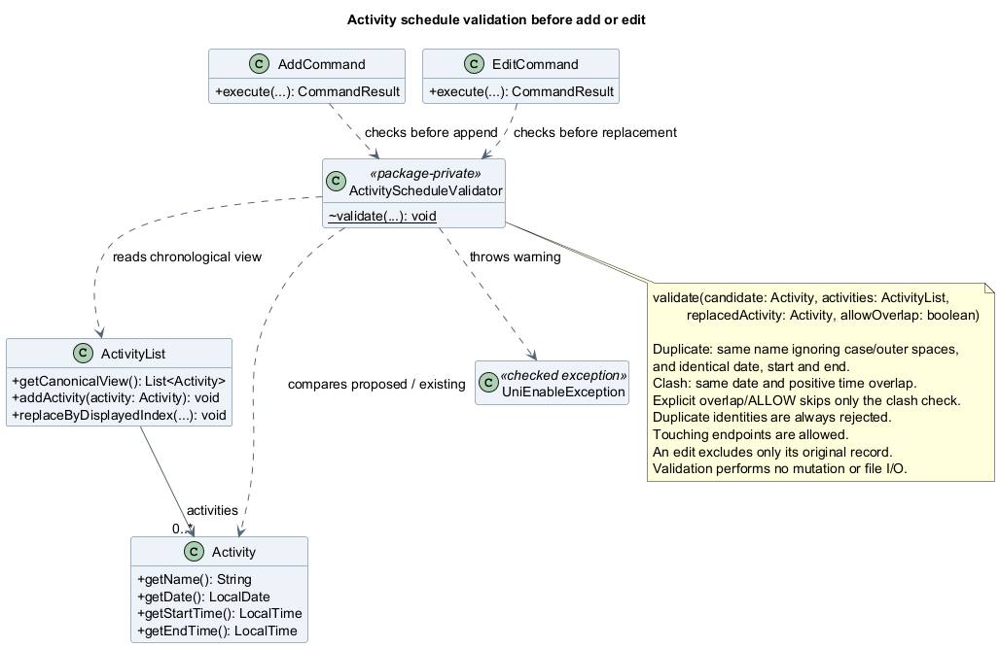

# UniEnable Developer Guide

<!--
RESPONSIBILITY SCOPES (feature responsibility, not the most recent Git editor):
Atharva005: activity creation, calendar dashboards, and command help.
officialasyrafrahim: listing, deletion, priority, overdue, and next.
Oliver-koh: completion changes, activity persistence/recovery, editing, and search.
lukelouyu: optional add ratings, facilities, routes, exit, and package moves.
Sections marked TEAM are maintained jointly and have no single-author override.
Named author comments begin a feature scope; the unnamed author comment ends it.
-->

<!-- TEAM: All members maintain the contents, introduction and setup instructions. -->

## Table of contents

- [Introduction](#introduction)
- [Setting up and getting started](#setting-up-and-getting-started)
- [Design and implementation](#design-and-implementation)
  - [Team design](#team-design)
    - [Architecture](#architecture)
    - [Source packages](#source-packages)
  - [Activity creation, calendar views and help](#activity-creation-calendar-views-and-help)
    - [Adding activities](#adding-activities)
    - [Calendar dashboards](#calendar-dashboards)
    - [Categorized and topic help](#categorized-and-topic-help)
  - [Activity views and deletion](#activity-views-and-deletion)
    - [Chronological listing](#chronological-listing)
    - [Demand-ordered listing](#demand-ordered-listing)
    - [Activity deletion](#activity-deletion)
    - [Priority listing](#priority-listing)
    - [Overdue activities](#overdue-activities)
    - [Next activity](#next-activity)
  - [Completion, storage, editing and search](#completion-storage-editing-and-search)
    - [Editing activities](#editing-activities)
    - [Name search](#name-search)
    - [Marking activities](#marking-activities)
    - [Unmarking activities](#unmarking-activities)
    - [Completion and persistence](#completion-and-persistence)
  - [Ratings and accessibility](#ratings-and-accessibility)
    - [Optional ratings integration](#optional-ratings-integration)
    - [Activity schedule validation](#activity-schedule-validation)
    - [Facility accessibility data (`facilities.txt`)](#facility-accessibility-data-facilitiestxt)
    - [Facility lookup](#facility-lookup)
    - [Accessibility route connections (`connections.txt`)](#accessibility-route-connections-connectionstxt)
    - [Accessible route search](#accessible-route-search)
    - [Exiting the application](#exiting-the-application)
- [Testing and defensive programming](#testing-and-defensive-programming)
  - [Automated testing](#automated-testing)
  - [Defensive programming](#defensive-programming)
- [Product scope](#product-scope)
  - [Target users and value proposition](#target-users-and-value-proposition)
  - [Current boundaries](#current-boundaries)
  - [Team contributions](#team-contributions)
- [User stories](#user-stories)
  - [Core schedule](#core-schedule)
  - [Views and reminders](#views-and-reminders)
  - [Energy and priority](#energy-and-priority)
  - [Accessible navigation](#accessible-navigation)
  - [Foundation](#foundation)
- [Non-Functional Requirements](#non-functional-requirements)
- [Glossary](#glossary)
- [Instructions for manual testing](#instructions-for-manual-testing)
  - [Prepare a separate test folder](#prepare-a-separate-test-folder)
  - [Run a session with a fixed clock](#run-a-session-with-a-fixed-clock)
  - [Activities and restart persistence](#activities-and-restart-persistence)
  - [Duplicate activities and time clashes](#duplicate-activities-and-time-clashes)
  - [Priority and strict local-time boundaries](#priority-and-strict-local-time-boundaries)
  - [Calendar dashboards and topic help](#calendar-dashboards-and-topic-help)
  - [Invalid activity and command input](#invalid-activity-and-command-input)
  - [Editing, searching and updated empty-state messages](#editing-searching-and-updated-empty-state-messages)
  - [Facility queries and routes](#facility-queries-and-routes)
  - [Legacy data, corruption warnings, and save failures](#legacy-data-corruption-warnings-and-save-failures)
- [Acknowledgements](#acknowledgements)

## Introduction

UniEnable is a Java command-line application for managing dated activities and
checking campus accessibility reference information. It combines activity
planning with facility lookup and route search.

The target users are tertiary students with ASD, ADHD, or mobility constraints
who are adapting to university routines and managing commitments independently.

This guide explains the current design for developers maintaining the application.
See the [User Guide](UserGuide.md) for commands and examples. Accessibility records
are bundled sample data; check results against current campus information before use.

## Setting up and getting started

Install **JDK 25** and clone the repository. Check `java -version` before building
or running the application. In IntelliJ IDEA, import the project as a Gradle
project and select JDK 25 for both the project SDK and Gradle JVM. The
[README](https://github.com/lukelouyu/tp/blob/dee199c35538bbb2fca3d64006ac13ee046f132a/README.md#setting-up-in-intellij) gives the IDE setup steps.

Run these commands from the project root using the included Gradle wrapper.
The first build needs internet access to download Gradle and dependencies.

| Purpose | Windows PowerShell | macOS / Linux |
| --- | --- | --- |
| Compile the application | `.\gradlew.bat classes` | `./gradlew classes` |
| Run automated tests | `.\gradlew.bat test` | `./gradlew test` |
| Run all configured checks | `.\gradlew.bat check` | `./gradlew check` |
| Run the console application | `.\gradlew.bat run --console=plain` | `./gradlew run --console=plain` |
| Build the executable JAR | `.\gradlew.bat shadowJar` | `./gradlew shadowJar` |

`check` runs tests, Checkstyle, and the configured JaCoCo coverage checks. The
application entry point is `seedu.unienable.UniEnable`. Gradle's `run` task enables
assertions; add `-ea` to the VM options when running the main method directly in
an IDE. After `shadowJar`, run the JAR with assertions enabled:

```text
java -ea -jar build/libs/unienable.jar
```

Enter `help` to see the commands and `bye` to exit. Activity data is stored at
`data/activities.txt`, relative to the directory where the application starts.
Use the same working directory between sessions to load the same activities.
Facility and connection data come from `src/main/resources/facilities.txt` and
`src/main/resources/connections.txt`; these resources are also included in the JAR.

## Design and implementation

<!-- TEAM: All members maintain this ownership overview and the diagram index. -->

Implementation sections and diagram folders follow the responsibility assignments
in [Team contributions](#team-contributions). The write-ups are grouped by feature
responsibility below.

| Implementation sections | PlantUML sources | Rendered images |
| --- | --- | --- |
| [Team design](#team-design) | [Architecture](diagrams/README.md#team) | [Architecture](images/README.md#team) |
| [Activity creation, calendar views and help](#activity-creation-calendar-views-and-help) | [Class and sequence](diagrams/README.md#atharva) | [Class and sequence](images/README.md#atharva) |
| [Activity views and deletion](#activity-views-and-deletion) | [Class and sequence](diagrams/README.md#asyraf) | [Class and sequence](images/README.md#asyraf) |
| [Completion, storage, editing and search](#completion-storage-editing-and-search) | [Class and sequence](diagrams/README.md#oliver) | [Class and sequence](images/README.md#oliver) |
| [Ratings and accessibility](#ratings-and-accessibility) | [Class, sequence, and graph](diagrams/README.md#luke) | [Class, sequence, and graph](images/README.md#luke) |

Each member's source and image folders use matching `class/` and `sequence/`
subfolders. The team component diagram uses `team/architecture/`; the campus
connectivity graph uses `graph/` within its feature's folders. The
[diagram index](diagrams/README.md) records source/image paths and regeneration instructions.

<!--
DIAGRAM EDITING GUIDE FOR ATHARVA, ASYRAF, AND OLIVER
The TODO comments in each feature section mark the exact diagram insertion points.
Create the named .puml source under docs/diagrams/OWNER/class or sequence, then
generate its matching PNG under docs/images/OWNER/class or sequence.
Each TODO contains the actual Markdown image and source-link format to use.
After both files are ready, remove the TODO instructions and surrounding HTML
comment markers to display the image and source link. These HTML comments hide
the templates in the rendered guide; // does not comment out Markdown.
For Asyraf's deletion sequence, keep the existing .puml and regenerate only its PNG.
-->

<!-- BEGIN TEAM: All members maintain the architecture and common models jointly. -->

### Team design

Architecture and models used across members' features are maintained jointly.

#### Architecture



[Open the full-size architecture diagram](images/team/architecture/ArchitectureDiagram.png).
Source: [ArchitectureDiagram.puml](diagrams/team/architecture/ArchitectureDiagram.puml).

`UniEnable` restores activities; `ConsoleHelper` loads facilities before connections
and creates the managers and parser. `Ui` reads input, `Parser` creates a command,
and the command queries or updates a model or manager. Its `CommandResult` carries
a message, an exit flag and an activity-change flag. `ConsoleHelper` saves only
when activities changed, then displays the message; the exit flag ends the loop.

<!-- @@author lukelouyu -->

`UniEnable.main()` supplies a `PrintStream` with explicit
`StandardCharsets.UTF_8` encoding to the console session. On Windows, the
original `System.out` can use a legacy encoding even when the JVM's default
charset is UTF-8, replacing characters in activity names with `?` in redirected
output. Encoding output explicitly preserves Chinese, Tamil and emoji text in
previously saved activities; it does not make those names valid for new input.
The injectable `UniEnable.run()` methods continue to use the caller's output stream.

`ActivityNameValidator` applies the shared ASCII-only name rule in
`AddCommandParser` and `EditCommandParser` before either command can change data.
Any character above U+007F produces
`[WARNING] Please write the activity name in English (ASCII characters only).`
Blank-name and pipe/newline checks keep their existing warnings. `Storage` does
not apply this new-input rule when restoring saved history.

`Parser` also rejects a non-ASCII command word before case conversion and
dispatch. For example, `加入` or `வணக்கம்` produces
`[WARNING] Please write the command in English (ASCII characters only).`
ASCII unknown commands and blank input keep the unrecognized-command warning.
This check applies to the command word; add/edit names still receive their
name-specific warning, and find keywords can still match historical Unicode names.

<!-- @@author -->

The diagram includes editing and search, completion changes, priority and time
queries, calendar dashboards, and categorized topic help. `ViewCommand` covers
today, tomorrow, or today and the following six days, and formats its schedule,
summary, and rating table. Read-only queries and help leave the activity-change
flag unset, so the console does not save them.

| Area | Main classes and responsibilities |
| --- | --- |
| Startup and console loop | `UniEnable` runs until `bye` or end of input. `ConsoleHelper` loads reference data, creates the parser, executes commands and saves changes. |
| User interface | `Ui` reads and displays text. `ActivityListFormatter`, `FacilityOutputFormatter` and `FacilityDetailsFormatter` build messages; `RouteCommand` and `ViewCommand` format their own results. |
| Parsing | `Parser` dispatches to `AddCommandParser`, `EditCommandParser`, `ListDeleteCommandParser`, `MarkCommandParser`, `FacilityCommandParser` or `RouteParser`. It checks `find`, `overdue`, `next`, `view` and `help` directly. A shared injected `Clock` makes time checks repeatable. |
| Command execution | Subclasses implement `Command.execute(ActivityList, Storage)` and return a `CommandResult`; both shared types live in `command.common`, alongside `HelpCommand` and `ByeCommand`. |
| Calendar dashboards and help | `ViewCommand` groups activities by date and displays completion, ratings, priority scores, and demand. `HelpCommand` provides a categorized menu and detailed pages for `help TOPIC`. |
| Activity model | `Activity` stores details, completion and ratings and calculates priority. `ActivityList` owns the collection, supplies filtered and ordered views, and resolves displayed indexes against chronological order. |
| Accessibility logic | `FacilityManager` handles facility queries. `ConnectionManager` delegates routes to `DijkstraShortestPath`, with a fresh `DijkstraSolver` per search. |
| Reference models | Immutable `Facility` and `FacilityFeature` objects describe hubs. Immutable `Connection` objects hold endpoints, distance, statuses, traversal type, barriers and notes. |
| Storage | `Storage` loads six- or nine-field activity rows and saves nine-field rows, with recovery backups when needed. `FacilityStorage` and `ConnectionStorage` load bundled reference records and return records plus warnings in `LoadResult<T>`. |
| Exceptions | `UniEnableException` is the checked error contract for recoverable failures. `ParseException` reports invalid commands, while `InvalidIndexException` reports indexes outside the current activity view. |

Recoverable failures use `UniEnableException`; the console displays the problem
and accepts another command. Failed facility loading leaves activity commands,
help and exit available. Failed connection loading disables routes but keeps
facility queries available. Activity-load warnings and failures appear at startup;
a fatal read failure starts an empty list with `Storage` recovery protection.

The team maintains the architecture source and image together in
`docs/diagrams/team/architecture` and `docs/images/team/architecture`.
Regenerate the PNG after changing components or dependencies using the
[diagram regeneration instructions](diagrams/README.md#regenerating-images).

<!-- @@author lukelouyu -->

#### Source packages

Java packages beneath `seedu.unienable` follow the source folders below.
The test tree mirrors these packages under `src/test/java/seedu/unienable`.

| Package | Contents and source location |
| --- | --- |
| `command.common` | [`Command`, `CommandResult`, `HelpCommand`, and `ByeCommand`](https://github.com/lukelouyu/tp/tree/dee199c35538bbb2fca3d64006ac13ee046f132a/src/main/java/seedu/unienable/command/common). |
| `command.activity` | [Activity commands](https://github.com/lukelouyu/tp/tree/dee199c35538bbb2fca3d64006ac13ee046f132a/src/main/java/seedu/unienable/command/activity), including `ViewCommand`. |
| `command.accessibility.facility` | [Facility list, lookup, and feature-search commands](https://github.com/lukelouyu/tp/tree/dee199c35538bbb2fca3d64006ac13ee046f132a/src/main/java/seedu/unienable/command/accessibility/facility). |
| `command.accessibility.connection` | [`RouteCommand`](https://github.com/lukelouyu/tp/blob/dee199c35538bbb2fca3d64006ac13ee046f132a/src/main/java/seedu/unienable/command/accessibility/connection/RouteCommand.java). |
| `command.accessibility.connection.logic` | [`ConnectionManager`, `FacilityManager`, `DijkstraShortestPath`, and `DijkstraSolver`](https://github.com/lukelouyu/tp/tree/dee199c35538bbb2fca3d64006ac13ee046f132a/src/main/java/seedu/unienable/command/accessibility/connection/logic). |

The former top-level `seedu.unienable.logic` package has moved under the connection
package. `ConsoleHelper`, parsers, and commands import the relocated classes;
the JaCoCo selection in `build.gradle` uses the new manager paths. The solver
remains package-private, and routing behavior is unchanged. The architecture
diagrams show logical components rather than exact Java package boundaries.

These folder moves preserve feature ownership through the scoped `@@author`
comments, including the help and calendar features.

<!-- @@author -->

<!-- END TEAM -->

<!-- BEGIN OWNER: Atharva Rege (@Atharva005). Maintain activity creation, calendar views and help here. -->

<!-- @@author Atharva005 -->

### Activity creation, calendar views and help

This section covers activity creation, calendar dashboards, and built-in help.
See [Optional ratings integration](#optional-ratings-integration) for the rating fields.

#### Adding activities

`Parser` delegates the arguments after `add` to `AddCommandParser`. The parser
uses the injected `Clock` to validate a real date and strict `HH:mm` times, a
non-blank name, supported prefixes, and optional demand and ratings. Demand
defaults to `MEDIUM`; each omitted rating remains `null`. The same-day end must
follow the start and the current local time. Invalid input produces a
`ParseException` without adding an activity.

`AddCommandParser` checks supplied names through `ActivityNameValidator`.
`AddCommand` checks the proposed activity with the shared
[schedule validator](#activity-schedule-validation) before inserting it. The
add diagrams include both checks and the rejection path without a save.

`AddCommand` creates an initially incomplete `Activity` and appends it through
`ActivityList.addActivity()`. Its result sets the activity-change flag, so the
console saves the list before displaying the confirmation. See the
[user examples](UserGuide.md#adding-an-activity-add).

<!-- TODO (@Atharva005): Add the class diagram for activity creation and optional ratings here.
Write the PlantUML source at: docs/diagrams/atharva/class/ActivityCreationClassDiagram.puml
Generate its image at: docs/images/atharva/class/ActivityCreationClassDiagram.png
Uncomment the image and source-link Markdown below once both files are ready.


Source: [ActivityCreationClassDiagram.puml](diagrams/atharva/class/ActivityCreationClassDiagram.puml).
-->
The diagram's source and image follow the activity-creation responsibility scope.
The optional rating implementation is documented in
[Optional ratings integration](#optional-ratings-integration).

The sequence follows parsing, construction, and insertion, including the optional
rating constructor. Saving follows the
[completion and persistence flow](#completion-and-persistence).

<!-- TODO (@Atharva005): Add the sequence diagram for adding an activity here.
Write the PlantUML source at: docs/diagrams/atharva/sequence/AddActivitySequence.puml
Generate its image at: docs/images/atharva/sequence/AddActivitySequence.png
Uncomment the image and source-link Markdown below once both files are ready.


Source: [AddActivitySequence.puml](diagrams/atharva/sequence/AddActivitySequence.puml).
-->

#### Calendar dashboards

`Parser` accepts exactly `view today`, `view tomorrow`, or `view week`, ignoring
letter case, and creates `ViewCommand` with a `Range` and the session's `Clock`.
At execution, `LocalDate.now(clock)` determines the date once:

| Range | Inclusive start | Inclusive end |
| --- | --- | --- |
| `TODAY` | Today | Today |
| `TOMORROW` | Today plus one day | Today plus one day |
| `WEEK` | Today | Today plus six days |

`ActivityList.getViewBetween(start, end)` filters the canonical chronological view
by date, retaining completed activities. A seven-day view crosses month and year
boundaries naturally and does not use the Monday boundary of `overdue` labels.
`ViewCommand` groups the results by day and returns a read-only `CommandResult`;
it never requests a save or exit.

The class diagram shows the selected command, date-range query, and result members.

<!-- TODO (@Atharva005): Add the class diagram for calendar dashboards here.
Write the PlantUML source at: docs/diagrams/atharva/class/CalendarViewClassDiagram.puml
Generate its image at: docs/images/atharva/class/CalendarViewClassDiagram.png
Uncomment the image and source-link Markdown below once both files are ready.


Source: [CalendarViewClassDiagram.puml](diagrams/atharva/class/CalendarViewClassDiagram.puml).
-->

For a populated period, the formatter appends:

1. Daily schedules with times, completion markers, ratings, and demand codes.
2. A vertical summary: total, completed, remaining, and high-demand counts.
   The daily high-demand count includes completed activities and all
   times on the selected date; it excludes other dates and LOW/MEDIUM demand.
3. A rating chart with padded columns, vertical bars, and a horizontal divider
   directly below its column headings. The divider's bars align with the header
   and data columns. Name width expands to fit the selected activity names;
   rating columns accommodate all five marks.
   Commitment uses ASCII `+` to avoid the former unsupported-symbol output.
4. Vertical IMP, URG, and COM totals; demand counts; and a legend including
   `URG x URG x (IMP + COM)`. Missing ratings display `-` and missing scores `N`.

Recorded values contribute to rating totals even when another rating on the
activity is unset. The removed `Ratings set: ...` line is no longer displayed.
Schedule numbers begin at 1 within the selected period, so users must run `list`
before an indexed edit, completion change, or deletion.

If the whole period is empty, only its heading and a warning are returned; no
empty summary or chart is appended. The warning refers to `this day` or
`the next seven days` as appropriate. Within a populated weekly view, an empty
day instead has a plain `No activities scheduled for this day.` message.
Missing, unsupported, or extra view arguments produce a warning and usage.

See [the User Guide dashboard example](UserGuide.md#viewing-calendar-dashboards-view).
`ViewCommandTest` covers empty periods, completed activities, date filtering,
month/year rollover, missing ratings, ASCII marks, header-divider alignment,
padded columns, and read-only results with a storage stub that fails on writes.

The sequence assumes a supported range and shows both empty and populated
periods. Invalid arguments are rejected before the command is created.

<!-- TODO (@Atharva005): Add the sequence diagram for calendar dashboards here.
Write the PlantUML source at: docs/diagrams/atharva/sequence/CalendarViewSequence.puml
Generate its image at: docs/images/atharva/sequence/CalendarViewSequence.png
Uncomment the image and source-link Markdown below once both files are ready.


Source: [CalendarViewSequence.puml](diagrams/atharva/sequence/CalendarViewSequence.puml).
-->

#### Categorized and topic help

`HelpCommand` lives in `command.common`. Its default constructor selects a menu
with five categories: activity management, planning and priorities, completion
and deletion, facilities and routes, and help and exit. A static `TOPIC_HELP` map
keeps detailed usage, rules, and examples beside each supported topic.

<!-- TODO (@Atharva005): Add the class diagram for categorized and topic help here.
Write the PlantUML source at: docs/diagrams/atharva/class/TopicHelpClassDiagram.puml
Generate its image at: docs/images/atharva/class/TopicHelpClassDiagram.png
Uncomment the image and source-link Markdown below once both files are ready.


Source: [TopicHelpClassDiagram.puml](diagrams/atharva/class/TopicHelpClassDiagram.puml).
-->

`Parser` accepts zero or one topic word after `help`. For one word,
`HelpCommand(String topic)` normalizes it with `Locale.ROOT`, looks it up, and
adds a prompt to return to the menu. Unknown topics and extra words produce a
`ParseException` with a warning and `Usage: help [TOPIC]`.

The 14 supported topics are `add`, `edit`, `find`, `list`, `view`,
`overdue`, `next`, `mark`, `unmark`, `delete`, `facility`, `route`, `help`, and
`bye`. `help list` includes the demand and priority variants; `help facility`
includes feature search. The topic never executes the command it describes:
`help delete` does not delete and `help bye` does not exit. Help remains available
without facility or connection data and leaves both result flags unset.

`HelpCommandTest` checks categories, every topic, mixed-case input, malformed
requests, and read-only execution. `UniEnableTest` checks topic help through the
console, including saved-file preservation.

The sequence shows a successful `help view` request, with construction beginning
the help object's lifeline. The note identifies how menu requests and invalid
input differ; the validation rules above cover those other scenarios.

<!-- TODO (@Atharva005): Add the sequence diagram for categorized and topic help here.
Write the PlantUML source at: docs/diagrams/atharva/sequence/TopicHelpSequence.puml
Generate its image at: docs/images/atharva/sequence/TopicHelpSequence.png
Uncomment the image and source-link Markdown below once both files are ready.


Source: [TopicHelpSequence.puml](diagrams/atharva/sequence/TopicHelpSequence.puml).
-->

<!-- @@author -->

<!-- END OWNER: Atharva Rege (@Atharva005) -->

<!-- BEGIN OWNER: Muhammad Asyraf Bin Abdul Rahim (@officialasyrafrahim). Add listing, deletion, priority, overdue and next documentation here. -->

<!-- @@author officialasyrafrahim -->

### Activity views and deletion

This section covers chronological and demand listing, deletion, priority ordering,
and overdue/next queries, including their displayed-index rules.

#### Chronological listing

`list` selects `ActivityList.getCanonicalView()` and passes the result to
`ActivityListFormatter.formatList()`. The view sorts by date and start time;
ties retain insertion order. It is a separate, unmodifiable snapshot, so listing
does not reorder the backing collection or request a save.

Displayed indexes start at 1 and form the common index contract for delete,
edit, mark, and unmark. An empty view displays `[WARNING] No activities yet.`.

<!-- TODO (@officialasyrafrahim): Add the class diagram for chronological listing here.
Write the PlantUML source at: docs/diagrams/asyraf/class/ListActivityClassDiagram.puml
Generate its image at: docs/images/asyraf/class/ListActivityClassDiagram.png
Uncomment the image and source-link Markdown below once both files are ready.


Source: [ListActivityClassDiagram.puml](diagrams/asyraf/class/ListActivityClassDiagram.puml).
-->

<!-- TODO (@officialasyrafrahim): Add the sequence diagram for chronological listing here.
Write the PlantUML source at: docs/diagrams/asyraf/sequence/ListActivitySequence.puml
Generate its image at: docs/images/asyraf/sequence/ListActivitySequence.png
Uncomment the image and source-link Markdown below once both files are ready.


Source: [ListActivitySequence.puml](diagrams/asyraf/sequence/ListActivitySequence.puml).
-->

#### Demand-ordered listing

`list demand` selects `getDemandView()` and calls `formatDemandList()`. Demand
sorts HIGH, MEDIUM, LOW, with date/start-time ordering for ties. Completion state
does not filter the view, and listing leaves stored activities unchanged.

These rows have their own demand-order numbering. The formatter includes a
notice to run `list` before selecting the chronological index for deletion.
Use that same chronological index for other indexed changes.

<!-- TODO (@officialasyrafrahim): Add the class diagram for demand-ordered listing here.
Write the PlantUML source at: docs/diagrams/asyraf/class/ListDemandClassDiagram.puml
Generate its image at: docs/images/asyraf/class/ListDemandClassDiagram.png
Uncomment the image and source-link Markdown below once both files are ready.


Source: [ListDemandClassDiagram.puml](diagrams/asyraf/class/ListDemandClassDiagram.puml).
-->

<!-- TODO (@officialasyrafrahim): Add the sequence diagram for demand-ordered listing here.
Write the PlantUML source at: docs/diagrams/asyraf/sequence/ListDemandSequence.puml
Generate its image at: docs/images/asyraf/sequence/ListDemandSequence.png
Uncomment the image and source-link Markdown below once both files are ready.


Source: [ListDemandSequence.puml](diagrams/asyraf/sequence/ListDemandSequence.puml).
-->

#### Activity deletion

`ListDeleteCommandParser.parseDelete()` accepts one unsigned ASCII integer that
fits in `int`. `ActivityList.deleteByDisplayedIndex()` then checks the index against
the full chronological view. Zero, an empty list, and out-of-range indexes raise
`InvalidIndexException` without changing activities.

The model selects the chronological activity object and removes that object from
the backing list. `DeleteCommand` returns its details and the remaining count,
with the activity-change flag set. The last deletion uses
`There is no activity recorded` and still requests saving the now-empty list.
`ConsoleHelper` saves before displaying the confirmation.

<!-- TODO (@officialasyrafrahim): Add the class diagram for activity deletion here.
Write the PlantUML source at: docs/diagrams/asyraf/class/DeleteActivityClassDiagram.puml
Generate its image at: docs/images/asyraf/class/DeleteActivityClassDiagram.png
Uncomment the image and source-link Markdown below once both files are ready.


Source: [DeleteActivityClassDiagram.puml](diagrams/asyraf/class/DeleteActivityClassDiagram.puml).
-->

<!-- TODO (@officialasyrafrahim): Add the sequence diagram for activity deletion here.
Keep the existing PlantUML source: docs/diagrams/asyraf/sequence/DeleteActivitySequence.puml
Generate its image at: docs/images/asyraf/sequence/DeleteActivitySequence.png
Uncomment the image Markdown below once the PNG is ready.

-->

Source: [DeleteActivitySequence.puml](diagrams/asyraf/sequence/DeleteActivitySequence.puml).

The delete sequence starts after parsing a valid index and focuses on object
selection and removal. Saving and display follow through the console as described
in [Architecture](#architecture).

#### Priority listing

`list priority` includes every activity, including completed ones. The command
obtains both `getCanonicalView()` and `getPriorityView()`; the formatter uses the
full chronological view for indexes, so sorted results do not renumber activities.

`Activity.getPriorityScore()` calculates:

```text
URG * URG * (IMP + COM)
```

**Formula Design Rationale**

We chose this formula for our target group of tertiary students managing
executive dysfunction, including students with ADHD or ASD:

- **Urgency-Centric Weighting:** Squaring urgency (`URG * URG`) gives it quadratic
  weight. When users assign higher urgency to looming commitments, those activities
  move up the priority list more strongly. This is intended to support students
  experiencing time-blindness by drawing attention to commitments before deadlines
  become overwhelming. Urgency is user-assigned; the score does not increase
  automatically as a deadline approaches.
- **Balanced Internal Drivers:** Importance (`IMP`) and commitment (`COM`)
  contribute linearly and equally within the sum. An internally valued personal
  task and an externally pledged obligation therefore receive equal baseline
  weight when their respective ratings are equal, including when urgency is low.
  This aims to keep self-care and academic milestones visible alongside immediate
  deadlines and external obligations.

Each rating is an integer from 1 to 5. The score ranges from 2 to 250 and is
available only when importance, urgency and commitment are all set. Missing
ratings produce `null`, displayed as `NA`; demand and completion do not affect
the score.

`Comparator.nullsLast(Comparator.reverseOrder())` places unavailable scores after
all available scores. Ties use date and start time, then retain insertion order.
The formatter shows unset ratings as `-` and unavailable priority as `NA`.
Demand and completion do not change the score. The query does not request saving.

<!-- TODO (@officialasyrafrahim): Add the class diagram for priority listing here.
Write the PlantUML source at: docs/diagrams/asyraf/class/ListPriorityClassDiagram.puml
Generate its image at: docs/images/asyraf/class/ListPriorityClassDiagram.png
Uncomment the image and source-link Markdown below once both files are ready.


Source: [ListPriorityClassDiagram.puml](diagrams/asyraf/class/ListPriorityClassDiagram.puml).
-->

<!-- TODO (@officialasyrafrahim): Add the sequence diagram for priority listing here.
Write the PlantUML source at: docs/diagrams/asyraf/sequence/ListPrioritySequence.puml
Generate its image at: docs/images/asyraf/sequence/ListPrioritySequence.png
Uncomment the image and source-link Markdown below once both files are ready.


Source: [ListPrioritySequence.puml](diagrams/asyraf/sequence/ListPrioritySequence.puml).
-->

#### Overdue activities

`overdue` captures `LocalDateTime.now(clock)` once and selects incomplete
activities whose start is strictly before that instant. Activities starting
exactly now are excluded. Results retain chronological order and full-list indexes.

`formatOverdueList()` uses the same captured time to label activities as today,
earlier in the current Monday-to-Sunday week, or earlier. An empty result displays
`[WARNING] No overdue activities.`. The query changes no completion state or file.

<!-- TODO (@officialasyrafrahim): Add the class diagram for overdue activities here.
Write the PlantUML source at: docs/diagrams/asyraf/class/OverdueActivityClassDiagram.puml
Generate its image at: docs/images/asyraf/class/OverdueActivityClassDiagram.png
Uncomment the image and source-link Markdown below once both files are ready.


Source: [OverdueActivityClassDiagram.puml](diagrams/asyraf/class/OverdueActivityClassDiagram.puml).
-->

<!-- TODO (@officialasyrafrahim): Add the sequence diagram for overdue activities here.
Write the PlantUML source at: docs/diagrams/asyraf/sequence/OverdueActivitySequence.puml
Generate its image at: docs/images/asyraf/sequence/OverdueActivitySequence.png
Uncomment the image and source-link Markdown below once both files are ready.


Source: [OverdueActivitySequence.puml](diagrams/asyraf/sequence/OverdueActivitySequence.puml).
-->

#### Next activity

`next` captures the session's local time once and calls `getNext(now)`. The model
selects the earliest incomplete activity whose start is strictly after now;
equal starts retain insertion order. Completed activities and starts exactly now
are excluded.

`formatNext()` receives the full chronological view to keep the selected index.
An empty `Optional` produces `[WARNING] No upcoming incomplete activities.`.
This command does not mark, reschedule, or save an activity.

<!-- TODO (@officialasyrafrahim): Add the class diagram for the next activity here.
Write the PlantUML source at: docs/diagrams/asyraf/class/NextActivityClassDiagram.puml
Generate its image at: docs/images/asyraf/class/NextActivityClassDiagram.png
Uncomment the image and source-link Markdown below once both files are ready.


Source: [NextActivityClassDiagram.puml](diagrams/asyraf/class/NextActivityClassDiagram.puml).
-->

<!-- TODO (@officialasyrafrahim): Add the sequence diagram for the next activity here.
Write the PlantUML source at: docs/diagrams/asyraf/sequence/NextActivitySequence.puml
Generate its image at: docs/images/asyraf/sequence/NextActivitySequence.png
Uncomment the image and source-link Markdown below once both files are ready.


Source: [NextActivitySequence.puml](diagrams/asyraf/sequence/NextActivitySequence.puml).
-->

The list parser rejects unknown variants and extra arguments. Time queries
reject extra words. Checked exceptions keep invalid commands recoverable; `FINE`
logs record query sizes and captured times. Assertions check internal view ordering.
Injecting `Clock` makes strict time boundaries repeatable in tests.

<!-- @@author -->

<!-- END OWNER: Muhammad Asyraf Bin Abdul Rahim (@officialasyrafrahim) -->

<!-- BEGIN OWNER: Oliver (@Oliver-koh). Maintain completion, storage/recovery, editing and search here. -->

<!-- @@author Oliver-koh -->

### Completion, storage, editing and search

Activity editing, name search, completion changes, and persistence use the same
chronological index contract as `list`.

#### Editing activities

The class diagram shows edit parsing, chronological index resolution, activity
replacement, and the result that requests saving. It omits unrelated activity
fields and the individual edit arguments.

<!-- TODO (@Oliver-koh): Add the class diagram for activity editing here.
Write the PlantUML source at: docs/diagrams/oliver/class/EditActivityClassDiagram.puml
Generate its image at: docs/images/oliver/class/EditActivityClassDiagram.png
Uncomment the image and source-link Markdown below once both files are ready.


Source: [EditActivityClassDiagram.puml](diagrams/oliver/class/EditActivityClassDiagram.puml).
-->

`EditCommandParser` records which fields were supplied. `EditCommand` resolves the
index, combines old and new values, and validates the replacement before calling
`ActivityList.replaceByDisplayedIndex()`. Omitted fields and completion state stay
unchanged. Time validation runs when a date or time is supplied; metadata-only
edits can update historical activities. Rejected edits leave the activity intact.

The edit diagrams show `ActivityNameValidator` checking a supplied name
and `ActivityScheduleValidator` checking name/schedule changes before replacement.
The original activity is excluded from the conflict search. Duplicate or clash
warnings preserve the entire record and do not request a save; demand/rating-only
edits skip schedule validation.

**Design choice:** Build and validate a replacement activity before changing the
list. This keeps a failed multi-field edit from leaving half of the requested
changes applied, and preserves the original completion state and omitted fields.
Mutating the original object field by field would allocate fewer objects, but
would require rollback or validation of the complete candidate state first.
Replacement is simpler here; callers must obtain a fresh view after an edit
rather than retain an old activity reference.

<!-- TODO (@Oliver-koh): Add the sequence diagram for activity editing here.
Write the PlantUML source at: docs/diagrams/oliver/sequence/EditActivitySequence.puml
Generate its image at: docs/images/oliver/sequence/EditActivitySequence.png
Uncomment the image and source-link Markdown below once both files are ready.


Source: [EditActivitySequence.puml](diagrams/oliver/sequence/EditActivitySequence.puml).
-->
This sequence assumes valid input and successful file operations; rejected edits
return before replacement or saving.

#### Name search

`FindCommand` uses case-insensitive literal substring matching through
`ActivityList.findByName()`. Results retain full chronological indexes and do not
request a save.

The class diagram separates keyword validation, name matching, and formatting.
The formatter receives both the matches and the full chronological view so it
can display the indexes used by activity-changing commands.

<!-- TODO (@Oliver-koh): Add the class diagram for name search here.
Write the PlantUML source at: docs/diagrams/oliver/class/FindActivityClassDiagram.puml
Generate its image at: docs/images/oliver/class/FindActivityClassDiagram.png
Uncomment the image and source-link Markdown below once both files are ready.


Source: [FindActivityClassDiagram.puml](diagrams/oliver/class/FindActivityClassDiagram.puml).
-->

<!-- TODO (@Oliver-koh): Add the sequence diagram for name search here.
Write the PlantUML source at: docs/diagrams/oliver/sequence/FindActivitySequence.puml
Generate its image at: docs/images/oliver/sequence/FindActivitySequence.png
Uncomment the image and source-link Markdown below once both files are ready.


Source: [FindActivitySequence.puml](diagrams/oliver/sequence/FindActivitySequence.puml).
-->
The activity-change flag stays unset, so the console displays the result without saving.

#### Marking activities

`mark INDEX` resolves the full chronological index through `MarkCommand` and
calls `ActivityList.setDoneAtDisplayedIndex(index, true)`. Omitted activity
details, ratings, and scheduling are preserved. An invalid index raises a checked
warning without changing or saving any activity.

The model returns whether completion changed. The command uses that value for
`CommandResult.didChangeActivities()`, so a repeated request returns an
already-in-that-state warning and skips saving. On a change, the console saves
before displaying the confirmation. The sequence assumes a valid index and
successful file operations.

<!-- TODO (@Oliver-koh): Add the class diagram for marking activities here.
Write the PlantUML source at: docs/diagrams/oliver/class/MarkActivityClassDiagram.puml
Generate its image at: docs/images/oliver/class/MarkActivityClassDiagram.png
Uncomment the image and source-link Markdown below once both files are ready.


Source: [MarkActivityClassDiagram.puml](diagrams/oliver/class/MarkActivityClassDiagram.puml).
-->

<!-- TODO (@Oliver-koh): Add the sequence diagram for marking activities here.
Write the PlantUML source at: docs/diagrams/oliver/sequence/MarkActivitySequence.puml
Generate its image at: docs/images/oliver/sequence/MarkActivitySequence.png
Uncomment the image and source-link Markdown below once both files are ready.


Source: [MarkActivitySequence.puml](diagrams/oliver/sequence/MarkActivitySequence.puml).
-->

#### Unmarking activities

`unmark INDEX` resolves the full chronological index through `UnmarkCommand` and
calls `ActivityList.setDoneAtDisplayedIndex(index, false)`. Omitted activity
details, ratings, and scheduling are preserved. An invalid index raises a checked
warning without changing or saving any activity.

The model returns whether completion changed. The command uses that value for
`CommandResult.didChangeActivities()`, so a repeated request returns an
already-in-that-state warning and skips saving. On a change, the console saves
before displaying the confirmation. The sequence assumes a valid index and
successful file operations.

<!-- TODO (@Oliver-koh): Add the class diagram for unmarking activities here.
Write the PlantUML source at: docs/diagrams/oliver/class/UnmarkActivityClassDiagram.puml
Generate its image at: docs/images/oliver/class/UnmarkActivityClassDiagram.png
Uncomment the image and source-link Markdown below once both files are ready.


Source: [UnmarkActivityClassDiagram.puml](diagrams/oliver/class/UnmarkActivityClassDiagram.puml).
-->

<!-- TODO (@Oliver-koh): Add the sequence diagram for unmarking activities here.
Write the PlantUML source at: docs/diagrams/oliver/sequence/UnmarkActivitySequence.puml
Generate its image at: docs/images/oliver/sequence/UnmarkActivitySequence.png
Uncomment the image and source-link Markdown below once both files are ready.


Source: [UnmarkActivitySequence.puml](diagrams/oliver/sequence/UnmarkActivitySequence.puml).
-->

#### Completion and persistence

`MarkCommand` and `UnmarkCommand` use the same canonical indexes as `list`;
they request persistence only when completion actually changes. The class diagram
focuses on the result flag that controls saving and on the storage recovery state.

<!-- TODO (@Oliver-koh): Add the class diagram for conditional activity saving and recovery here.
Write the PlantUML source at: docs/diagrams/oliver/class/ActivityPersistenceClassDiagram.puml
Generate its image at: docs/images/oliver/class/ActivityPersistenceClassDiagram.png
Uncomment the image and source-link Markdown below once both files are ready.


Source: [ActivityPersistenceClassDiagram.puml](diagrams/oliver/class/ActivityPersistenceClassDiagram.puml).
-->

`Storage` loads legacy six-field rows and current nine-field rows, preserving
optional ratings. It reports malformed rows and protects later recovery saves
with a verified copy of the original file. `ConsoleHelper` saves only when a
command's activity-change flag is set. See [Data Storage](UserGuide.md#data-storage),
[editing](UserGuide.md#editing-an-activity-edit), and
[searching](UserGuide.md#searching-activity-names-find) for user-facing rules.

<!-- TODO (@Oliver-koh): Add the sequence diagram for completion and conditional saving here.
Write the PlantUML source at: docs/diagrams/oliver/sequence/CompletionAndSaveSequence.puml
Generate its image at: docs/images/oliver/sequence/CompletionAndSaveSequence.png
Uncomment the image and source-link Markdown below once both files are ready.


Source: [CompletionAndSaveSequence.puml](diagrams/oliver/sequence/CompletionAndSaveSequence.puml).
-->
The sequence assumes a valid index and successful file operations. Its optional
blocks show when the console saves and when storage first creates a recovery backup.

**Save ownership:** Commands report whether they changed activities;
`ConsoleHelper` owns the save-and-display sequence. This gives every modifying
command the same save-error handling and avoids writes for queries and repeated
completion requests. Command-owned saves would make each command independently
persistent, but would duplicate this policy. A new caller that bypasses the
console must honour the result flag itself. Saving follows the in-memory change,
so an I/O failure leaves that change in memory and requires the documented recovery.

**File format:** UTF-8 pipe-separated rows are easy to inspect, require no
serialization dependency, and keep the six-field legacy format readable alongside
the nine-field rated format. JSON would support named fields and escaping more
flexibly, but would add a parser and a migration decision. The current format
instead rejects pipes and line breaks in names and requires coordinated
loader/writer changes whenever a column is added. It provides recovery protection
for detected corruption, rather than a versioned backup history.

<!-- @@author -->

<!-- END OWNER: Oliver (@Oliver-koh) -->

<!-- BEGIN OWNER: Lou Yu Luke (@lukelouyu). Maintain optional add ratings, facilities, routes and exit documentation here. -->

<!-- @@author lukelouyu -->

<a id="luke-ratings-and-accessibility"></a>

### Ratings and accessibility

This section covers optional add ratings, shared activity schedule validation, facility reference data and queries,
accessible route search, and the exit command.
These features use the shared activity models and command/result flow.

#### Optional ratings integration

`add` accepts optional `imp/`, `urg/`, and `com/` ratings.
`AddCommandParser` parses each rating independently into a nullable `Integer`;
omitting a field leaves it unset. `Activity.validateRating()` accepts `null` or
an integer from 1 to 5, so add, edit and storage use the same validation rule.
The class-diagram placeholder in [Adding activities](#adding-activities) marks
where to show how ratings fit into activity creation. The priority view uses
these ratings; editing and persistence update and preserve them.

#### Activity schedule validation

`ActivityScheduleValidator` is a package-private helper in `command.activity`,
maintained under Luke's author scope. Atharva's `AddCommand` calls it before
appending an activity. Oliver's `EditCommand` calls it before replacement when
a name, date, start or end is supplied. The integrations retain their existing
feature-owner markers.



Source: [ActivityScheduleValidatorClassDiagram.puml](diagrams/luke/class/ActivityScheduleValidatorClassDiagram.puml).

The helper reads `ActivityList.getCanonicalView()` without changing the list.
It checks duplicates first: name equality ignores case and surrounding whitespace,
while date, start and end must match exactly. Demand, ratings and completion do
not change duplicate identity. It then checks positive-duration overlap on the
same date: `candidate.start < existing.end && existing.start < candidate.end`.
Equal endpoints are allowed, and completed activities participate in both checks.

An edit passes the original activity reference so only that record is excluded.
Warnings identify the conflicting chronological index and activity. A checked
`UniEnableException` stops the command before mutation or a save request, preserving
counts, fields, saved bytes and modification times. Demand/rating-only edits do
not create a new schedule and skip this check. Saved duplicates and overlaps remain
loadable; the validator does not silently delete historical data.

`ActivityScheduleValidatorTest` covers duplicate identity, partial/contained/covering
overlaps, adjacency, different dates, completion, canonical indexes, self-exclusion
and atomic edits. `UniEnableProcessTest` verifies rejection, stable counts and
unchanged storage across restarts through the real console entry point.

#### Facility accessibility data (`facilities.txt`)

The [facility dataset](https://github.com/lukelouyu/tp/blob/dee199c35538bbb2fca3d64006ac13ee046f132a/src/main/resources/facilities.txt) stores nine
facilities: AS1 to AS8 and Central Library (CLB), identified by F01 to F09.
It is bundled with the application and loaded from the classpath, including
when running the packaged JAR.

The facility and connection records were adapted with reference to the
[NUS FASS accessibility map](https://osa.nus.edu.sg/wp-content/uploads/2025/03/250224-FASS-Access-Route-Faculty-Map.pdf),
updated 24 February 2025. UniEnable maintains these text datasets separately;
the source credits are listed in [Acknowledgements](#acknowledgements).

Each pipe-separated facility row has one of two formats:

```text
FACILITY|ID|NAME|DESCRIPTION
FEATURE|FACILITY_ID|TYPE|STATUS|NOTES
```

For `FACILITY`, `NAME` is the short hub code used by `Facility.getName()`, such
as AS1; `DESCRIPTION` supplies the longer building description. The row requires
four fields, although the description may be empty. A `FEATURE` row references
the stable facility ID and records a feature type, a `YES`, `NO`, or `UNKNOWN`
status, and optional notes. The notes field may be omitted or left empty.

##### Facilities covered

All nine facilities record `STEP_FREE_ENTRANCE: YES`. The table summarises their
other recorded features and notes. An omitted feature means no record is present;
it does not imply `NO` or `UNKNOWN`. Full entrance notes remain in the dataset.

| ID | Hub | Dataset description | Other recorded features and notes |
| --- | --- | --- | --- |
| F01 | AS1 | Faculty of Arts and Social Sciences, Block 1 | `LIFT: NO`; floors 4-5 are not accessible. |
| F02 | AS2 | Faculty of Arts and Social Sciences, Block 2 | `LIFT: NO`; building has no lift. |
| F03 | AS3 | Faculty of Arts and Social Sciences, Block 3 | `LIFT: YES`; serves the main floors. |
| F04 | AS4 | Faculty of Arts and Social Sciences, Block 4 | `LIFT: YES` (floors 1-6); `ACCESSIBLE_WASHROOM: YES` (floors 3-6). |
| F05 | AS5 | Faculty of Arts and Social Sciences, Block 5 | `LIFT: YES` (floor 6 is not accessible); `ACCESSIBLE_WASHROOM: YES` (near the lift lobby). |
| F06 | AS6 | Computing Drive link building (School of Computing) | `LIFT: YES` (floors 1, B1, and 6 are not accessible); `ACCESSIBLE_WASHROOM: YES` (upper floor, shared with SoC). |
| F07 | AS7 | The Shaw Foundation Building | `LIFT: YES` (basement B1 is not accessible); `ACCESSIBLE_WASHROOM: YES` (ground floor). |
| F08 | AS8 | Faculty of Arts and Social Sciences, Block 8 | `LIFT: YES` (floors 1-4); `ACCESSIBLE_WASHROOM: YES` (near the lift lobby); `REST_POINT: YES` (PitStop@FASS). |
| F09 | CLB | Central Library | `LIFT: YES` (shared upper floors linked to School of Computing); `ACCESSIBLE_WASHROOM: YES` (4th-floor toilet requires staff card access). |

`FacilityStorage` associates features with facilities by exact ID after reading
all rows, so a feature can precede its facility declaration. It constructs
immutable `Facility` objects containing their `FacilityFeature` lists and skips
unknown facility references with warnings. [Facility lookup](#facility-lookup)
explains how commands query these records.

#### Facility lookup

##### Overview

The `facility` commands list reference facilities, show one hub's recorded
features, or search by feature and accessibility status. They read the
[bundled dataset](#facility-accessibility-data-facilitiestxt) without changing
activities or facility records.

##### High-level design

`FacilityStorage` parses the bundled resource into immutable `Facility` and
`FacilityFeature` objects. `FacilityManager` takes a snapshot of the loaded list
and handles queries without file I/O. `LoadResult<Facility>` carries accepted
records and load warnings.


Source: [FacilityClassDiagram.puml](diagrams/luke/class/FacilityClassDiagram.puml).

##### Implementation and sequence diagram

1. At startup, `ConsoleHelper` loads facilities, displays warnings and passes a
   `FacilityManager` to `Parser` and its `FacilityCommandParser`.
2. The feature parser creates `FacilityListCommand`, `FacilityViewCommand`, or
   `FacilityFindCommand`. For searches, `type/` must precede the optional
   `status/`; the omitted status defaults to `YES`.
3. The manager uses `getFacilities()`, `findFacility()` or `findByFeature(type, status)`.
   Lookup checks IDs before names, ignoring case and surrounding spaces. Searches
   match statuses exactly, exclude absent features from `UNKNOWN`, and return each
   matching facility once in dataset order.
4. `FacilityOutputFormatter` builds responses and adds the accessibility disclaimer,
   using `FacilityDetailsFormatter` for details in lists and single-hub lookups.
   The command returns a `CommandResult` with no activity change, so no save occurs.

The sequence shows `facility find type/LIFT status/NO`, which returns AS1 and AS2
in the bundled dataset.


Source: [FacilityLookupSequence.puml](diagrams/luke/sequence/FacilityLookupSequence.puml).

##### Design considerations

Separating the loader from the manager lets query tests supply small lists
without creating files. Defensive copies keep callers from changing the loaded
collection or a facility's feature list. Explicit `YES`, `NO`, and `UNKNOWN`
values preserve the difference between confirmed absence and unconfirmed data;
treating missing features as `UNKNOWN` would lose that distinction.

##### Error handling

The loader skips malformed rows, duplicate IDs/names, unknown facility references
and invalid enums with line-numbered warnings. For conflicting statuses of the
same feature, it keeps the first valid status. Loading matches tags, enums and
facility IDs exactly; command input ignores case.

A missing or unreadable resource raises `UniEnableException` and uses the
fallback described in [Architecture](#architecture). Invalid command filters
raise `ParseException`. An unknown hub produces a warning with supported names;
a valid search with no matches returns `[WARNING] No matching facilities found.`

#### Accessibility route connections (`connections.txt`)

The [connection dataset](https://github.com/lukelouyu/tp/blob/dee199c35538bbb2fca3d64006ac13ee046f132a/src/main/resources/connections.txt) stores ten
bidirectional links between the nine facilities. Hub names form graph vertices;
links form edges weighted by the [Connection model's](https://github.com/lukelouyu/tp/blob/dee199c35538bbb2fca3d64006ac13ee046f132a/src/main/java/seedu/unienable/model/Connection.java)
recorded `distanceInMetres` values.

Each pipe-separated row follows this format:

```text
CONNECTION|ID|FROM|TO|DISTANCE|ACCESSIBILITY|TYPE|SHELTER|KNOWN_BARRIER|NOTES
```

| Column | Field | Meaning and validation |
| --- | --- | --- |
| 1 | `CONNECTION` | Required record tag, matched exactly. |
| 2 | `ID` | Unique connection identifier, parsed as a Java `int`. |
| 3 | `FROM` | One endpoint's facility name, such as AS6; must exactly match a loaded facility name. |
| 4 | `TO` | The other endpoint's facility name; must be known and different from `FROM`. Endpoint order does not restrict travel direction. |
| 5 | `DISTANCE` | Positive integer distance in metres, used as the routing weight. |
| 6 | `ACCESSIBILITY` | `YES`, `NO`, or `UNKNOWN`. Only `YES` connections are eligible for route search. |
| 7 | `TYPE` | Traversal category: `PATH`, `RAMP`, `SHELTERED_RAMP`, `LIFT`, or `OTHER`. |
| 8 | `SHELTER` | Independent `YES`, `NO`, or `UNKNOWN` shelter status; `UNKNOWN` means unconfirmed. |
| 9 | `KNOWN_BARRIER` | Optional description of a recorded barrier. |
| 10 | `NOTES` | Optional additional route information. |

`ConnectionStorage` accepts eight to ten fields. Omitted or empty optional
fields become `null`; to supply notes without a barrier, keep an empty ninth
field. Tags and enum values are case-sensitive when loading.

For example, this actual record describes a bidirectional, 90-metre accessible
path between AS6 and AS1, recorded as sheltered, with no barrier text:

```text
CONNECTION|3|AS6|AS1|90|YES|PATH|YES||Main covered walkway
```

Connection 7, between **AS1 and AS2**, is a 130-metre `RAMP` with accessibility
`YES` and shelter `NO`. Its note identifies the route via the unsheltered
pick-up/drop-off points (PUDOs) at CP14/Arts Link. Shelter and accessibility are
separate properties, so this connection remains eligible for routing.

At startup, `ConnectionStorage` validates endpoints against facilities already
loaded from `facilities.txt`. [Accessible route search](#accessible-route-search)
explains how the graph is built and how routes are found and displayed.

##### Connectivity graph

This schematic connectivity graph shows the ten recorded connections; it is
not a geographical map.


Source: [fass-accessibility-network.puml](diagrams/luke/graph/fass-accessibility-network.puml).
Regenerate its SVG when the source changes.

#### Accessible route search

##### Overview

`route from/START to/END` finds a shortest route by recorded distance between
two hub names. Connections are bidirectional, and only those marked `YES` for
accessibility can be traversed. The result includes ordered stops, segment
details, total metres, and the sample-data disclaimer.

##### High-level design

`ConnectionManager` keeps a connection snapshot and constructs one reusable
`DijkstraShortestPath` graph. Each query creates a fresh package-private
`DijkstraSolver` to track distances and predecessors. The nested
`DijkstraShortestPath.Route` record copies its stop and segment lists to protect
the result from later changes.


Source: [RoutingClassDiagram.puml](diagrams/luke/class/RoutingClassDiagram.puml).

##### Implementation and sequence diagram

1. `ConsoleHelper` loads facilities before connections so `ConnectionStorage`
   can validate endpoint names, then passes valid connections to `ConnectionManager`.
2. `DijkstraShortestPath` assigns a vertex index to each distinct, normalised
   endpoint name. Endpoints from `NO` or `UNKNOWN` connections are still known
   vertices. It then adds two adjacency entries for each `YES` connection, using
   its positive distance and retaining the original `Connection` object.
3. `Parser` delegates route input to `RouteParser`, which requires `from/` before
   `to/` and creates a `RouteCommand`. Executing the command calls
   `ConnectionManager.findRoute()`, which delegates to the reusable graph.
4. The graph resolves names ignoring case and surrounding spaces and creates a
   fresh solver. `dijkstra()` selects the nearest unsettled vertex with a priority
   queue and updates neighbours only for shorter distances, recording predecessor
   vertices and connections. Totals use `long` to exceed individual segments' `int` range.
5. An unreachable destination retains `Long.MAX_VALUE`, producing `Optional.empty()`.
   Otherwise, the graph follows predecessors back to the source and reverses the
   stops and connections into a `Route`. `RouteCommand` formats ordered stops,
   segment types, shelter, barriers and notes, adds the disclaimer and returns
   without changing activities or saving.

The sequence shows a successful query between different hubs after parsing.
Endpoints are names in the connection dataset; facility IDs such as F01 are not accepted.


Source: [RouteSearchSequence.puml](diagrams/luke/sequence/RouteSearchSequence.puml).
Minor getter calls and console output are omitted to keep the search flow readable.

##### Design considerations

Positive edge weights make Dijkstra suitable for finding the shortest recorded
distance. Reusing the graph avoids rebuilding adjacency lists; a fresh solver
keeps each query's search state independent. Computing paths from connections
also avoids maintaining a separate route for every hub pair.

The cost is distance alone. Shelter, traversal type, and recorded barriers do
not add routing restrictions or preferences, so a selected route may include
an unsheltered section or a narrow passage. The result describes recorded links
and needs checking against current campus conditions and the user's needs.

##### Error handling

The connection loader skips invalid rows with line-numbered warnings, including
unknown endpoints, self-connections, duplicate IDs, non-positive distances, and
invalid enum values. Missing or unreadable data makes route commands unavailable
without disabling successfully loaded facility queries.

`RouteParser` reports malformed prefixes or missing endpoints through
`ParseException`. Unknown or blank graph endpoints raise `IllegalArgumentException`,
which `RouteCommand` converts to a checked `UniEnableException` with usage text.
Known but disconnected endpoints return a `[WARNING] No confirmed accessible route
recorded` message; this describes the local dataset rather than proving that
no accessible route exists on campus.

For the same known hub at both ends, the graph returns a zero-distance route
with one stop and no segments. `RouteCommand` rejects that result with
`[WARNING] Sorry, the source and destination are the same.`

#### Exiting the application

`ByeCommand.execute()` returns `Goodbye from UniEnable!` with the exit flag
set and the activity-change flag unset. `ConsoleHelper` displays the message,
then `UniEnable` stops the console loop. Exit does not save or retry a failed
save; recovery must finish before the user enters `bye`.

<!-- @@author -->

<!-- END OWNER: Lou Yu Luke (@lukelouyu) -->

<!-- TEAM: All members maintain testing guidance and cross-feature validation notes. -->

## Testing and defensive programming

### Automated testing

JUnit Jupiter tests are under `src/test/java/seedu/unienable`. Run `test` for
the test suite, or `check` for tests, Checkstyle, and the configured coverage
checks, using the wrapper commands in [Setting up](#setting-up-and-getting-started).
To focus on one class on Windows, for example:

```text
.\gradlew.bat test --tests "seedu.unienable.parser.AddCommandParserTest"
```

<!-- @@author lukelouyu -->

The common command tests and moved connection-logic tests use these package names:

```text
.\gradlew.bat test --tests "seedu.unienable.command.common.HelpCommandTest"
.\gradlew.bat test --tests "seedu.unienable.command.accessibility.connection.logic.*"
```

<!-- @@author -->

On macOS or Linux, replace `.\gradlew.bat` with `./gradlew`. Test results are
written to `build/reports/tests/test/index.html`; the JaCoCo HTML report is at
`build/reports/jacoco/test/html/index.html` after `check` or `jacocoTestReport`.

| Area | Representative tests and purpose |
| --- | --- |
| Activity input and commands | Parser tests cover valid and rejected syntax. `EditCommandTest` checks partial changes and atomic rejection; `FindCommandTest` checks name matching and chronological indexes. |
| Calendar dashboards and help | `ViewCommandTest` checks inclusive seven-day ranges, high-demand counts including completed activities, local-midnight transitions, missing days, empty-period warnings, aligned ASCII tables, totals, and no writes. `HelpCommandTest` checks the categorized menu, all 14 topics, case handling, errors, and read-only results; `UniEnableTest` covers console integration and legacy-file preservation. |
| Priority and time views | `ActivityTest`, `ListPriorityCommandTest`, `OverdueCommandTest`, `NextCommandTest` and `ActivityListFormatterTest` cover ratings, completion, ordering, ties, indexes, empty results and time boundaries. |
| Activity persistence | `StorageTest` covers round trips, legacy data, malformed rows, backups and failed writes. `UniEnableTest` covers sessions, warnings, restarts and saved-byte preservation. |
| Facility reference data | `FacilityStorageTest`, `FacilityManagerTest`, `FacilityCommandParserTest` and facility command tests cover loading, exact status matching, formatting and unavailable data. |
| Routing | `DijkstraSolverTest` checks distances and predecessors. `DijkstraShortestPathTest` checks all 81 hub pairs against a manual distance matrix, validates route segments, checks a same-hub route and rejects inaccessible shortcuts. `ConnectionManagerTest`, `RouteParserTest` and `RouteCommandTest` cover endpoint errors, disconnected/same-hub routes and output. |

<!-- @@author lukelouyu -->

`UniEnableProcessTest` checks the real console entry point in separate JVMs with
`-Dstdout.encoding=US-ASCII`, reproducing character loss without depending on the
host's output encoding. Each case sends UTF-8 input, captures output and uses an
isolated temporary working directory. Chinese `复习`, Tamil `வணக்கம்` and `படி`,
accented letters and emoji must produce the English-only warning for both add
and edit. The tests require exit code 0, empty stderr, continued command handling,
and unchanged activity bytes and modification times after rejection. Rejected
adds in an empty folder must not create an activity file.

`ParserTest` checks non-ASCII command words, ASCII unknown/blank commands and
the separate activity-name warning. A process regression checks the exact
bordered command warning for `加入`, Tamil, accented and emoji input, continued
handling of `list` and `bye`, and preserved saved bytes and modification times.

A positive case checks ASCII names with spaces, digits, punctuation and a slash
through add, edit, find and restart. A separate history case loads existing
Chinese, Tamil, accented and emoji names, verifies their exact UTF-8 output and
preserves the file across read-only restarts. Run these process tests on Windows with:

```text
.\gradlew.bat test --tests "seedu.unienable.UniEnableProcessTest" --rerun-tasks
```

Validation on 28 October 2026 with Java 25.0.4:
`.\gradlew.bat check shadowJar --rerun-tasks` passed all 465 tests, with no failures,
errors or skipped tests. Both Checkstyle checks reported zero violations, and
the configured JaCoCo coverage verification passed.

<!-- @@author -->

<!-- TEAM: All members maintain validation, assertions, and defensive collection contracts. -->

### Defensive programming

Parsers reject malformed command syntax; commands and models validate resulting
values, displayed-index bounds and rating ranges. Recoverable failures use checked
exceptions. Defensive collection copies protect activity views and reference
data. Assertions check internal ordering and deletion invariants; enable them
as described in the setup section. They support debugging rather than input validation.

<!-- @@author Oliver-koh -->

`Storage` distinguishes invalid records from read failures, using backups for
recovery writes and temporary files for saves. Recoverable errors let the console
continue; failed saves may leave unsaved changes in memory, so follow the
[recovery steps](UserGuide.md#error-handling) before exiting.

<!-- @@author -->

<!-- @@author lukelouyu -->

Reference-data failures use the [architecture fallback](#architecture).

<!-- @@author -->

<!-- TEAM: Add and edit validation spans activity-creation and editing responsibilities. -->

Add and edit
[reject blank names, including Unicode whitespace](UserGuide.md#editing-an-activity-edit) with
`[WARNING]` and usage without changing data; loaders retain their handling of
historical names. Parser tests and `UniEnableTest` check validation, unchanged
file bytes and restarts.

<!-- TEAM: All members maintain product scope and the team responsibility table. -->

## Product scope

### Target users and value proposition

UniEnable combines commitment planning and campus reference queries in a
keyboard-operated terminal application, with activities stored locally.

### Current boundaries

The current build supports dated, same-day activities, optional ratings,
chronological, demand, and priority views, overdue and next queries,
today's and tomorrow's dashboards, the next seven days' dashboard,
activity editing and name search, completion, deletion, persistence,
facility queries, and shortest recorded accessible routes.
Reference information covers the nine bundled hubs; it is sample data without
live campus updates.

The [user stories](#user-stories) distinguish available features from proposals.
Calendar summaries are implemented by `view today`, `view tomorrow`,
and `view week`. Categorized help and `help TOPIC` describe the available commands.
The high-demand count in `view today` includes completed activities. Keyword
search, editing, and manual rescheduling are supported by `find` and `edit`.
Workbook priority therefore does not imply inclusion in the current build.
The team still needs to confirm release scope for the remaining stories.

### Team contributions

The team supplied the ownership and version allocations below. Each member
maintains their descriptions and diagrams; [portfolio pages](team/README.md)
link their responsibilities, design, code and tests.

| Team member | Feature area | V1.0 work | V2.0 work |
| --- | --- | --- | --- |
| [Lou Yu Luke](team/lukelouyu.md) | Ratings, shared validation and accessibility | Exit: `bye`. [Facility listing, lookup, and feature searches](#facility-lookup): `facility list`, `facility AS4` (or `facility F04`), and `facility find type/LIFT status/NO`. | [Accessible routes](#accessible-route-search): `route from/AS6 to/AS7`. [Optional importance, urgency, and commitment ratings on add](#optional-ratings-integration): `add n/Project d/2026-12-01 s/09:00 e/10:00 imp/5 urg/4 com/3`. [Shared ASCII command/name validation](#architecture) and [duplicate/clash checks](#activity-schedule-validation). |
| [Atharva Rege](team/atharva005.md) | Activity creation, calendar views and help | Help: `help`. [Adding an activity with name, date, times, and optional demand](#adding-activities): `add n/Tutorial d/2026-12-01 s/09:00 e/10:00 dem/HIGH`. | [Calendar dashboards](#calendar-dashboards): `view today`, `view tomorrow`, and `view week`, including summaries, high-demand counts, and aligned rating charts. [Categorized and topic help](#categorized-and-topic-help): `help [TOPIC]`. |
| [Muhammad Asyraf Bin Abdul Rahim](team/officialasyrafrahim.md) | Activity views and deletion | [Chronological listing, demand ordering, and deletion](#activity-views-and-deletion): `list`, `list demand`, and `delete 1`. | [Priority, overdue, and next views](#activity-views-and-deletion): `list priority`, `overdue`, and `next`. |
| [Oliver](team/oliver-koh.md) | Completion, storage, editing and search | [Saving, backups, and recovery](#completion-storage-editing-and-search), triggered automatically by activity changes; completion commands: `mark 1` and `unmark 1`. | [Activity editing and name search](#completion-storage-editing-and-search): `edit 1 n/CS2113 tutorial class` and `find tutorial`. |

Luke maintains the shared validation helpers and their regression tests and
diagrams. Activity creation and its validation integration remain Atharva's
responsibility; activity editing and its validation integration remain Oliver's.
The shared checks reject invalid input before either feature changes or saves data.

<!-- TEAM: All members maintain story status; feature ownership is defined in Team contributions. -->

## User stories

### Core schedule

| ID | Priority | As a/an ... | I can ... | So that ... | Current status |
| --- | --- | --- | --- | --- | --- |
| US01 | Must-Have | student managing multiple commitments | add an activity with a name, date, and time | I can record what I need to attend | Implemented |
| US02 | Must-Have | student planning my routine | list all my activities in chronological order | I can review my commitments and anticipate what comes next | Implemented |
| US03 | Must-Have | student with a long schedule | find activities by keyword | I can locate a specific commitment quickly | Implemented |
| US04 | Must-Have | student whose plans change | delete an activity | obsolete commitments do not clutter my schedule | Implemented |
| US05 | Must-Have | student whose details change | edit an existing activity's name, date, or time | I can correct my plan without deleting and re-adding it | Implemented |
| US06 | Must-Have | student who finds it difficult to track completion | mark and unmark an activity as done | I know what is finished and what remains | Implemented |
| US07 | Nice-to-Have | student balancing responsibilities | assign a category (academic, CCA, daily) to an activity | I can distinguish types of commitments | Not implemented |
| US08 | Nice-to-Have | student who finds timetable entry tedious | add a recurring activity by specifying its day, time, and week numbers | I do not re-enter the same class repeatedly | Not implemented |
| US09 | Nice-to-Have | student whose day changes unexpectedly | reschedule an activity to a new date or time | my plan stays realistic when disruptions occur | Implemented |

### Views and reminders

| ID | Priority | As a/an ... | I can ... | So that ... | Current status |
| --- | --- | --- | --- | --- | --- |
| US10 | Must-Have | student who benefits from predictable routines | view all of today's activities in one summary | I can prepare for the day ahead | Implemented |
| US11 | Nice-to-Have | student preparing in advance | view tomorrow's activity summary | I can plan before the next morning | Implemented |
| US12 | Nice-to-Have | student who struggles to track a full timetable | view a week's activities grouped by day | I have an overview of my upcoming week | Implemented |
| US13 | Nice-to-Have | student who forgets tasks easily | see my overdue and next-upcoming activities highlighted | I know what needs attention first | Implemented |
| US14 | Future | student who finds it difficult to keep track of time | get an alert 10 minutes before an activity starts | I can mentally prepare for the transition | Not implemented |

### Energy and priority

| ID | Priority | As a/an ... | I can ... | So that ... | Current status |
| --- | --- | --- | --- | --- | --- |
| US15 | Must-Have | student with sensory or attention limits | assign a demand level to an activity | I can record how demanding I expect it to be | Implemented |
| US16 | Must-Have | student with sensory limits | see the count of high-demand activities scheduled today | I can anticipate a potentially stressful day | Implemented |
| US17 | Nice-to-Have | student managing my energy | set importance, commitment, and urgency levels on an activity | I can capture how much each one matters | Implemented |
| US18 | Nice-to-Have | student unsure what to do first | view my activities, including completed ones, ordered by combined priority score | I can decide what to tackle next | Implemented |
| US19 | Nice-to-Have | student aware of my workload | view the commitment level of a specific activity | I can decide whether to take it on | Implemented |
| US20 | Nice-to-Have | student aware of my sensory limits | get a warning when the total demand of a day exceeds my personal daily limit | I can avoid overloading myself | Not implemented |
| US21 | Future | student with a short gap between classes | see pending activities whose estimated duration fits a given gap | I can use the available time realistically | Not implemented |
| US22 | Future | student managing my energy | get reminders to take a short break after a sustained work interval | I keep my energy up instead of burning out | Not implemented |

### Accessible navigation

| ID | Priority | As a/an ... | I can ... | So that ... | Current status |
| --- | --- | --- | --- | --- | --- |
| US23 | Must-Have | student with mobility constraints | list accessible facilities at a supported hub | I can identify useful facilities before travelling there | Implemented |
| US24 | Future | student who avoids stairs | get textual directions to a lift at a supported hub | I can move between levels more easily | Not implemented |
| US25 | Future | student using a mobility aid | get textual directions to a ramp at a supported hub | I can avoid step-only entrances | Not implemented |
| US26 | Must-Have | student navigating an unfamiliar campus | get the shortest recorded accessible route between two supported hubs | I can follow a suitable path without interpreting a map | Implemented |
| US27 | Nice-to-Have | student assessing a stored route | see which lifts, ramps, or accessible entrances occur along it | I can judge whether the route suits my needs | Partial |
| US28 | Future | student whose mobility needs affect travel time | record my own travel duration between two locations | my planning reflects the journey I can actually make | Not implemented |
| US29 | Future | student overwhelmed by ambient noise | view which supported locations are flagged as high-noise | I can avoid visiting them | Not implemented |
| US30 | Future | student overwhelmed by ambient noise | request a route between hubs that avoids locations flagged as high-noise | my emotional wellbeing is protected while travelling | Not implemented |

### Foundation

| ID | Priority | As a/an ... | I can ... | So that ... | Current status |
| --- | --- | --- | --- | --- | --- |
| US31 | Must-Have | returning user | have my activities saved automatically and reloaded when I reopen the app | I can continue from my saved schedule between sessions | Implemented |
| US32 | Future | student estimating my time | record an estimated duration on an activity | gap-fitting and planning features have data to work with | Not implemented |
| US33 | Must-Have | new user | see a list of available commands and their formats | I can learn to use the product without external documentation | Implemented |

## Non-Functional Requirements

These are acceptance constraints for maintenance and release testing. The checks
below describe how to verify them; they do not claim every platform has already
been tested or establish an unmeasured performance benchmark.

| ID | Requirement | Acceptance check |
| --- | --- | --- |
| NFR-01 | The executable uses Java 25 and a text terminal on Windows, macOS, or Linux, without requiring an IDE at runtime. | On each release platform, build with JDK 25, launch the JAR with `java -ea -jar unienable.jar`, and complete an add/list/bye/restart smoke test. |
| NFR-02 | Activity management, facility lookup, help, and routing work offline once the JAR is built or downloaded. | Disconnect networking and run the activity, facility, route, and help manual scenarios using the bundled reference data. The initial Gradle dependency download is outside this runtime constraint. |
| NFR-03 | After a successful activity save, restarting from the same working directory restores all activity fields, ratings, completion state, and insertion order. | Run the restart scenario below and compare the nine-field UTF-8 file and reloaded activities. Repeat with a legacy six-field row. |
| NFR-04 | Read-only commands, rejected input, and repeated mark/unmark requests do not rewrite the activity file. | Compare saved bytes and modification time before and after queries, invalid commands, and completion no-ops. |
| NFR-05 | Detected malformed activity rows produce line-numbered warnings. A later recovery save must preserve and verify the original bytes in `.corrupt.bak` before replacing the activity file; a failed backup must preserve the original file. | Run the corruption and blocked-backup scenarios below and the storage regression suite. |
| NFR-06 | Invalid user input produces an informative warning and allows another command. Users can discover supported syntax through `help` and `help TOPIC`. | Run the invalid-input and topic-help scenarios, then issue `list` and `bye` to confirm the session remains usable. |
| NFR-07 | Date-sensitive behavior uses the session's local time consistently and can be reproduced without changing the computer clock. | Run the fixed-clock fixtures below in Asia/Singapore and the automated strict-boundary and calendar tests. |
| NFR-08 | Changes remain buildable and follow the configured style and accessibility coverage constraints. | Run `check` with Java 25 before release; it must pass JUnit, Checkstyle, and the configured JaCoCo verification. |

The supported runtime assumes a writable local data directory and one running
instance per activity file. Concurrent editing and synchronization across devices
are outside the current scope. Timing targets require a separately recorded
workload, hardware, and measurement procedure before they can be claimed.

## Glossary

| Term | Meaning in UniEnable |
| --- | --- |
| Activity | A named commitment with a date, start/end times, demand, completion state, and optional ratings. |
| Demand | The activity's `LOW`, `MEDIUM`, or `HIGH` level; separate from its numeric ratings. |
| Ratings | Independent importance, urgency, and commitment values from 1 to 5. An omitted value is unset, stored as `-`. |
| Priority score | `URG * URG * (IMP + COM)`, available only when all three ratings are set. |
| Canonical view | Activities sorted by date and start time, retaining insertion order for ties. |
| Displayed index | A one-based position in chronological `list`, used by edit, delete, mark, and unmark and retained by find, priority, overdue, and next. Demand output and calendar dashboards number their selected rows separately. |
| Seven-day dashboard | `view week`: today through today plus six days, including completed activities and grouped by date. |
| Hub | A supported facility name: AS1 to AS8 or CLB in the bundled dataset. |
| Facility ID | A stable lookup identifier, F01 to F09. Route endpoints use hub names instead. |
| Connection | A bidirectional recorded link with distance, accessibility, traversal type, shelter, and optional barrier information or notes. |
| Accessibility status | A recorded `YES`, `NO`, or `UNKNOWN` value. A missing feature is distinct from an explicit `UNKNOWN`. |
| Route | Ordered stops and their connecting segments, with total recorded distance. |
| Recovery backup | The original activity-file bytes copied to `.corrupt.bak` before a save following detected corruption; not a backup history. |

<!-- TEAM: All members maintain manual regression scenarios and expected results. -->

## Instructions for manual testing

### Prepare a separate test folder

1. Use Java 25 and the [setup commands](#setting-up-and-getting-started) to run
   `check` and build `shadowJar`.
2. Copy `build/libs/unienable.jar` into a new, empty test folder. Open a terminal
   there and run `java -ea -jar unienable.jar`. Its `data/activities.txt` will
   belong to this test folder. Keep the folder for restart checks.
3. Enter commands one at a time. Expected results below omit console borders.
   Examples use 2026 dates; for future-date scenarios, choose dates and times
   later than the computer's current local time.

### Run a session with a fixed clock

The repository includes a small [manual session driver](testing/FixedClockSession.java)
and [priority](testing/fixtures/priority.txt),
[boundary](testing/fixtures/boundary.txt), and
[calendar](testing/fixtures/calendar.txt) fixtures. The driver copies the chosen
fixture into a new temporary directory, prints the disposable activity-file path,
and calls `UniEnable.run(input, output, activityFile, clock)`. Every launch starts
with a fresh copy, so it cannot overwrite personal activity data. Enter commands
interactively and finish with `bye`.

Build the JAR and compile the driver once from the repository root. In Windows
PowerShell with JDK 25 selected:

```powershell
.\gradlew.bat shadowJar
javac -cp build/libs/unienable.jar -d build/manual-test docs/testing/FixedClockSession.java
java -ea -cp "build/manual-test;build/libs/unienable.jar" seedu.unienable.FixedClockSession docs/testing/fixtures/priority.txt 2026-11-22T12:00
```

On macOS / Linux, use:

```sh
./gradlew shadowJar
javac -cp build/libs/unienable.jar -d build/manual-test docs/testing/FixedClockSession.java
java -ea -cp "build/manual-test:build/libs/unienable.jar" seedu.unienable.FixedClockSession docs/testing/fixtures/priority.txt 2026-11-22T12:00
```

The final argument is the simulated local date/time in `Asia/Singapore`.
For the priority scenario, enter `list priority`, `overdue`, `next`,
`mark 3`, `next`, and `bye`. For the strict-boundary table, replace the last
two arguments with `docs/testing/fixtures/boundary.txt 2026-11-22T08:59`, then
repeat at `2026-11-22T09:00` and `2026-11-22T09:15`, entering `overdue`,
`next`, and `bye` each time. For calendar dashboards, use
`docs/testing/fixtures/calendar.txt 2026-10-25T12:00` and enter `view today`,
`view tomorrow`, `view week`, `help view`, and `bye`.
The expected results and fixture rows appear in the corresponding sections below.

<!-- TEAM: This walkthrough combines Atharva's add/help, Asyraf's listing/deletion, and Oliver's completion/storage. -->

### Activities and restart persistence

Run these steps in order, starting with no activity file.

| Step | Input or action | Expected result |
| --- | --- | --- |
| 1 | `help`, then `list` | Help lists supported commands; the list is empty. |
| 2 | `add n/CCA EXCO meeting d/2026-12-02 s/14:00 e/15:00 dem/HIGH imp/5 urg/4 com/3` | CCA EXCO meeting is added with all three ratings and a count of 1. |
| 3 | `add n/CS2113 tutorial class d/2026-12-01 s/09:00 e/10:00 imp/2` | CS2113 tutorial class is added with default MEDIUM demand, importance 2, and unset urgency/commitment; count is 2. |
| 4 | `list`, then `list demand` | Chronological order is CS2113 tutorial class, CCA EXCO meeting; demand order is CCA EXCO meeting, CS2113 tutorial class. Both are incomplete. |
| 5 | `mark 1`, then `mark 1` again | CS2113 tutorial class becomes done even though demand order was shown last. The second command reports it is already done. |
| 6 | `bye`, relaunch from the same folder, then `list` | The app exits cleanly; CS2113 tutorial class reloads as `[X]` and CCA EXCO meeting as `[ ]`. |
| 7 | `unmark 1`, then `list` | CS2113 tutorial class is incomplete again. |
| 8 | `delete 1`, then `list` | CS2113 tutorial class is removed; CCA EXCO meeting is now chronological index 1. |
| 9 | `list priority` | The remaining CCA EXCO meeting is index 1 with `Priority 128 (IMP 5, URG 4, COM 3)`. |
| 10 | `overdue`, then `next` | Before the meeting starts, `[WARNING] No overdue activities.`; `next` shows CCA EXCO meeting at chronological index 1. |
| 11 | `list priority extra`, `overdue extra`, and `next extra` | Each command produces a warning and leaves activities unchanged. |

At step 6, inspect `data/activities.txt`. It should retain insertion order and
all ratings, even though `list` shows chronological order:

```text
CCA EXCO meeting|2026-12-02|14:00|15:00|HIGH|false|5|4|3
CS2113 tutorial class|2026-12-01|09:00|10:00|MEDIUM|true|2|-|-
```

Compare the file contents before and after the repeated mark at step 5 and the
read-only commands below: these commands should not change the saved bytes.

<!-- @@author lukelouyu -->

#### Foreign language name rejection and UTF-8 output

Use a fresh disposable test folder and the real JAR entry point from
[Prepare a separate test folder](#prepare-a-separate-test-folder). Send input as
UTF-8 so the test reaches name validation with the intended characters. Names
supplied to add and edit must contain ASCII characters only. Each non-ASCII
example below must show:

```text
[WARNING] Please write the activity name in English (ASCII characters only).
```

| Input or action | Expected result |
| --- | --- |
| `add n/வணக்கம் d/2099-12-10 s/09:00 e/10:00` | English-only warning; no activity is added. |
| `add n/படி d/2099-12-11 s/09:00 e/10:00` | English-only warning; no activity is added. |
| `add n/复习 d/2099-12-12 s/09:00 e/10:00` | English-only warning; no activity is added. |
| `加入`, `வணக்கம்` or `படி` as the command word | `[WARNING] Please write the command in English (ASCII characters only).` The session continues without changing data. |
| `bogus` or a blank line | Existing unrecognized-command warning; the session continues. |
| Repeat with `n/Café` or `n/Study 🎉` | English-only warning for accented letters and emoji. |
| `list`, then inspect the test folder | Empty-list warning; no `data/activities.txt` has been created. |
| `add n/Study d/2099-12-12 s/09:00 e/10:00` | Valid ASCII name is added at index 1; the session continues after the earlier warnings. |
| `edit 1 n/复习 imp/5`, then `edit 1 n/படி` | English-only warnings; neither the name nor any other supplied field is changed. |
| Inspect `data/activities.txt` as UTF-8 | Only the ASCII activity below is saved. Rejected edits preserve the file bytes and modification time. |
| `bye`, relaunch from the same folder, then `list` and `bye` | Only Study reloads, stderr stays empty, and this read-only session preserves the saved bytes. |

```text
Study|2099-12-12|09:00|10:00|MEDIUM|false|-|-|-
```

For repeatable redirected-output checks, run `UniEnableProcessTest` using the
command in [Automated testing](#automated-testing). It writes UTF-8 input directly
to the child JVM and forces ASCII as its initial stdout encoding, so shell input
encoding cannot hide validation or historical-output defects. These process tests
check the actual `main()` method; the fixed-clock driver calls an injectable
`run()` method instead. Existing saved non-ASCII names are retained and displayed;
the new rule restricts names supplied by add or edit.

### Duplicate activities and time clashes

Use another fresh test folder. Compare saved bytes and modification times before
and after each rejected command. All warnings must allow the next command, and
the count must increase only after a successful add.

| Input or action | Expected result |
| --- | --- |
| `add n/CS2113 tutorial d/2099-12-01 s/10:00 e/11:00` | One activity is added; count 1. |
| Repeat the same command | `[WARNING] Duplicate activity already recorded at index 1: CS2113 tutorial (2099-12-01, 10:00-11:00).` No change to the list or file. |
| `add n/cs2113 tutorial d/2099-12-01 s/10:00 e/11:00 dem/HIGH imp/5` | Duplicate warning; case, demand and ratings do not bypass duplicate detection. |
| `add n/Other d/2099-12-01 s/10:30 e/11:30` | `[WARNING] Activity clashes with index 1: CS2113 tutorial (2099-12-01, 10:00-11:00).` Count stays 1. |
| `add n/Other d/2099-12-01 s/09:00 e/12:00` | Clash warning for the containing range; count stays 1. |
| `add n/Next class d/2099-12-01 s/11:00 e/12:00` | Adjacent activity is accepted; count 2. |
| `edit 2 s/10:30 e/11:30 imp/5` | Clash warning; Next class stays at 11:00-12:00 with its original ratings. |
| `edit 2 n/CS2113 tutorial s/10:00 e/11:00` | Duplicate warning; every original field is preserved. |
| `edit 2 s/11:00 e/12:00` | Accepted: an activity does not conflict with itself. |
| `bye`, relaunch from the same folder, then `list` | Only CS2113 tutorial and Next class reload; rejected commands have added no records. |

Repeat an overlap attempt after marking the first activity done: it still occupies
its scheduled time. A matching time on a different date is allowed. Existing
duplicates in older files remain visible; delete unwanted records explicitly
using their current chronological indexes.

<!-- @@author -->

<!-- @@author officialasyrafrahim -->

### Priority and strict local-time boundaries

For deterministic time checks, use the [fixed-clock driver](#run-a-session-with-a-fixed-clock)
with `priority.txt` at `2026-11-22T12:00`. It supplies `Clock.fixed()` with
`ZoneId.of("Asia/Singapore")` and disposable storage.

The `priority.txt` fixture contains these rows; the driver copies them into its
disposable `activities.txt`:

```text
Planning meeting|2026-11-21|10:00|11:00|MEDIUM|false|3|2|4
Team stand-up|2026-11-22|09:00|09:30|HIGH|false|5|4|-
Submit project report|2026-11-22|14:00|15:00|HIGH|false|4|5|4
Dentist appointment|2026-11-24|15:00|16:00|LOW|false|4|3|2
```

At 2026-11-22 12:00 local time, priority indexes are 3, 4, 1, 2 with scores
200, 54, 28, NA. Overdue returns index 1 as `OVERDUE WEEK` and index 2 as
`OVERDUE TODAY`; next selects index 3. Marking
index 3 removes it from next but leaves it in priority at score 200.

For one incomplete activity on the same date at 09:00-09:30, check these clocks:

| Local now | Overdue | Next |
| --- | --- | --- |
| 08:59 | Empty | That activity. |
| Exactly 09:00 | Empty | Empty. |
| 09:15 | That activity with `OVERDUE TODAY`. | Empty. |

Repeat with the activity completed: both time queries are empty. Check
Sunday/Monday, December/January and local-midnight boundaries with a non-UTC clock.
Queries must preserve file bytes and modification times. `ActivityTest` and
`ListPriorityCommandTest` cover score bounds 2/250, missing ratings, demand and
completion combinations, and stable ties.

<!-- @@author -->

<!-- @@author Atharva005 -->

### Calendar dashboards and topic help

Use the [fixed-clock driver](#run-a-session-with-a-fixed-clock) with `calendar.txt`
at `2026-10-25T12:00` in `Asia/Singapore`. Its fixture contains:

```text
Yesterday|2026-10-24|09:00|10:00|LOW|false|-|-|-
Practice quiz|2026-10-25|21:00|21:30|HIGH|true|4|5|3
Stretch break|2026-10-25|21:30|21:45|LOW|false|1|1|1
Plan tomorrow|2026-10-25|22:00|22:30|MEDIUM|false|3|-|2
Project notes|2026-10-25|22:30|23:00|MEDIUM|false|-|2|-
Project meeting|2026-10-26|10:00|11:00|HIGH|false|5|4|3
Final included day|2026-10-31|10:00|11:00|LOW|false|-|-|-
Outside window|2026-11-01|10:00|11:00|LOW|false|-|-|-
```

| Input or action | Expected result |
| --- | --- |
| `view today` | Four activities including the completed quiz; vertical summary totals 4, completed 1, remaining 3, high-demand 1. Vertical rating totals are IMP 8, URG 8, COM 6. |
| Inspect the rating chart | A horizontal divider appears immediately below the headings and spans the table width, with bars at the same column boundaries. Data rows retain padded columns; commitment uses `+`; incomplete ratings display `-` and priority `N`. The legend includes the priority formula. There is no `Ratings set:` line. |
| `view tomorrow` | Only Project meeting, with total 1 and high-demand 1. |
| `view week` | Sunday, 25 October to Saturday, 31 October inclusive; six activities, completed 1, remaining 5, high-demand 2. Yesterday and Outside window are absent. Empty dates show plain messages without `[WARNING]`. |
| Compare `view today` with `list` | The quiz is row 1 in the dashboard and chronological index 2 in `list`; indexed changes must use the latter. |
| Run the three view commands with an empty file | A period heading and warning only. Today/tomorrow refer to `this day`; week refers to `the next seven days`. No summary or rating chart appears. |
| `view`, `view month`, `view today extra` | Warning and `Usage: view today\|tomorrow\|week`, followed by a working valid command. |
| `help` | Menu contains all five categories and the view commands. |
| `help add`, `help edit`, `help list`, `help facility`, `help route`, `help overdue`, `help next`, `help mark`, `help unmark`, `help delete`, `help view` | Each page has usage, details, examples, and the return-to-menu prompt. |
| `HELP VIEW`, `help find`, `help help`, `help bye` | Supported topic pages; reading about bye keeps the session open. |
| `help unknown` or `help list demand` | Unknown-topic or extra-word warning with `Usage: help [TOPIC]`; the next valid command still works. |

Compare saved bytes and modification times before and after these queries;
they must remain unchanged. Repeat a weekly query with the clock at
2026-12-31: it must end on 2027-01-06, including that final day and excluding
2027-01-07. `ViewCommandTest` exercises this rollover with deterministic data.

<!-- @@author -->

<!-- TEAM: Each member maintains invalid-input cases for their commands in this combined table. -->

### Invalid activity and command input

After the walkthrough, try each input below. Each should produce a warning,
leave CCA EXCO meeting unchanged in memory and on disk, and allow the next command.

| Input | Expected reason for rejection |
| --- | --- |
| `add n/Bad d/2026-12-01 s/09:00` | Missing end time. |
| `add n/Bad d/2026-12-01 s/09:00 e/10:00 imp/6` | Rating outside 1 to 5. |
| `add n/Bad d/2026-02-30 s/09:00 e/10:00` | Invalid calendar date. |
| `add n/Bad d/2026-12-01 s/10:00 e/09:00` | End time does not follow start time. |
| `add n/Ended d/2000-01-01 s/09:00 e/10:00` | Activity has already ended. |
| `delete 0` and `mark 99` | Index outside the current chronological list. |
| `edit 1` or `edit 1 n/` | At least one field is required; a supplied name cannot be empty. |
| `edit 1 s/16:00` | Existing end 15:00 is not after the new start. |
| `edit 1 com/6` | Rating outside 1 to 5. |
| `edit 1 n/One n/Two` | Duplicate name prefix. |
| `find` | Missing non-blank name keyword. |
| `help extra` | Unknown help topic; valid topic names are accepted. |
| `help add extra` | Help accepts at most one topic word. |
| `view week extra` | View accepts exactly one supported range word. |

<!-- @@author Oliver-koh -->

### Editing, searching and updated empty-state messages

Use another empty test folder so this sequence does not change the earlier
walkthrough's activity. Enter each command separately. Compare saved bytes
before and after searches and rejected edits; they must remain unchanged.

| Step | Input or action | Expected result |
| --- | --- | --- |
| 1 | `add n/CCA EXCO meeting d/2026-12-02 s/14:00 e/15:00 dem/HIGH imp/5 urg/4 com/3` | Meeting is chronological index 1, initially incomplete. |
| 2 | `add n/CS2113 tutorial class d/2026-12-01 s/09:00 e/10:00 imp/2` | Tutorial becomes index 1; meeting becomes index 2. |
| 3 | `mark 2`, then `find eXcO` | One matching activity, numbered 2, with the meeting marked `[X]`. |
| 4 | `edit 2 n/CCA EXCO planning meeting com/4` | Only name and commitment change. Date, times, HIGH demand, importance 5, urgency 4 and completion remain unchanged. |
| 5 | `edit 1 d/2026-12-03 s/11:00 e/12:00` | Tutorial moves after the meeting; refreshed chronological indexes are meeting 1 and tutorial 2. |
| 6 | `find tutorial`, then `edit 2 imp/5` | Find retains tutorial index 2. Only its importance changes; its demand stays MEDIUM, completion stays incomplete and urgency/commitment stay unset. |
| 7 | `bye`, relaunch from the same folder, then `list` | Meeting reloads as index 1 and `[X]`; tutorial reloads as index 2 and `[ ]`, with the edited dates and names. The file retains all edited ratings. |
| 8 | `edit 2 s/13:00`, then `list` | Warning: existing end 12:00 is before the proposed start. Tutorial stays at 11:00–12:00 in memory and in the file. |
| 9 | `find exam` | `[WARNING] No activities matched keyword "exam".`; no saved-file changes. |
| 10 | `delete 2` | Tutorial is removed; confirmation ends with `Activities in this session: 1`. |
| 11 | `delete 1`, then `list` | Final meeting is removed; confirmation ends with `There is no activity recorded`. List shows `[WARNING] No activities yet.`. |
| 12 | `delete 1`, then `find tutorial` | Empty-list deletion warning, followed by the `[WARNING]` no-match search message. |
| 13 | `bye`, relaunch, then `list` | Empty activity file reloads successfully with no remaining activities. |

In a disposable test folder, also try `add` and `edit` with a name containing only
U+2003 EM SPACE or U+3000 IDEOGRAPHIC SPACE: both must show the blank-name warning.
Chinese, Tamil, accented and emoji names supplied to add or edit must show the
English-only warning. Existing saved non-ASCII names still load. Confirm that
rejected commands leave the original activity and
saved file unchanged, including after restarting.

<!-- @@author -->

<!-- @@author lukelouyu -->

### Facility queries and routes

Use the bundled resources without editing them. These commands should leave the
activity file unchanged. Every successful facility or route response includes
the sample-data disclaimer.

| Input | Expected result |
| --- | --- |
| `facility list` | Nine facilities, F01 to F09, with recorded features and notes. |
| `facility F04` | AS4 details, including LIFT and ACCESSIBLE_WASHROOM marked YES. |
| `facility find type/LIFT status/NO` | AS1 and AS2. |
| `facility find type/REST_POINT` | AS8; omitted status defaults to YES. |
| `facility find type/RAMP status/UNKNOWN` | No matches; absent ramp records do not count as UNKNOWN. |
| `facility XYZ` | Unknown-facility warning with supported names. |
| `facility find type/LIFT status/MAYBE` | Invalid-status warning. |
| `route from/as6 to/as7` | AS6 -> AS1 -> AS4 -> AS7, total 200 metres, with segment details and the recorded narrow passage. |
| `route from/as7 to/as6` | The reverse stop order, still 200 metres. |
| `route from/AS6 to/AS6` | `[WARNING] Sorry, the source and destination are the same.` |
| `route from/F06 to/AS7` | Unknown-endpoint warning: facility IDs are not route endpoints. |
| `route to/AS7 from/AS6` | Invalid-command warning because the prefixes are reversed. |

The bundled graph connects all nine hubs through confirmed accessible links.
Disconnected graphs and unavailable resources are covered by automated fixtures;
do not infer a no-route case from this connected dataset.

<!-- @@author -->

<!-- @@author Oliver-koh -->

### Legacy data, corruption warnings, and save failures

Use a fresh test folder with a copy of the JAR for these cases. With the app
closed, create `data/activities.txt` in UTF-8 containing exactly these two rows:

```text
Legacy|2000-01-01|09:00|10:00|LOW|true
Broken row
```

1. Launch the app. Expect a warning for line 2; `list` shows Legacy as completed
   despite its past date. Loading alone leaves the file unchanged.
2. Enter `add n/Recovery d/2026-12-01 s/10:00 e/11:00`. Expect a successful save.
   `data/activities.txt.corrupt.bak` must match the original two-row file byte for
   byte, including the malformed row. The replacement activity file has two
   valid nine-field rows, with unset ratings represented by `-`.
3. Exit and relaunch. Both activities should load without the malformed-row
   warning. Keep a separate copy of the backup before testing further corruption.

For a failed-backup case, start from a fresh copy of the two-row fixture and
create a **non-empty directory** named `data/activities.txt.corrupt.bak` before
launching. Adding Recovery should report a save failure and preserve the original
activity file. The added activity remains in memory; follow the
[recovery steps](UserGuide.md#error-handling) before exiting.

<!-- @@author -->

<!-- TEAM: All members maintain acknowledgements and source references. -->

## Acknowledgements

UniEnable builds on the [CS2113 team-project starter](https://github.com/NUS-CS2113-AY2627-S1/tp),
whose history includes the [SE-EDU Duke starter](https://github.com/se-edu/duke).
Retained and adapted material includes the Gradle wrapper and build conventions,
Checkstyle configuration, GitHub Actions CI structure, and the original
README/setup and documentation scaffolding. The team updated the build for
Java 25 and developed UniEnable's activity and accessibility features and guides.
The inherited [contributors list](https://github.com/lukelouyu/tp/blob/dee199c35538bbb2fca3d64006ac13ee046f132a/CONTRIBUTORS.md)
records contributors to that starter foundation.

UniEnable's facility and connection datasets were compiled with reference to
the [NUS FASS *Access Routes / Faculty Map*](https://osa.nus.edu.sg/wp-content/uploads/2025/03/250224-FASS-Access-Route-Faculty-Map.pdf),
updated 24 February 2025. The map is an effort led by the Student Accessibility
Unit (SAU), Office of Student Affairs, National University of Singapore.

The PlantUML connectivity graph is UniEnable's own schematic representation of
its text datasets. The linked NUS PDF provides the original campus map.
