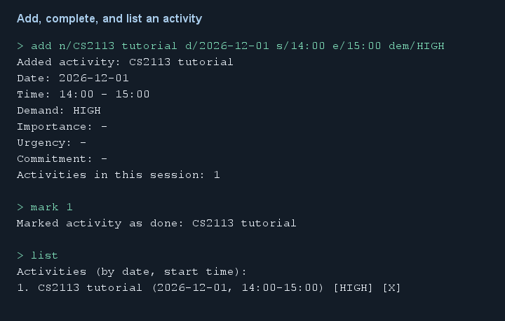
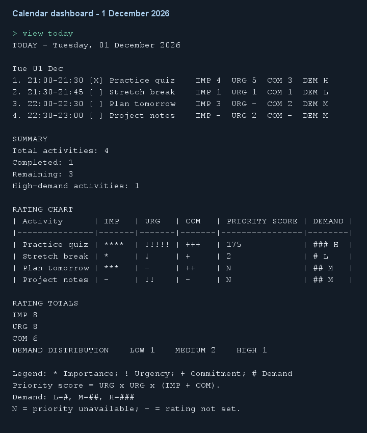

# UniEnable User Guide

<!--
RESPONSIBILITY SCOPES (feature responsibility, not the most recent Git editor):
Atharva005: activity creation, calendar dashboards, and command help.
officialasyrafrahim: listing, deletion, priority, overdue, and next.
Oliver-koh: completion changes, activity persistence/recovery, editing, and search.
lukelouyu: optional add ratings, facilities, routes, and exit.
Sections marked TEAM are maintained jointly and have no single-author override.
Named author comments begin a feature scope; the unnamed author comment ends it.
-->

<!-- TEAM: All members maintain the introduction and navigation. -->
## Introduction

UniEnable is a command-line application for managing dated activities and checking
campus accessibility information. Add activities with optional importance, urgency
and commitment ratings, edit activities, search their names, track completion,
rank activities by priority, count today's high-demand activities, identify
overdue and upcoming activities, search facilities, and find shortest recorded
accessible routes. Activity changes save automatically.

<!-- @@author Atharva005 -->
Calendar dashboards (`view today`, `view tomorrow`, and `view week`) summarize
scheduled activities and ratings. `view week` covers today and the following six days.
See [Calendar dashboards](#viewing-calendar-dashboards-view) for examples, or enter `help view`.
<!-- @@author -->

[Quick Start](#quick-start) · [Command Format](#command-format) ·
[Data Storage](#data-storage) · [Features](#features) ·
[Error Handling](#error-handling) · [FAQ](#faq) · [Command Summary](#command-summary)

<!-- TEAM: All members maintain installation and startup instructions. -->
## Quick Start

1. Install Java 25 and obtain `unienable.jar`.
2. Open a terminal in the folder containing the JAR.
3. Run `java -jar unienable.jar`.
4. Enter a command and press Enter; use `help` to view the built-in command list.
5. Enter `bye` to exit.

To build from source on Windows, run `.\gradlew.bat shadowJar` in the project folder,
then `java -jar build/libs/unienable.jar`. Use Java 25 for both commands.

<!-- TEAM: All members maintain the cross-feature command and index conventions. -->
## Command Format

This example shows adding an activity, marking it complete, and listing it.
The `[X]` marker indicates completion. It assumes 1 December 2026 before 14:00;
use a future date when trying the commands yourself.



[Plain-text version of the workflow](images/user-guide/activity-workflow.txt).

- Words in UPPER_CASE are placeholders; replace them with your own values.
- Square brackets in command formats indicate optional fields; do not type them.
- Command words, prefixes, demand levels, feature types, statuses, and hub codes
  are case-insensitive. Activity names preserve their capitalization.
- For `add` and `edit`, fields can appear in any order. Names can contain spaces.
  For `edit`, put the activity index before the fields.
- Separate fields with whitespace (for example, `n/Meeting d/2026-12-01`).
  Do not put text before the first field.
- Enter each command on one line, including all optional fields.
- Dates use `YYYY-MM-DD`, such as `2026-12-01`; times use 24-hour `HH:mm`.
- Activity indexes start at 1. Change commands (`delete`, `edit`, `mark`, and `unmark`)
  use indexes from chronological `list` output. `list demand`,
  `find`, `list priority`, `overdue`, and `next` retain full chronological
  indexes, even when some indexes are missing from the results. Run `list` before
  changing an activity; adding, deleting, or rescheduling can change indexes.
- Calendar dashboards (`view today`, `view tomorrow`, and `view week`) number only
  their selected period. Run `list` to get indexes for changing those activities.
- Sample outputs below omit the application's horizontal borders.
  The activity walkthrough, from `add` through `delete`, starts with an empty list
  and runs in order. Additional rating examples follow the walkthrough.
  If you try them after the example dates, replace the dates with future dates.

<!-- @@author Oliver-koh -->

## Data Storage

Activities save automatically to `data/activities.txt`, relative to the folder
where the app starts. Use the same folder on each launch. A missing file starts
an empty list. Ratings and completion status survive restarting.

Read-only commands and repeated mark/unmark requests do not save. A successful
edit saves even if the supplied values match the existing ones. Older six-field
files still load; later saves use the current format, which V1.0 cannot read.

Malformed rows, including time ranges whose end is not after their start, are
skipped with line-numbered warnings. Historical activities with valid time ranges
still load. An unreadable file starts
an empty list with a warning. Before a later save, the app preserves the original
file in `data/activities.txt.corrupt.bak`; a failed backup prevents replacement.
Keep a separate copy of that backup before further recovery attempts.

If saving fails, keep the app open and follow [Error Handling](#error-handling).
Facility and connection reference data are bundled and read-only.

<!-- @@author -->

## Features

<!-- @@author Atharva005 -->

### Adding an activity: `add`

Add an incomplete activity with a date, time, and optional demand and ratings.

Format:

```text
add n/NAME d/YYYY-MM-DD s/HH:mm e/HH:mm [dem/LOW|MEDIUM|HIGH] [imp/IMP] [urg/URG] [com/COM] [overlap/ALLOW]
```

`n/`, `d/`, `s/`, and `e/` are required and must each appear once with a value.
Every supplied known prefix must appear once and contain a value.

Optional demand:

| Optional field | Meaning | Accepted values | When omitted |
| --- | --- | --- | --- |
| `dem/` | Activity demand, separate from ratings | LOW, MEDIUM, HIGH | MEDIUM |

<!-- @@author -->
<!-- @@author lukelouyu -->

Optional ratings:

| Optional field | Meaning | Accepted values | When omitted |
| --- | --- | --- | --- |
| `imp/` | Importance | Whole number from 1 to 5 | Unset (`-`) |
| `urg/` | Urgency | Whole number from 1 to 5 | Unset (`-`) |
| `com/` | Commitment | Whole number from 1 to 5 | Unset (`-`) |

Supply all, some, or none of the ratings. To leave one unset, omit its prefix;
do not enter a literal `-`. Empty values, duplicate prefixes, ratings outside
1 to 5, decimals, and text are rejected.

<!-- @@author -->

<!-- @@author Atharva005 -->

The end time must be strictly after the start time on
the same day; overnight activities are not supported. The activity's date and end
time together must also be strictly after the current date/time in your computer's
local time zone. An activity that has already started can still be added if it
has not ended; an activity ending exactly now is rejected. Historical activities
cannot be added, and there is no override for this restriction. New activities start
incomplete.

Activity names must contain at least one non-whitespace character and use
printable ASCII characters only. English letters, digits, spaces, and ordinary
ASCII punctuation are allowed. Chinese, Tamil, accented letters, emoji, and
non-printable characters such as tabs are rejected with:

```text
[WARNING] Please write the activity name in English (ASCII characters only).
```

The `|` character and line breaks remain forbidden and receive a separate
delimiter warning. Ordinary slash text such as `and/or` and `w/o` is allowed.
Avoid field prefixes at the start of a word in a name: they are parsed as fields.
Names are saved in UTF-8. Historical saved names containing non-ASCII characters
can still be loaded, listed, and searched; a replacement name supplied with
`edit INDEX n/NAME` must follow the printable-ASCII rule.

Likely misspellings of multi-letter prefixes, such as `demm/HIGH`, `dem1/HIGH`, or `impp/5`,
produce a warning instead of becoming part of the name. This also applies to edit.

A duplicate activity has the same name (ignoring case and surrounding whitespace),
date, start and end times as an existing activity. Changing demand, ratings or
completion does not make it a different activity. Duplicates are rejected with
`[WARNING] Duplicate activity already recorded at index ...`.

By default, activities on the same date are rejected if their times overlap, with
`[WARNING] Activity clashes with index ...`. Both warnings identify the existing
activity using its chronological `list` index. Completed activities still occupy
their scheduled time. Back-to-back activities, such as 10:00-11:00 and
11:00-12:00, and the same times on different dates are allowed. Add `overlap/ALLOW`
to confirm an intentional overlap, including with a completed activity. The flag
applies only to that command and never permits a duplicate. For example:
append `overlap/ALLOW` when intentionally adding a concurrent reminder. A rejected
add does not increase the activity count or change saved data.

Input:
```text
add n/CS2113 tutorial d/2026-12-01 s/10:00 e/11:00
```
Output:
```text
Added activity: CS2113 tutorial
Date: 2026-12-01
Time: 10:00 - 11:00
Demand: MEDIUM
Importance: -
Urgency: -
Commitment: -
Activities in this session: 1
```

Rejected duplicates and overlaps show the conflicting activity and its
chronological index without changing the list or saved data.

For the following examples, also enter:
```text
add n/Project meeting d/2026-12-02 s/14:00 e/15:00 dem/HIGH
```
The app confirms Project meeting, its date/time, HIGH demand, three unset ratings,
and a total of 2 activities.

<!-- @@author -->

<!-- @@author officialasyrafrahim -->

### Listing activities: `list` and `list demand`

`list` sorts by date, then start time. `list demand` sorts HIGH, MEDIUM, LOW,
then by date and start time for ties. Completion appears as `[X]` or `[ ]`.

Input: `list`

Output:
```text
Activities (by date, start time):
1. CS2113 tutorial (2026-12-01, 10:00-11:00) [MEDIUM] [ ]
2. Project meeting (2026-12-02, 14:00-15:00) [HIGH] [ ]
```

Input: `list demand`

Output:
```text
Activities by demand (HIGH to LOW):
Indexes refer to the chronological 'list' order.
2. Project meeting (2026-12-02, 14:00-15:00) [HIGH] [ ]
1. CS2113 tutorial (2026-12-01, 10:00-11:00) [MEDIUM] [ ]
```

Demand sorting changes row order while keeping the indexes from `list`.
For example, `mark 2`, `unmark 2`, `edit 2 imp/5`, and `delete 2` select Project meeting.

An empty list shows `[WARNING] No activities yet.` beneath the heading
(and demand-view notice).

<!-- @@author -->

<!-- @@author Atharva005 -->

### Viewing calendar dashboards: `view`

Review a day's schedule or the next seven days, with completion counts, ratings,
priority scores, and demand levels in one dashboard.

Formats: `view today`, `view tomorrow`, and `view week`

| Command | Included dates |
| --- | --- |
| `view today` | The full current local calendar day. |
| `view tomorrow` | The full next local calendar day. |
| `view week` | Today and the following six days, including both endpoints. |

- Activities appear by date and start time, including completed and already-ended
  activities on those dates. HIGH-demand counts include completed activities.
- Each populated dashboard includes a schedule, completion summary, rating table,
  rating totals, and demand distribution. Recorded ratings contribute to totals
  even when other ratings are unset.
- Table symbols are `*` for importance, `!` for urgency, `+` for commitment,
  and `# L` / `## M` / `### H` for demand. Missing ratings show `-`;
  unavailable priority shows `N`.
- Use a monospaced font. Rating table rows fit within 80 terminal columns; names use
  at most 26 terminal columns, including a trailing `...` when shortened. Full names
  remain in the schedule and saved data.
- Dashboard row numbers belong to the selected period. Use `list` to obtain
  indexes for edit, mark, unmark, or delete. Dashboards do not save changes.

Try this example in a separate empty test folder. Assume today is **1 December
2026**, before 21:00. When trying it on another date, replace the dates with today
and tomorrow and choose times that have not ended for today's activities.

```text
add n/Practice quiz d/2026-12-01 s/21:00 e/21:30 dem/HIGH imp/4 urg/5 com/3
add n/Stretch break d/2026-12-01 s/21:30 e/21:45 dem/LOW imp/1 urg/1 com/1
add n/Plan tomorrow d/2026-12-01 s/22:00 e/22:30 dem/MEDIUM imp/3 com/2
add n/Project notes d/2026-12-01 s/22:30 e/23:00 dem/MEDIUM urg/2
add n/Project meeting d/2026-12-02 s/10:00 e/11:00 dem/HIGH imp/5 urg/4 com/3
mark 1
view today
```

The dashboard is:



The image uses the example's date and activities. The same output is available
as [plain text](images/user-guide/calendar-today.txt) and below for easy copying.

```text
TODAY - Tuesday, 01 December 2026

Tue 01 Dec
1. 21:00-21:30 [X] Practice quiz    IMP 4  URG 5  COM 3  DEM H
2. 21:30-21:45 [ ] Stretch break    IMP 1  URG 1  COM 1  DEM L
3. 22:00-22:30 [ ] Plan tomorrow    IMP 3  URG -  COM 2  DEM M
4. 22:30-23:00 [ ] Project notes    IMP -  URG 2  COM -  DEM M

SUMMARY
Total activities: 4
Completed: 1
Remaining: 3
High-demand activities: 1

RATING CHART
| Activity      | IMP   | URG   | COM   | PRIORITY SCORE | DEMAND |
|---------------|-------|-------|-------|----------------|--------|
| Practice quiz | ****  | !!!!! | +++   | 175            | ### H  |
| Stretch break | *     | !     | +     | 2              | # L    |
| Plan tomorrow | ***   | -     | ++    | N              | ## M   |
| Project notes | -     | !!    | -     | N              | ## M   |

RATING TOTALS
IMP 8
URG 8
COM 6
DEMAND DISTRIBUTION    LOW 1    MEDIUM 2    HIGH 1

Legend: * Importance; ! Urgency; + Commitment; # Demand
Priority score = URG x URG x (IMP + COM).
Demand: L=#, M=##, H=###
N = priority unavailable; - = rating not set.
```

Practice quiz has priority `5 x 5 x (4 + 3) = 175`.
Rows with a missing rating show `N` for priority.
`view tomorrow` shows Project meeting; `view week` includes all five activities.

An empty day shows `[WARNING] No activities scheduled for this day.`; an empty
week shows `[WARNING] No activities scheduled for the next seven days.` Empty
periods omit the summary and rating sections. An empty day within a populated
week instead shows a plain no-activities message.

Missing or unsupported arguments show `Usage: view today|tomorrow|week`.
Use `help view` for the command rules.

<!-- @@author -->

<!-- @@author Oliver-koh -->

### Changing completion: `mark` and `unmark`

Formats: `mark INDEX` and `unmark INDEX`

Input: `mark 1`

Output: `Marked activity as done: CS2113 tutorial`

Input: `unmark 1`

Output: `Unmarked activity: CS2113 tutorial`

Repeating a command reports `[WARNING] Activity is already marked as done: NAME`
or `[WARNING] Activity is already unmarked: NAME`, without changing or saving it.

<!-- @@author -->

<!-- @@author officialasyrafrahim -->

### Deleting an activity: `delete`

Format: `delete INDEX`

Input: `delete 2` (the index shown beside Project meeting in either list view)

Output:
```text
Deleted activity: Project meeting
Date: 2026-12-02
Time: 14:00 - 15:00
Demand: HIGH
Activities in this session: 1
```

The activity is removed immediately; subsequent indexes may change.
When the last activity is deleted, the confirmation ends with
`There is no activity recorded` instead of a remaining count.

<!-- @@author -->

<!-- @@author lukelouyu -->

### Trying optional add ratings

After the add/list/completion/delete examples, re-add Project meeting and add
the rated activities below. This five-activity schedule is used by the priority,
overdue, and next examples. Enter each command on its own line:

```text
add n/Project meeting d/2026-12-02 s/14:00 e/15:00 dem/HIGH
add CoM/3 dem/low e/11:00 n/Planning and/or review d/2026-12-03 s/10:00 iMp/5
add n/CS2113 project d/2026-12-04 s/14:00 e/15:00 imp/5 urg/5 com/4
add n/Team stand-up d/2026-12-04 s/16:00 e/17:00 imp/5 urg/4
```

The mixed-case command demonstrates reordered fields and a slash in a name.
Omitted ratings stay unset. Ratings appear in add confirmations and persist across
restarts; `list` and `list demand` show demand and completion without ratings.

<!-- @@author -->

<!-- @@author Oliver-koh -->

### Editing an activity: `edit`

Change selected fields while preserving omitted fields and completion status.

Format:

```text
edit INDEX [n/NAME] [d/YYYY-MM-DD] [s/HH:mm] [e/HH:mm] [dem/LOW|MEDIUM|HIGH] [imp/IMP] [urg/URG] [com/COM] [overlap/ALLOW]
```

- Use an index from chronological `list` or activity `find` output and supply
  at least one field. The command updates one activity at a time.
- Each supplied field must have a value and appear once. Names follow the same
  printable-ASCII, prefix, pipe, and line-break rules as `add`.
- Omitted fields, including ratings, keep their existing values. An omitted
  demand does not reset to MEDIUM. Ratings accept 1 to 5; `-` cannot clear a rating.
- If any date/time field is supplied, the combined old and new values must form
  a same-day activity with its end strictly after its start and the current local
  time. Activities whose existing end is at or before the current local time cannot
  be edited at all, including name, demand, rating, or rescheduling changes.
  Historical activities already saved remain loadable, listable, and searchable.
- Validation failures leave the activity unchanged. Successful edits save
  automatically and display all resulting fields, including ratings.
- Name or schedule edits must not duplicate another activity. Time overlaps
  require `overlap/ALLOW` on that edit, for example `edit 2 s/10:30 overlap/ALLOW`. The
  activity being edited is excluded from this comparison. Rejected multi-field
  edits leave every field and the saved file unchanged.
- Rescheduling can change chronological indexes. Run `list` or `find` again
  before selecting another activity.

Try these editing and searching examples in a **separate empty test folder**;
they are independent of the earlier activity walkthrough:

```text
add n/CCA EXCO meeting d/2026-12-02 s/14:00 e/15:00 dem/HIGH imp/5 urg/4 com/3
mark 1
edit 1 n/CCA EXCO planning meeting com/4
```

The confirmation begins with `Edited activity: CCA EXCO planning meeting` and
shows the resulting fields. Completion stays `[X]`; omitted fields are preserved.
Replacement names follow the same printable-ASCII and delimiter rules as add.
Historical non-ASCII saved names can still be listed and searched. An edit that
omits `n/` preserves the existing name.

### Searching activity names: `find`

Find activities by a case-insensitive substring of their names.

Format: `find KEYWORD`

- Supply a non-blank name substring. Multiple words form one literal phrase;
  do not add quotation marks unless the quotes are part of the name.
- Searches include completed and incomplete activities. They search names,
  rather than dates, demand levels or ratings, and do not interpret regular expressions.
- Matches appear chronologically with indexes from the **full** chronological
  list. For example, a single match can still be numbered 2.
- Searching does not change activities or save the activity file.

Continuing the editing example, add an earlier tutorial and search:

```text
add n/CS2113 tutorial class d/2026-12-01 s/09:00 e/10:00
find EXCO planning
```

Output:

```text
Found 1 matching activity:
2. CCA EXCO planning meeting (2026-12-02, 14:00-15:00) [HIGH] [X]
```

`find exco PLANNING` returns the same activity. `find exam` reports
`[WARNING] No activities matched keyword "exam".`; a valid search on an empty list has
the same no-match form. `find` without a keyword reports a warning and usage.

<!-- @@author -->

<!-- @@author officialasyrafrahim -->

### Viewing priority: `list priority`

`list priority` includes completed and incomplete activities. An activity receives
a score only when importance, urgency, and commitment are all set:

```text
Priority = URG x URG x (IMP + COM)
```

Available scores range from 2 to 250. Demand and completion do not affect the
formula. Higher scores appear first. Activities with missing ratings show
`Priority NA` and appear after every scored activity. Equal scores keep date and
start-time order, and equal date/time keep add order. Indexes refer to chronological
`list` output.

Using the five-activity schedule from [optional add ratings](#trying-optional-add-ratings),
with all activities incomplete:

```text
Activities by priority (highest first):
Indexes refer to the chronological 'list' order.
4. CS2113 project (2026-12-04, 14:00-15:00) [MEDIUM] [ ] | Priority 225 (IMP 5, URG 5, COM 4)
1. CS2113 tutorial (2026-12-01, 10:00-11:00) [MEDIUM] [ ] | Priority NA (IMP -, URG -, COM -)
2. Project meeting (2026-12-02, 14:00-15:00) [HIGH] [ ] | Priority NA (IMP -, URG -, COM -)
3. Planning and/or review (2026-12-03, 10:00-11:00) [LOW] [ ] | Priority NA (IMP 5, URG -, COM 3)
5. Team stand-up (2026-12-04, 16:00-17:00) [MEDIUM] [ ] | Priority NA (IMP 5, URG 4, COM -)
```

### Viewing overdue activities: `overdue`

`overdue` shows incomplete activities whose end is strictly before the current
local time. Ongoing and completed activities are excluded. An activity ending
exactly now becomes overdue only after that time has passed.

Each row keeps its chronological `list` index and adds one label:

| Label | Meaning |
| --- | --- |
| `OVERDUE TODAY` | Ended earlier today. |
| `OVERDUE WEEK` | Ended on an earlier day in the current Monday-to-Sunday week. |
| `OVERDUE EARLIER` | Ended before the current week's Monday. |

Using the same five-activity schedule, assume the current local time is
2026-12-04 at 15:01. The containing week starts on Monday, 2026-11-30:

```text
Overdue activities (ended before now):
1. [OVERDUE WEEK] CS2113 tutorial (2026-12-01, 10:00-11:00) [MEDIUM] [ ]
2. [OVERDUE WEEK] Project meeting (2026-12-02, 14:00-15:00) [HIGH] [ ]
3. [OVERDUE WEEK] Planning and/or review (2026-12-03, 10:00-11:00) [LOW] [ ]
4. [OVERDUE TODAY] CS2113 project (2026-12-04, 14:00-15:00) [MEDIUM] [ ]
```

If nothing is overdue, the command shows `[WARNING] No overdue activities.`

### Viewing the next activity: `next`

`next` shows the single earliest incomplete activity whose start is strictly after
the current local time. Activities starting exactly now and completed activities
are skipped. Equal starts keep add order, and the row keeps its chronological
`list` index.

At the same assumed local time, 2026-12-04 at 15:01, with the same five activities:

```text
Next activity (earliest upcoming):
5. Team stand-up (2026-12-04, 16:00-17:00) [MEDIUM] [ ]
```

If no incomplete activity starts later, the command shows
`[WARNING] No upcoming incomplete activities.`

For an incomplete activity scheduled 09:00-09:30 on the current date:

| Current local time | In `overdue`? | Eligible for `next`? |
| --- | --- | --- |
| 08:59 | No | Yes, if it is the earliest future incomplete activity. |
| Exactly 09:00 | No | No. |
| 09:15 | No; the activity is ongoing. | No. |
| Exactly 09:30 | No. | No. |
| 09:31 | Yes, if still incomplete. | No. |

A completed activity appears in neither time query. At its exact start, an
incomplete activity appears in neither query; it remains visible in `list`.
These strict boundaries also apply when the current clock includes seconds.

<!-- @@author -->

<!-- @@author lukelouyu -->

### Listing and viewing facilities: `facility`

Formats: `facility list` and `facility LOCATION`

The nine supported hubs are AS1-AS8 and CLB, with IDs F01-F09 respectively.
`facility list` starts with `Known facilities in the local reference:` and shows
all facility details, recorded feature statuses, and notes.

Input: `facility AS4` (or `facility F04`)

Output:
```text
[F04] AS4 - Faculty of Arts and Social Sciences, Block 4

Accessibility Features:
STEP_FREE_ENTRANCE | YES | Ground floor entrance
LIFT | YES | Lift serves floors 1-6
ACCESSIBLE_WASHROOM | YES | Floors 3-6

Sample reference data.
Verify with current campus information before you rely on it.
```

### Finding facilities by feature: `facility find`

Format: `facility find type/FEATURE [status/YES|NO|UNKNOWN]`

Supported features: LIFT, RAMP, SHELTERED_RAMP, ACCESSIBLE_WASHROOM,
STEP_FREE_ENTRANCE, REST_POINT, AUTOMATIC_DOOR, OTHER.
Status defaults to YES; `status/` must follow `type/`.
UNKNOWN matches explicitly recorded UNKNOWN values, rather than missing features.

Input: `facility find type/LIFT status/NO`

Output:
```text
Facilities with LIFT (status: NO):
[F01] AS1
[F02] AS2

Sample reference data.
Verify with current campus information before you rely on it.
```

`facility find type/REST_POINT` returns AS8; an unmatched search shows
`[WARNING] No matching facilities found.`.

### Finding an accessible route: `route`

Format: `route from/START to/END`

Use hub names (AS1-AS8 or CLB), rather than IDs such as F01.
Keep `from/` before `to/`. Routes minimize recorded distance using only connections
marked YES for accessibility. Shelter, barriers, and notes are displayed;
a shortest route may include unsheltered sections or recorded barriers.
If the source and destination are the same hub, including names that differ only
in letter case, the command shows
`[WARNING] Sorry, the source and destination are the same.`

Input: `route from/as6 to/as7`

Output:
```text
Shortest recorded accessible route:
AS6 -> AS1 -> AS4 -> AS7
Total distance: 200 metres

Connections:
1. AS6 -> AS1: 90 m (Path, Sheltered)
   Note: Main covered walkway
2. AS1 -> AS4: 60 m (Path, Sheltered)
   Recorded barrier: Narrow passageway (2F link via LT9/LT10)
   Note: Via The Deck
3. AS4 -> AS7: 50 m (Path, Sheltered)
   Note: Via The Deck

Sample reference data.
Verify with current campus information before you rely on it.
```

<!-- @@author -->

<!-- @@author Atharva005 -->
### Viewing command help: `help`

Format: `help [TOPIC]`

- `help` displays a menu grouped into activity management, planning and priorities,
  completion and deletion, facilities and routes, and help and exit.
- `help TOPIC` displays that command's syntax, rules, and examples. Topic names
  ignore letter case and must be a single command name.
- Supported topics are `add`, `edit`, `find`, `list`, `view`, `overdue`,
  `next`, `mark`, `unmark`, `delete`, `facility`, `route`, `save`, `help`, and `bye`.
- `help list` covers all list variants; `help facility` includes feature search.
  Enter `help list` rather than `help list demand`.
- Help only displays instructions. For example, `help delete` removes nothing,
  and `help bye` keeps the application running. Activity data is unchanged.

Examples:

```text
help
help add
help view
```

The main menu begins with `UniEnable commands:`. Topic pages have a title such as
`ADD - Create an activity`, followed by **Usage**, **Details**, and **Examples**.
Each topic ends with `Type help to return to the command menu.`.

<!-- @@author -->
<!-- @@author Oliver-koh -->

### Saving changes: `save`

Format: `save`

Retry a failed save after fixing the reported problem. Successful saving displays
`Activities saved.` and clears the unsaved-change warning. No activity fields change.

<!-- @@author -->
<!-- @@author lukelouyu -->

### Exiting the application: `bye`

Format: `bye`

Exit the console session after checking that any activity changes saved successfully.
`bye` accepts no arguments and does not retry a failed save. If changes remain
unsaved, exit is blocked; fix the error and run `save` first.

Input: `bye`

Output: `Goodbye from UniEnable!`
<!-- @@author -->

<!-- TEAM: All members maintain common error behavior and cross-feature validation rules. -->
## Error Handling

Invalid input usually produces `[WARNING]` and the app waits for another command.
Empty activity views, searches with no matches, and
unavailable route results also include `[WARNING]` on the no-result message.

<!-- @@author Atharva005 -->
For `view week`, this warning applies only when the whole selected period is empty;
empty days inside a populated week have a plain no-activities message.
<!-- @@author -->

<!-- @@author lukelouyu -->
Facility lists without records or recorded features use the same marker.

Command words must use ASCII characters. For example, entering `加入` or
`வணக்கம்` as a command shows:

```text
[WARNING] Please write the command in English (ASCII characters only).
```

The app then waits for another command. Unknown ASCII command words and blank
input keep the usual unrecognized-command warning. Non-ASCII or non-printable
activity names supplied to `add` or `edit` receive the separate name warning:

```text
[WARNING] Please write the activity name in English (ASCII characters only).
```

Rejected commands leave activities and the saved file unchanged.
<!-- @@author -->

<!-- @@author Oliver-koh -->
Repeated mark/unmark requests warn that completion is already in the requested
state. A repeated request does not save or modify activities.
<!-- @@author -->

<!-- TEAM: The following validation rules apply to multiple members' features. -->
Common causes include missing/duplicate fields, invalid dates or times, unknown
facilities, or an activity index outside the current list.
For `add` and `edit`, use real calendar dates and two-digit hours and minutes (for example,
`09:30`, not `9:30`). Use `help add` or `help edit` to check the expected format.
Rejected add or edit input, including an invalid rating, leaves the activity list and
stored data unchanged.

Duplicate and clash warnings prevent new conflicting entries. Existing duplicates
or overlaps in saved files still load; remove unwanted entries using their current
`list` indexes and `delete INDEX`. They are not removed automatically.

<!-- @@author officialasyrafrahim -->
`list priority`, `overdue`, and `next` accept no arguments. Extra arguments and
unsupported list variants produce a warning; they do not change activities.
<!-- @@author -->

<!-- @@author Atharva005 -->
Example input: `help extra`

Output:

```text
[WARNING] Unknown help topic 'extra'.
Usage: help [TOPIC]
Type help to see the available commands.
```

Extra topic words, such as `help add extra`, also show a warning and the help usage.
<!-- @@author -->

<!-- @@author Oliver-koh -->
If saving fails, the change remains in memory and an unsaved-changes warning
appears after subsequent commands. Repeating an add is not a save retry.

1. Keep the app open and fix the reported file or backup-path problem. Preserve
   a separate copy of any existing activity file or recovery backup.
2. Enter `save`. It writes the current list without changing any activity.
3. Wait for `Activities saved.` and check that the unsaved warning has cleared.
   Then use `bye`. Exit is blocked while changes remain unsaved.
<!-- @@author -->

<!-- TEAM: Each FAQ answer is maintained by the owner of the feature it describes. -->
## FAQ

<!-- @@author Oliver-koh -->
**Where is my data?** In `data/activities.txt` under the launch folder; use the same
folder on each run. To transfer activities, copy this file before starting the app.

**Can I edit an activity?** Use `edit INDEX` with at least one field
to update an activity while keeping omitted values and completion status.
Date/time edits must leave an end after now. Activities ending at or before now
cannot be edited, including metadata-only changes or moving them into the future.

**Why does a search result start at index 2?** Activity `find` preserves indexes
from the full chronological list. Use the displayed index directly for `edit`,
`mark`, `unmark`, or `delete`; indexes can change after editing dates or times.
<!-- @@author -->

<!-- @@author lukelouyu -->
**Can I edit facility records?** Facility records are read-only.
<!-- @@author -->

<!-- @@author Atharva005 -->
**Why does `view week` start in the middle of a week?** It shows today and the
following six days. It does not select a Monday-to-Sunday calendar week.

**Why are dashboard numbers different from `list`?** Dashboards number the selected
period from 1. Run `list` to get the current indexes for changing activities.
<!-- @@author -->

<!-- TEAM: All members maintain the combined command inventory; feature sections above carry individual tags. -->
## Command Summary

<!-- @@author Atharva005 -->
Use `help TOPIC` with any command name below for detailed instructions, such as
`help add`, `help list`, or `help route`. Use `help view` for the calendar dashboards:
`view today`, `view tomorrow`, and `view week`.
<!-- @@author -->

| Command | Purpose |
| --- | --- |
| `save` | Save current activities or retry a failed save |
| `help [TOPIC]` / `bye` | Show categorized or detailed command help / exit |
| `add n/NAME d/YYYY-MM-DD s/HH:mm e/HH:mm [dem/LOW\|MEDIUM\|HIGH] [imp/IMP] [urg/URG] [com/COM] [overlap/ALLOW]` | Add an activity with optional ratings |
| `list` / `list demand` | View activities by time / demand |
| `edit INDEX [n/NAME] [d/YYYY-MM-DD] [s/HH:mm] [e/HH:mm] [dem/LOW\|MEDIUM\|HIGH] [imp/IMP] [urg/URG] [com/COM] [overlap/ALLOW]` | Update supplied activity fields; preserve omitted fields and completion |
| `find KEYWORD` | Search activity names and retain chronological list indexes |
| `list priority` | View all activities by combined priority score |
| `view today` / `view tomorrow` / `view week` | Show today's, tomorrow's, or the next seven days' dashboard |
| `overdue` / `next` | View incomplete activities that ended before now / the earliest upcoming incomplete activity |
| `mark INDEX` / `unmark INDEX` / `delete INDEX` | Change completion / delete |
| `facility list` / `facility LOCATION` | View all facilities / one facility |
| `facility find type/FEATURE [status/YES\|NO\|UNKNOWN]` | Search recorded features |
| `route from/START to/END` | Find a shortest recorded accessible route |
